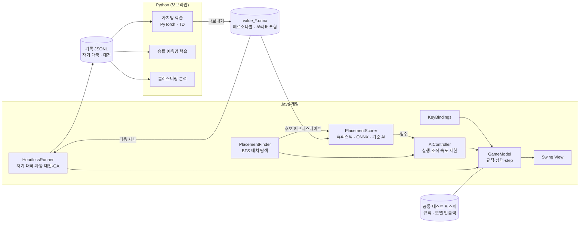

# 난이도별·페르소나 AI 대전 시스템 구현 계획서 v5

> 2인용 테트리스 팀 프로젝트 | 작성일 2026-09-28, 개정 2026-09-30 | 상태: 학습 모델 방식 확정
>
> 규칙 수치의 최종 기준은 [RULES.md](RULES.md), 학습 모델 입출력은 [MODEL_IO.md](MODEL_IO.md), 학습 설계는 [TRAINING.md](TRAINING.md)이며, 이 문서와 다르면 그쪽을 따른다. 진행 상황은 [PROGRESS.md](PROGRESS.md)에 있다.

---

## 0. 변경 이력

### 0.1 v4 → v5 (2026-09-30, 학습 모델 방식과 과제 3번)

| # | 변경 | 위치 |
|---|---|---|
| 1 | **학습 AI 확정: 애프터스테이트 딥러닝 가치망**(TD-Gammon식). MuZero는 과제상 필수가 아니고, 규칙을 아는 게임이라 모델 학습의 장점이 없어 주 경로에서 뺐다. 여유가 있으면 AlphaZero식 탐색(실제 규칙으로 MCTS)으로 확장 | 1, 2, 9장 |
| 2 | **학습 루프: Java가 두고 Python이 배운다.** 검증된 Java 엔진이 현재 모델로 자기 대국 기록을 쌓고, Python(PyTorch)은 학습과 ONNX 내보내기만 한다. Python 규칙 환경은 독립 검증용 선택 작업으로 내림 | 3, 9.2, 10장 |
| 3 | **페르소나: 보상 비율이 다른 여러 AI가 신경망 하나를 공유하고 각자 페르소나 임베딩을 학습.** 과제의 "학습 가중치 클러스터링"은 이 임베딩을 클러스터링하고 행동 지표로 검증하는 방식으로 한다 | 1.3, 8.4, 9.3장 |
| 4 | **과제 2번 예상 승률: 딥러닝 승률 예측망**(백그라운드 대전 기록으로 지도학습) | 2, 9.5장 |
| 5 | **과제 3번 반영(RULES 0.3):** 일반 클리어도 지운 줄 수만큼 공격(1/2/3/4). 과제 13번은 반영하지 않음 | 5, 6장 |

### 0.2 v3 → v4 (2026-09-29, 팀 결정 반영)

| # | 변경 | 위치 |
|---|---|---|
| 1 | **기준 코드 확정:** 팀 private 저장소(`ZAHA034/SourceCode_tetris`)에 09-26 리팩터링을 반영한 코드. 규칙은 새 `core` 패키지로 구현 | 1.2 |
| 2 | **보드 10 × 24 확정**(숨김 4행). 스폰, 좌표 범위, 락 아웃 변경. 5장은 요약만 남기고 RULES.md 0.2를 기준으로 함 | 5장 |
| 3 | **Python 추론 서버(FastAPI `/act`) 삭제.** Python에서 학습한 모델을 **ONNX로 내보내 Java에서 ONNX Runtime으로 실행**한다. 게임 실행 중에는 Python이 필요 없다 | 2, 3, 4.3, 5, 9, 10~16장 |
| 4 | 모델은 Java가 만든 후보 애프터스테이트에 **점수만 매긴다**(점수 매기기 인터페이스: 휴리스틱·ONNX·기준 AI). 입력 형식은 MODEL_IO.md | 3, 9장 |
| 5 | **도구 확정:** Java 21, Gradle 9.8(Wrapper), JUnit 6, Jackson, ONNX Runtime 1.30. Python 3.11, numpy, onnx, onnxruntime(학습 시작 시 PyTorch 추가). 사용 도구는 모두 README.md에 기록 | 15장 |
| 6 | 측정 반영: 블록당 배치 수는 평균 42개(최대 80개 안팎), 배치 탐색은 블록당 평균 약 0.4ms. 레벨 5 빔 탐색의 BFS 횟수를 9 → 18로 정정 | 4.1, 7장 |
| 7 | 결정 사항 정리: 기준 코드·보드·구조·도구·Java 버전 확정(PROGRESS.md 분기점 1의 D1~D4), 남은 결정 갱신 | 16장 |
| 8 | 최종 리뷰 반영: 모델 출력 `value`는 즉시 보상을 포함한 최종 점수, ONNX Runtime 지원 플랫폼(Intel Mac 불가) | 9.1, 13장 |

### 0.3 v2 → v3

| # | 변경 | 위치 |
|---|---|---|
| 1 | 코드 진단을 줄 번호 대신 **메서드 이름**으로 표기. 기준 코드 버전 확정을 결정 사항에 추가 | 1.2, 16장 |
| 2 | AI 조작 속도를 **생각 지연 + 초당 입력 수**로 정의. 경로를 통째로 재생하지 않고 **매 입력마다 현재 위치에서 경로 재계산**. AI 대전 중력 상한 설정 | 4.3, 5.1, 7장 |
| 3 | 배치의 정체성을 **(점유 칸 집합, spin 종류, hold)**로 정규화. BFS 결과를 공통 픽스처에 포함 | 4.1, 5.5 |
| 4 | 규칙 명세 보강: 스폰 위치, 배치 좌표 범위, T-spin mini 더블, 줄 없는 T-spin, B2B 유지·단절 조건, 콤보 기준, 가비지 상한, 퍼펙트 클리어 합산 방식 | 5장 |
| 5 | 애프터스테이트 입력을 **놓은 직후 이미 아는 정보**로 한정. 대기 가비지는 숫자 특징으로만 | 9.1 |
| 6 | 레벨 5 탐색을 **빔 탐색**으로, 유전 알고리즘 평가를 1수 탐색·짧은 판으로. 계산 예산 명시 | 7장, 10장 3단계, 11장 |
| 7 | 헤드리스 수집이 실제 게임(중력·시간)과 다를 수 있다는 **한계와 검증 방법** 추가 | 8.1 |
| 8 | 완료 기준 보완: 효과 크기(Cliff's delta), T-spin 더블 횟수 수치화, ARI는 최소 확인용으로 격하 | 8.3, 10장 |
| 9 | 일정 조정: 가비지 구현 5주차로 당기고 1차 수집은 7주차로 | 11장 |
| 10 | `/act` 요청의 `hold_used` 삭제 | 5.5 |

### 0.4 v1 → v2 (요약)

| # | 변경 |
|---|---|
| 1 | AI 행동을 "회전 × 열 + 하드드롭"에서 도달 가능한 최종 배치 + 경로 재생으로 변경 (T-spin 가능) |
| 2 | 대전 규칙 명세(5장) 신설, 1주차 확정 |
| 3 | 클러스터링에서 난이도 영향 제거 (PPS 제외, APP 사용, 난이도·상대 고정, ARI/NMI) |
| 4 | 학습 AI 1순위를 애프터스테이트 가치 학습으로, MuZero는 확장으로 |
| 5 | 승률 바 → 형세 점수 |
| 6 | 휴리스틱 AI를 Java에 구현, 필수 범위는 Python 서버 없이 동작 |
| 7 | 3단계(휴리스틱 AI) 완료 기준을 가비지 압박 하 생존으로 변경, 유전 알고리즘으로 페르소나 자동 발견 실험 추가 |
| 8 | 2단계(Java 게임 정비) 작업량을 코드 기준으로 재산정 |

---

## 1. 개요

### 1.1 목표

1인용 PC 환경에서 플레이어가 **난이도**와 **AI 페르소나**(공격형, 수비형, T-spin 전문)를 골라 AI와 대전하는 시스템을 만든다. 휴리스틱 AI로 전체 시스템을 먼저 완성하고, **딥러닝 AI(애프터스테이트 가치망 + 학습된 페르소나 임베딩)** 로 확장한다. 페르소나는 **학습된 임베딩의 클러스터링**으로 나누고, 실제로 서로 다르게 플레이하는지는 **행동 지표**로 검증한다. 관전용으로 **딥러닝 승률 예측망**이 실시간 예상 승률을 보여 준다(과제 기능 1·2번).

### 1.2 출발점 (기존 코드 진단)

> 줄 번호는 작업하면서 곧 바뀌므로 메서드 이름으로 적는다. **기준 코드는 팀 private 저장소에 09-26 리팩터링(REFACTORING.md, 버그 5건 수정)을 반영한 버전**으로 확정했다. 아래 표는 그 버전의 옛 게임 코드(`Board`, `Shape`) 진단이다. 규칙 부품(시드 7-bag, SRS, 공격, 가비지, 배치 탐색)은 이미 새 `core` 패키지로 구현·검증돼 있고(PROGRESS.md), 남은 일은 옛 코드를 `core` 위로 옮기는 것이다.

| 위치 | 현재 상태 | 필요한 작업 |
|---|---|---|
| `Shape.setRandomShape()` | `java.util.Random`으로 균등 랜덤 생성. 버전에 따라 static 인스턴스 공유 또는 호출마다 생성이지만, 어느 쪽이든 게임 단위로 시드를 줄 수 없음 | 시드를 받는 7-bag 생성기를 게임마다 주입 (두 보드 동일 순서, Java·Python 공통 테스트의 전제) |
| `Shape.setShape()`의 좌표표, `rotateLeft()` / `rotateRight()` | 한 칸을 중심으로 좌표를 돌림. 회전 상태(0/R/2/L) 없음. O는 회전 생략 | SRS로 교체: 회전 상태, I·O의 별도 회전 중심, 상태별 킥 테이블 |
| `Board` 생성자와 필드 | `Tetris` 부모를 받아 `javax.swing.Timer`와 상태바 `JLabel`에 직접 연결 | UI 없이 `step()`으로 진행하는 `GameModel` 분리. `Board`는 화면만 담당 |
| `Board.oneLineDown()` → `pieceDropped()` | 더 내려갈 수 없으면 즉시 고정 | 락 딜레이 추가 |
| `Board.removeFullLines()`, `TAdapter.keyPressed()` | 줄 삭제 시 블록을 비우고 한 틱 대기. `keyPressed()`의 조기 return 때문에 대기 중 일시정지 키까지 차단 | 전역 입력(일시정지)과 조작 입력 분리 |
| `TAdapter.keyPressed()`의 키 분기 | ↓ 회전, ↑ 반대 회전, D 한 칸 내리기, Space 하드드롭 | 표준 키 배치로 재정의, KeyBindings 사용 |
| 없음 | 미리보기, 홀드, 고스트, 가비지, 공격 계산 | 신규 구현 |

### 1.3 핵심 아이디어

| 구분 | 내용 |
|---|---|
| 행동 | 도달 가능한 최종 배치를 BFS로 모두 찾고, 그중 하나를 고른 뒤 매 입력마다 경로를 다시 계산하며 실행 |
| 학습 AI | 애프터스테이트 딥러닝 가치망. Java가 현재 모델로 자기 대국 기록을 쌓고 Python이 학습해 ONNX로 내보내는 루프를 반복한다. 게임에서는 Java가 후보 배치의 애프터스테이트에 점수를 매길 때 실행 |
| 난이도 | 결정 품질(학습 단계·온도·탐색 깊이, 휴리스틱은 노이즈·차선책 확률)과 조작 속도(생각 지연 + 초당 입력 수)로 조절 |
| 페르소나 | 휴리스틱은 가중치. 학습 AI는 보상 비율이 다른 여러 AI가 신경망을 공유하며 각자 페르소나 임베딩을 학습하고, 임베딩을 클러스터링해 페르소나를 정한다 |
| 검증 | 난이도와 상대를 고정한 상태에서 행동 지표를 클러스터링해, 임베딩 군집과 실제 행동이 맞는지 확인 |
| 예상 승률 | 백그라운드 대전 기록으로 학습한 승률 예측망 (과제 2번) |

---

## 2. 범위

| 등급 | 내용 | Python 필요 |
|---|---|---|
| **필수** | 규칙 명세, 게임 정비, Java 휴리스틱 AI(난이도 5단계 × 페르소나 3종), 헤드리스 자동 대전, 행동 클러스터링 분석 | 분석에만 |
| **목표** | 애프터스테이트 딥러닝 가치망 AI와 페르소나 임베딩(Python에서 학습, ONNX로 Java에서 실행), 승률 예측망과 관전용 예상 승률 표시(과제 2번) | 학습에만 (게임 실행에는 불필요) |
| **확장** | AlphaZero식 탐색(정책망 + 실제 규칙으로 MCTS), 2인 같은 키보드 대전, Python 규칙 환경(독립 검증), MuZero(선택) | 학습에만 |
| 제외 | 온라인 대전, 모바일·웹, 게임 실행 중 Python 프로세스 호출 | |

---

## 3. 시스템 구조

- **규칙의 기준은 Java `core` 패키지**(`GameModel`)다. 학습용 게임도 Java가 두므로 학습과 게임의 규칙이 저절로 같다. Python 규칙 환경은 독립 검증용 확장으로 두고, 만들면 공통 픽스처로 일치를 검증한다.
- **학습 루프(9.2):** Java 러너가 현재 모델로 자기 대국을 두며 기록을 쌓고 → Python이 그 기록으로 가중치를 학습해 ONNX로 내보내고 → Java가 새 모델로 다시 둔다. 이 루프를 백그라운드로 계속 돌린다.
- **모델은 점수만 매긴다.** 후보 배치는 언제나 Java `PlacementFinder`가 만든, 실제로 갈 수 있는 배치다. 모델은 규칙을 몰라도 되고, 엉뚱한 배치를 고를 수 없다.
- **게임 실행 중에는 Python이 필요 없다.** 학습한 모델을 ONNX 파일로 내보내면 Java가 ONNX Runtime으로 실행한다. 모델 꼬리표(형식·규칙 버전)가 맞지 않거나 실행에 실패하면 Java 휴리스틱으로 대신한다(MODEL_IO.md 5장).
- 휴리스틱 AI, 자기 대국, 데이터 수집, 유전 알고리즘은 모두 Java 헤드리스 러너에서 돌린다. Python은 학습과 분석만 맡는다.

---

## 4. AI 행동 정의

### 4.1 배치 탐색

1. 시작 상태는 새 블록의 스폰 위치다. 재결정할 때는 블록의 현재 위치에서 시작한다. `PlacementFinder`는 두 경우를 모두 지원한다.
2. 조작 {왼쪽, 오른쪽, 시계 회전, 반시계 회전, 한 칸 소프트드롭}으로 BFS를 돌린다. 회전에는 SRS 킥을 적용한다.
3. 더 내려갈 수 없는 상태를 **최종 배치**로 모으고, 각 배치까지의 최단 조작 경로를 기록한다.
4. T 블록은 같은 위치라도 "마지막 조작이 회전이었는지"와 "사용한 킥 테스트 번호"에 따라 T-spin 여부가 달라지므로, 이 둘을 탐색 상태에 포함한다.

**배치의 정체성**은 `(점유 칸 4개의 집합, spin 종류, hold)`로 정한다. S·Z·I는 회전 상태 0과 2(또는 R과 L)에서 같은 칸을 차지하면서 `(rotation, x, y)`만 다르므로, 좌표로 비교하면 같은 배치를 다른 배치로 취급하게 된다.

- 중복 제거: 같은 키를 가진 배치는 하나로 합치고 가장 짧은 경로를 남긴다. 경로 길이가 같으면 회전 수가 적은 쪽을 남긴다.
- spin 종류가 다르면(`none` / `mini` / `full`) 같은 칸이라도 별개의 배치다.
- `(rotation, x, y)`는 경로를 만들기 위한 대표값으로만 쓴다.
- 블록당 홀드 포함 평균 42개, 많아야 80개 안팎이 나온다(자기 플레이 측정, PROGRESS.md).
- **BFS 결과(정규화된 배치 키 집합)도 공통 픽스처에 넣는다.** Python 학습 환경도 같은 탐색이 필요하기 때문이다.

### 4.2 T-spin 판정

- 조건: T 블록, 마지막으로 성공한 조작이 회전, T 중심의 대각선 네 칸 중 3칸 이상이 막힘(벽·바닥 포함)
- 앞쪽 두 칸 중 한 칸만 막혔으면 **T-spin mini**. 단, 마지막 회전이 마지막 킥 테스트(1×2 이동)로 성공했으면 정식 T-spin으로 인정

### 4.3 실행

AI는 사람과 같은 시간 규칙 안에서 움직인다. 조작 속도는 **생각 지연**(블록이 나온 뒤 첫 입력까지)과 **초당 입력 수**로 정의한다(7장).

1. **선택:** 점수 순으로 후보 배치를 보면서, 각 후보의 경로를 가상 시간으로 시뮬레이션한다(생각 지연, 입력 간격, 중력, 락 딜레이와 리셋 횟수 포함). 도달할 수 있는 첫 번째 후보를 고른다.
2. **실행:** 목표 배치(칸 집합)는 고정하고, **매 입력 직전에 현재 위치에서 목표까지 경로를 다시 계산**해 다음 조작 하나만 수행한다. 목표에 도착하면 하드드롭한다.
3. **재결정:** 중력으로 목표를 지나쳤거나 도달이 불가능해지면, 현재 위치에서 다시 배치를 고른다. 이미 홀드를 썼으면 홀드는 후보에서 뺀다. 블록 도중의 재결정도 같은 점수 매기기 인터페이스(학습 모델 또는 휴리스틱)로 한다. 모델이 게임 안에서 실행되므로 따로 다룰 이유가 없다.
4. **기록:** 목표 배치에 도달하지 못한 비율(실행 실패율)을 레벨별로 기록한다. 목표는 레벨별 5% 이하다.

가비지는 블록이 고정될 때만 올라오므로(RULES 10.3) 블록이 움직이는 동안 보드는 바뀌지 않는다. 블록 도중 재결정이 필요한 이유는 시간(중력, 락 딜레이)뿐이다.

---

## 5. 대전 규칙과 데이터 형식

> v3의 이 장에 있던 규칙 초안은 [RULES.md](RULES.md)로 옮겨 확정·보강했다. **규칙의 기준은 RULES.md**이고, 여기에는 계획을 읽는 데 필요한 요약만 둔다. v3에 있던 Python 서버 인터페이스(`/act`)는 v4에서 삭제했고, 대신 모델 입출력 형식을 [MODEL_IO.md](MODEL_IO.md)에서 정한다.

| 항목 | 요약 (RULES.md 0.3) |
|---|---|
| 보드 | 10열 × **24행**. 0~3행은 숨김 영역, 4~23행이 보이는 영역. 0행이 맨 위 |
| 블록 생성 | 7-bag, 게임 시드(SplitMix64)로 결정. 두 플레이어 동일 순서, 가비지 구멍 난수는 플레이어별 별도 스트림 |
| 미리보기·홀드 | 미리보기 5개, 홀드는 블록 하나당 1회 |
| 회전 | SRS(JLSTZ 공통, I 전용 킥 표). O의 회전은 언제나 실패 |
| 스폰 | 회전 상태 0, 박스 `(3, 2)`. 보이는 영역 바로 위 |
| 시간 | 정수 ms, 락 딜레이 500ms·리셋 최대 15회, 30초마다 중력 단계 상승(레벨별 상한). 세부는 `[초안]` |
| T-spin | 마지막 조작이 회전 + 3코너. 앞쪽 코너 하나면 mini, 단 킥 4면 full |
| 공격 | 일반 클리어는 지운 줄 수만큼 1/2/3/4(과제 3번), T-spin 2/4/6(mini 1/2), B2B +1, 콤보표, 퍼펙트 클리어 +10 |
| 가비지 | 먼저 상쇄, 줄을 못 지운 고정에서만 상승, 한 번에 최대 8줄, 공격 하나는 같은 구멍 열 |
| 패배 | 블록 아웃, 락 아웃(4칸 모두 숨김 영역), 가비지 아웃 |
| 진행 방식 | 시간 없는 모드(1인용·학습·수집), 블록 동기 모드(AI 대 AI 승률), 가상 시간 모드(실제 게임·검증) |
| 배치 | 정규화 키 = (홀드 여부, spin 종류, 칸 4개). 같은 칸이라도 spin이 다르면 다른 배치 (RULES 14장) |

---

## 6. 페르소나 설계

| 페르소나 | 성향 | 휴리스틱 가중치 방향 | 학습 AI 보너스·보상 | 기대 행동 지표 |
|---|---|---|---|---|
| 공격형 | 테트리스로 큰 공격 | 공격 줄 수 ↑, 높이 페널티 ↓, 우물 한 칸 유지 보너스 | 보낸 줄 수 가산 | APP ↑, 테트리스 비율 ↑, 평균 높이 ↑ |
| 수비형 | 낮고 평평하게 버팀 | 높이·구멍·울퉁불퉁함 페널티 ↑, 가비지 상쇄 우선 | 높이·구멍 증가 페널티 | 평균 높이 ↓, 구멍 ↓, 가비지 압박 생존 ↑ |
| T-spin 전문 | T-spin 자리 설계 | T-spin 자리(TSD 홈) 형성 보너스 ↑, T 블록 홀드 선호 | T-spin 클리어 보너스 | T-spin 비율 ↑, 홀드 사용률 ↑ |

- 규칙 0.3(과제 3번)에서는 일반 클리어도 지운 줄 수만큼 공격하므로 **연속 클리어(콤보)** 가 강해졌다. 공격형은 테트리스와 콤보를 함께 노리도록 가중치를 정하고, 행동이 뚜렷이 갈리면 콤보형을 따로 둔다.
- 이 표는 **설계 의도**다. 학습 AI의 페르소나는 9.3처럼 보상 비율이 다른 AI들의 학습된 임베딩을 클러스터링해 정하고, 군집의 실제 행동을 보고 이 표의 이름을 붙인다.

---

## 7. 난이도 설계

| 레벨 | 이름 | 휴리스틱 결정 품질 | 학습 AI 결정 품질 | 생각 지연 | 초당 입력 | 대략 PPS* | 중력 상한 |
|---|---|---|---|---|---|---|---|
| 1 | 입문 | 가중치 노이즈 큼, 30% 확률로 상위 5개 중 무작위 | 초반 체크포인트, 온도 1.0 | 900ms | 5 | 0.5 | 초당 2칸 |
| 2 | 초급 | 노이즈 중간, 20% | 초중반, 0.7 | 500ms | 8 | 0.8 | 초당 3칸 |
| 3 | 중급 | 노이즈 작음, 10% | 중반, 0.4 | 300ms | 12 | 1.25 | 초당 5칸 |
| 4 | 상급 | 노이즈 없음, 현재 블록만 평가(1수) | 후반, 0.2 | 180ms | 16 | 1.8 | 초당 8칸 |
| 5 | 고수 | 노이즈 없음, 다음 블록까지 빔 탐색(2수) | 최종, 0.0 | 100ms | 25 | 2.9 | 초당 12칸 |

\* 블록당 평균 입력 6회를 가정한 값: PPS ≈ 1 / (생각 지연 + 6 / 초당 입력)

(10-04) 게임에서는 단계 이름을 초급·중급·상급·최상급·불가능으로 바꾸고, 1~3단계를 약 20% 늦췄다. 지금 값은 [GAME.md](GAME.md) 6.1.

- **느림은 생각 지연으로 만든다.** 초당 입력 수를 너무 낮추면 경로가 긴 배치를 실행하지 못해, 난이도가 판단력이 아니라 실행 실패로 정해진다. 낮은 레벨도 초당 입력 수는 5 이상을 유지한다.
- **중력 상한은 그 판의 두 플레이어에게 똑같이 적용**된다. 레벨을 고르면 AI의 조작 속도와 그 판의 최대 중력이 함께 정해진다.
- **레벨 5 빔 탐색:** 모든 첫 배치를 1수 평가로 점수 매기고 상위 k = 8개만 골라, 각각에 대해 다음 블록(홀드 선택 포함)의 배치를 탐색한다. 두 수를 합친 점수가 가장 높은 첫 배치를 고른다. 모든 조합(약 40 × 40)을 보지 않으므로 BFS는 블록당 최대 18번이다(첫 수에서 현재·홀드 2번, 두 번째 수에서 후보 8개 × 2번). 측정으로는 BFS 2번에 평균 약 0.4ms라서 18번이어도 수 ms다.
- **검증:** 가상 시간 모드에서 레벨별 실행 실패율(4.3)이 5% 이하인지 확인한다. 넘으면 그 레벨의 중력 상한을 낮추거나 초당 입력 수를 올리고, 생각 지연은 유지한다.

> 모두 초기값이다. 플레이 테스트로 레벨별 사람 승률이 대략 90 / 70 / 50 / 30 / 10%가 되도록 조정한다. 사람이 체감하는 난이도는 PPS의 영향이 가장 크다.

---

## 8. 행동 클러스터링 설계

### 8.1 데이터 수집 조건

난이도와 상대가 지표를 좌우하지 않도록 조건을 고정한다.

| 항목 | 조건 |
|---|---|
| 난이도 | 주 분석은 레벨 5 결정 품질 하나로 고정. 레벨별 분석은 보조로 따로 수행 |
| 상대 | AI 상대 대신 **시드 고정 가비지 스케줄러**(예: 10블록마다 2~4줄) 사용. 보조로 고정 기준 AI와의 대전도 수집 |
| 시간 | 주 수집은 **시간 없는 모드**(중력·입력 속도 없음). 지표는 모두 블록 단위로 계산 |
| 판 수 | 조건당 200판, 판당 최대 1,000블록 |

**한계와 검증:** 실제 게임에서는 중력과 입력 속도 때문에 멀리 있는 배치나 경로가 긴 배치(특히 T-spin 넣기)를 포기하는 일이 생겨, 시간 없는 모드와 행동이 달라질 수 있다. `GameModel`은 결정론적이고 `step()`으로 진행하므로, 레벨 5의 조작 속도와 중력을 적용한 **가상 시간 모드**를 실제 시간보다 빠르게 돌릴 수 있다. 페르소나마다 30판을 가상 시간 모드로 따로 돌려 주 수집과 지표를 비교한다. 차이가 크면 주 수집을 가상 시간 모드로 바꾸고, 어느 경우든 보고서에 한계로 적는다.

### 8.2 지표

| 포함 | 제외 (이유) |
|---|---|
| APP(블록당 공격 줄 수), 테트리스 비율, T-spin 비율, 평균 콤보 길이, 평균 높이, 평균 구멍 수, 울퉁불퉁함, 홀드 사용률, 상쇄 비율 | PPS (난이도 표에서 직접 정함), APM (속도에 좌우됨) |

생존 블록 수는 실력의 영향이 커서 클러스터링 입력에서는 빼고, 페르소나별 비교 표에만 싣는다.

### 8.3 분석 절차

1. 지표를 z-score로 표준화한다.
2. **검증 분석:** k = 페르소나 수로 k-means와 GMM을 돌리고, 의도한 라벨과 비교해 **군집 순도, ARI, NMI**를 보고한다.
3. **탐색 분석:** k = 2~8에서 실루엣 점수를 보고 "자연스러운 스타일이 몇 개인지" 따로 보고한다. 순도는 이 분석에서 쓰지 않는다.
4. 레벨별로 같은 분석을 반복해 페르소나 구분이 레벨에 따라 유지되는지 확인한다.
5. PCA 2차원 산점도와 군집별 지표 평균표로 해석한다.

**판단 기준(초안)**

- **최소 확인:** 레벨 5 고정 조건에서 ARI 0.6 이상, 군집 순도 80% 이상. 페르소나를 가중치로 직접 설계했으므로 넘는 것이 당연한 수준이다. 넘지 못하면 설계나 지표에 문제가 있다는 신호로 본다.
- **주요 근거:** (1) 8.4 자동 발견에서 설계 페르소나가 재발견되는지, (2) 레벨 1~5 각각에서 페르소나 구분이 유지되는지(레벨별 ARI 추이), (3) 가상 시간 모드에서도 구분이 유지되는지. 보고서는 이 세 가지를 중심으로 쓴다.
- **지표별 차이:** Mann-Whitney 검정의 p 값과 함께 효과 크기 Cliff's delta를 보고한다. 표본이 200판이면 아주 작은 차이도 p < 0.01을 통과하므로, |δ| ≥ 0.33(중간 이상)일 때만 의미 있는 차이로 본다.

### 8.4 페르소나 자동 발견 실험

1. 유전 알고리즘에 서로 다른 적합도 함수를 준다: APP 최대화, 가비지 압박 생존 최대화, T-spin 횟수 최대화, 이들의 가중 합 여러 조합
2. 적합도 함수마다 상위 가중치 벡터를 모아 후보 30~60개를 만든다.
3. 후보들을 **행동 지표**로 클러스터링하고, 설계한 페르소나 3종이 군집으로 재발견되는지 본다.
4. 휴리스틱 가중치는 항목마다 의미가 있으므로 **가중치 공간 클러스터링**과 **행동 공간 클러스터링**의 결과를 비교한다.
5. 학습 AI는 9.3처럼 **학습된 페르소나 임베딩**을 클러스터링한다(과제 1번의 "학습 가중치 클러스터링"). 임베딩 군집, 휴리스틱 가중치 군집, 행동 군집이 서로 얼마나 맞는지(ARI)를 함께 보고한다.

---

## 9. 학습 기반 AI (딥러닝)

> v5에서 확정: **애프터스테이트 딥러닝 가치망**을 주 모델로, **Java가 두고 Python이 배우는** 학습 루프로 학습한다. 페르소나는 **학습된 임베딩의 클러스터링**으로, 과제 2번의 예상 승률은 **승률 예측망**으로 만든다. MuZero는 주 경로에서 뺐다(9.6).
>
> **10-01:** 학습 세부 설계는 [TRAINING.md](TRAINING.md)로 옮겼다. **2인 대전(블록 동기)으로 학습**하고 상대 상태를 모델 입력에 넣으며, 세대 0은 기준 AI끼리 둔다(9.2의 모방 사전학습 대신). 이 장과 다른 점은 TRAINING.md를 따른다.

### 9.1 모델: 애프터스테이트 가치망

| 항목 | 내용 |
|---|---|
| 아이디어 | 블록을 놓은 직후의 상태(애프터스테이트)가 얼마나 좋은지를 신경망 V로 배운다. 매 블록마다 도달 가능한 모든 배치의 `r + γ·V(애프터스테이트)`를 비교해 가장 큰 배치를 고른다. 주사위가 있는 백개먼에서 검증된 TD-Gammon과 같은 구조다. 내보낼 때 즉시 보상 r과 γ를 모델 안에서 더해, 모델 출력 `value` 하나가 곧 이 값이 되게 한다(MODEL_IO.md 4장) |
| 입력 | 놓은 직후 **이미 아는 정보만**: 보드 24×10과 특징 48개(알고 있는 대기열, 홀드, 콤보·B2B, 지운 줄, 공격, 대기 가비지, 가비지 상승 여부). [MODEL_IO.md](MODEL_IO.md) 형식 1. 새로 공개될 블록과 가비지 구멍 위치는 넣지 않으므로, 가치망이 그 무작위성의 평균을 배운다 |
| 구조 (초안) | 보드는 작은 CNN(3×3 합성곱 몇 층), 특징은 MLP로 받아 합친 뒤 MLP로 점수 하나를 낸다. 페르소나 임베딩(9.3)은 합치는 층에 넣는다. 매개변수 수십만 개 이하로 두어 CPU 추론이 후보 40여 개에 수 ms 안에 끝나게 한다 |
| 왜 이 모델인가 | 규칙을 아는 게임이라 MuZero처럼 규칙 모델을 배울 필요가 없다. 배치를 모두 열거하므로 행동 공간 문제(액션 마스킹)가 없다. 블록 무작위성을 자연스럽게 다룬다. 입력 형식과 Java 실행 통로(`OnnxScorer`)가 이미 있다 |
| 실행 | ONNX(opset 17)로 내보내 Java `OnnxScorer`가 실행한다. 꼬리표(형식·규칙 버전)가 맞지 않거나 실행에 실패하면 Java 휴리스틱으로 대신한다 |

### 9.2 학습 루프: Java가 두고 Python이 배운다

1. **모방 사전학습.** Java 휴리스틱 AI(10장 3단계)가 둔 판의 기록으로, 휴리스틱이 매긴 후보 순위를 따라가도록 가치망을 먼저 학습한다. 빈 신경망에서 시작하는 것보다 훨씬 빨리 쓸 만한 수준이 된다.
2. **자기 대국 강화학습 (세대 반복).**
   - Java `HeadlessRunner`가 현재 세대 ONNX 모델로 게임을 둔다(시간 없는 모드, 가비지 스케줄러 `S-mix`, 탐험은 소프트맥스 온도). 매 블록마다 고른 애프터스테이트와 보상 구성 요소를 기록한다.
   - Python(PyTorch)이 그 기록으로 TD(λ) 목표 `r + γ·V(다음에 고른 애프터스테이트)`에 맞춰 V를 학습한다(TD-Gammon과 같은 on-policy 방식). 최근 몇 세대의 기록을 섞어 쓴다.
   - 새 세대를 ONNX로 내보내면 Java가 이어서 둔다. 이 루프를 **백그라운드로 계속** 돌린다.
3. **기록 형식.** [TRAINING.md](TRAINING.md) 7장의 대전 기록 `match-1`(한 줄에 한 판, 턴마다 두 플레이어의 결정 시점 상태와 고른 애프터스테이트)로 정했다. 공통 픽스처로 Java와 Python이 같은 값을 읽는지 확인한다.
4. **보상 (초안).** 기본은 송신 공격 + 생존 − 패배 페널티. 학습 초반에는 높이·구멍 증가 페널티를 보조로 주고 세대가 지날수록 줄인다. 페르소나마다 비율을 다르게 준다(9.3).
5. **평가.** 세대마다 고정 시드 판에서 생존 블록 수와 APP를 재고, 레벨별 휴리스틱 AI와 블록 동기 모드(RULES 12.2)로 대전해 승률을 잰다. 가장 좋은 세대를 난이도별 모델로 고른다.
6. **왜 Java가 두는가.** Java 엔진은 공통 픽스처 60개로 검증돼 있고 블록당 1ms 안팎이라, Python으로 규칙을 다시 짜는 것보다 수십 배 빠르고 규칙이 어긋날 위험이 없다. 학습과 게임의 규칙이 저절로 같다.

### 9.3 페르소나: 학습된 임베딩과 클러스터링 (과제 1번)

1. 보상 비율이 다른 AI를 여러 개(예: 12~24개) 둔다: 공격 위주, 안전 위주, T-spin 위주, 콤보 위주, 그리고 이들을 무작위로 섞은 것.
2. 모든 AI가 **신경망 하나를 공유**하고, AI마다 작은 **페르소나 임베딩**(예: 8차원 벡터)을 학습한다. 신경망 전체의 가중치는 뉴런 순서만 바꿔도 같은 동작이 되어 서로 비교할 수 없지만, 임베딩은 모두 **같은 좌표계**에 있어서 거리를 재고 묶을 수 있다.
3. 학습이 끝나면 임베딩을 **k-means·GMM으로 클러스터링**하고(과제의 "학습 가중치 클러스터링"), 군집마다 AI들이 실제로 다르게 두는지 **행동 지표**(8장)로 검증한다.
4. 군집마다 대표 AI를 골라 행동을 보고 이름(공격형·수비형·T-spin형 등)을 붙이고, 임베딩을 고정한 **페르소나별 ONNX 파일**로 내보낸다(MODEL_IO.md 8장). 게임은 이 파일을 캐릭터로 제시한다.
5. 휴리스틱 가중치 클러스터링(8.4)과 결과를 비교한다.

### 9.4 난이도 (학습 AI)

| 수단 | 내용 |
|---|---|
| 학습 단계 | 이른 세대(약함)부터 최종 세대까지의 모델 파일 |
| 온도 | 소프트맥스 온도가 높을수록 차선책을 자주 고른다 |
| 탐색 깊이 | 레벨 5는 미리보기로 2~3수 앞을 가치망으로 탐색(빔 탐색, 7장) |
| 조작 속도 | 7장과 같음 (생각 지연 + 초당 입력 수) |

### 9.5 승률 예측망 (과제 2번)

| 항목 | 내용 |
|---|---|
| 입력 | 두 플레이어의 보드와 특징(대기 가비지, 콤보, B2B, 미리보기 등), 경과 블록 수. 형식은 MODEL_IO.md `winprob-1`(예정) |
| 출력 | 그 순간 기준 플레이어 1의 승리 확률 |
| 데이터 | AI끼리 블록 동기 모드 대전을 백그라운드로 돌리며, 판 중간 상태와 최종 승패를 기록한다. 여러 난이도·페르소나 조합을 섞는다. 한 코어로 시간당 수천 판 규모 |
| 학습 | 이진 분류(교차 엔트로피). 같은 판의 상태가 학습·검증에 나뉘어 들어가지 않도록 판 단위로 나눈다 |
| 검증 | 보정 곡선(예측 60%인 상황들이 실제로 60% 이기는가), Brier 점수 |
| 표시 | 게임 화면에 두 플레이어의 예상 승률 막대. "AI끼리의 대전 기록 기준"임을 표시한다 |
| 한계 | AI끼리의 기록이라 사람 플레이어에게는 어긋날 수 있다. 사람과 둔 판의 기록이 쌓이면 보정한다 |

### 9.6 확장: AlphaZero식 탐색, MuZero

- **AlphaZero식 탐색.** 가치망에 정책 출력을 더하고, 실제 규칙(Java 엔진)으로 MCTS를 돌린다. 미리보기 5개가 보이므로 5수 앞까지는 무작위가 없어 탐색이 정확하다. 9.1~9.5를 마친 뒤 여유가 있으면 한다.
- **MuZero.** 과제상 필수가 아니다. 규칙 모델까지 학습해야 해서 가장 무겁고, 블록 무작위성 때문에 Stochastic MuZero가 필요하며, 게임에서 쓰려면 Java에 MCTS와 신경망 3개가 필요하다. 규칙을 아는 게임에서는 AlphaZero식과 비슷한 성능을 내므로 주 경로에서 뺐다.

---

## 10. 단계별 구현 계획

### 1단계. 규칙 명세 확정 (1주차, 전원)

| 항목 | 내용 |
|---|---|
| 산출물 | `docs/RULES.md` (5장 내용 확정본, 블록별 회전 박스·스폰 그림), 공통 픽스처 형식 정의(규칙 사례와 BFS 배치 목록 포함) |
| 완료 기준 | 공격표, 가비지, 좌표계, 킥 테이블, 인터페이스에 팀 전원 합의 |
| 현황 (09-29) | RULES.md 0.2(10 × 24) 작성, 공통 픽스처와 core 규칙 엔진으로 검증 완료. `[초안]` 항목(구멍 열, 중력표, 락 딜레이 세부 등)의 팀 합의가 남음 |

### 2단계. Java 게임 정비 (2~6주차)

| 항목 | 내용 |
|---|---|
| 작업 | `GameModel` 분리와 `step()` / 시드 주입 7-bag / SRS 회전 시스템 교체 / 락 딜레이 / 미리보기·홀드·고스트 / 공격·가비지·상쇄 / KeyBindings와 입력 분리 / 대전 화면(플레이어 vs AI) |
| 산출물 | UI 없이 돌아가는 `GameModel`, 대전 화면, 픽스처 통과 |
| 완료 기준 | 공통 픽스처(SRS 킥, T-spin 판정, 공격·B2B·콤보 계산, 가비지 상쇄·상한, 스폰·패배 판정 포함) 전부 통과 |
| 현황 (09-30) | Gradle 빌드, 시드 7-bag, SRS, 공격·가비지·상쇄, 패배 판정, **`GameModel`(시간 없는 모드: 홀드·미리보기 진행, 고정 처리 전체, 스케줄러, 상태 복사)** 은 `core` 패키지로 구현·검증. 시간(중력·락 딜레이), 화면, 입력은 아직 |

### 3단계. Java 휴리스틱 AI (4~8주차)

| 항목 | 내용 |
|---|---|
| 작업 | `PlacementFinder`(BFS, T-spin 상태, 정규화 키, 임의 위치에서 시작) / 특징 계산 / 페르소나 가중치 / 난이도와 레벨 5 빔 탐색 / `AIController`(가상 시간 실행 가능성 검사, 매 입력 경로 재계산) / 헤드리스 러너(시간 없는 모드, 가상 시간 모드) / 유전 알고리즘 |
| 완료 기준 | 레벨 5가 가비지 압박 조건(10블록마다 3줄)에서 2,000블록 상한까지 70% 이상 생존 / T-spin 페르소나가 1,000블록당 T-spin 더블 평균 10회 이상이고 다른 페르소나 평균의 3배 이상 / 페르소나 간 APP·평균 높이 차이가 p < 0.01이면서 Cliff's \|δ\| ≥ 0.33 / 가상 시간 모드에서 레벨별 실행 실패율 5% 이하 / 레벨 5 결정 시간 p95 20ms 이하(한 코어). 수치는 첫 측정 후 조정 |
| 계산 예산 | 유전 알고리즘 평가는 레벨 4 품질(1수 탐색), 판당 300블록, 개체당 5판으로 돌린다. 개체 50 × 세대 30 × 5판 × 300블록 = 225만 블록이므로, 블록당 1ms라면 적합도 함수 하나에 약 38분(한 코어), 4종이면 약 2.5시간이다. 4주차에 블록당 실제 처리 시간을 측정해 예산을 확정하고, 멀티코어로 병렬화한다 |

### 4단계. 클러스터링 분석 (7~10주차)

| 항목 | 내용 |
|---|---|
| 작업 | 로그 형식, 지표 계산, 8.3 분석, 8.4 자동 발견 실험 |
| 산출물 | `analysis/` 노트북, 산점도, 지표 비교표 |
| 완료 기준 | 8.3의 판단 기준에 따른 결과와 해석, 기준 미달 시 원인 분석 |

### 5단계. 학습 루프와 딥러닝 AI (휴리스틱 AI 이후, 병행)

| 항목 | 내용 |
|---|---|
| 작업 | 자기 대국·대전 기록 형식(`docs/TRAINING.md`)과 공통 픽스처 / Java 자기 대국 러너(현재 ONNX 모델로 두며 기록) / PyTorch 가치망과 학습기(모방 사전학습 → TD(λ)) / ONNX 내보내기(MODEL_IO.md, 페르소나별 파일) / 페르소나 임베딩 학습과 클러스터링(9.3) / 승률 예측망(9.5) |
| 완료 기준 | 최종 세대가 레벨 5 휴리스틱 AI와의 블록 동기 모드 대전에서 승률 50% 이상. 페르소나 임베딩 군집이 행동 지표로 구분됨(8.3 기준). 승률 예측망의 보정 곡선이 대각선에 가까움 |
| 중단 기준 | 8주차 점검 때 레벨 3 휴리스틱을 이기지 못하면 학습 AI는 실험 결과로만 보고하고 게임에는 휴리스틱 AI를 사용 |
| 선택 | Python 규칙 환경(공통 픽스처로 독립 검증). 학습에는 필요 없다 |

### 6단계. 연동과 통합 (9~12주차)

| 항목 | 내용 |
|---|---|
| 작업 | `AIController`가 점수 매기기 인터페이스로 ONNX 모델 사용, 난이도·페르소나별 모델 파일 선택, 모델 꼬리표 확인과 실패 시 Java 휴리스틱 대체, 난이도·페르소나 선택 화면, 관전용 예상 승률 막대(승률 예측망) |
| 완료 기준 | 레벨 5 결정 시간(배치 탐색 + 모델 추론) p95 20ms 이내, 모델 파일이 없거나 꼬리표가 맞지 않아도 게임이 휴리스틱 AI로 계속 진행, 30분 연속 대전 무오류 |
| 현황 (09-29) | ONNX Runtime 연동, 입력 인코더, 꼬리표 확인, 점수 매기기 인터페이스를 구현하고 Python과의 교차 검증까지 완료. AIController와 화면은 아직 |

---

## 11. 일정 (예시, 12주)

| 주차 | Java 게임 | Java AI·러너 | 분석 | Python 학습 |
|---|---|---|---|---|
| 1 | **규칙 명세 확정 (전원)** | | | |
| 2–3 | GameModel 분리, 7-bag, SRS | | 로그 형식 정의 | PyTorch 환경, 가치망 구조 |
| 4 | 락 딜레이, 미리보기·홀드 | PlacementFinder, T-spin 판정, **블록당 처리 시간 측정** | | 기록 형식(TRAINING.md) |
| 5 | **공격·가비지·상쇄**, 입력 분리 | 휴리스틱·페르소나, 자기 대국 러너 | | 모방 사전학습 |
| 6 | 대전 화면 | AIController, 헤드리스 러너(두 모드) | 지표 계산 코드 | TD 학습 루프 시작(백그라운드) |
| 7 | 선택 화면 | 난이도(조작 속도·중력 상한), 빔 탐색 | **1차 데이터 수집** | 페르소나 임베딩 학습 |
| 8 | UI 다듬기 시작 | 유전 알고리즘 실행(예산 안에서, 병렬) | 1차 클러스터링 | 중간 평가, 승률 예측망 데이터 |
| **8주차 말** | **중간 점검: 휴리스틱 AI 대전 데모** | | | **학습 AI 계속 여부 결정** |
| 9–10 | UI 다듬기, 예상 승률 막대 | AIController ↔ ONNX 모델 연동 | 임베딩 클러스터링, 자동 발견 실험, 가상 시간 검증 | 승률 예측망, 페르소나별 ONNX 내보내기 |
| 11 | 버그 수정 | 플레이 테스트, 난이도 조정 | 최종 분석 | 최종 세대 |
| 12 | 발표 준비 | 최종 빌드 | 보고서 그림 | (AlphaZero식 탐색은 여유 시) |

> 실제 진행 순서와 현황은 PROGRESS.md를 따른다. 규칙 엔진·GameModel·ONNX 실행 통로는 일정보다 먼저 끝났다.

---

## 12. 역할 분담 (예시)

| 역할 | 담당 |
|---|---|
| 게임 엔진 | GameModel, SRS, 가비지, 공통 픽스처 관리 |
| 게임 UI·연동 | View, 입력, AIController, ONNX 모델 연동 |
| 휴리스틱 AI | PlacementFinder, 휴리스틱, 유전 알고리즘, 헤드리스 러너 |
| 학습·분석 | PyTorch 가치망과 학습 루프, 페르소나 임베딩, 승률 예측망, 클러스터링 분석 |

---

## 13. 리스크와 대응

| 리스크 | 가능성 | 영향 | 대응 |
|---|---|---|---|
| Java와 Python 규칙 불일치 | 높음 | 높음 | 규칙 명세 단일 문서, 공통 픽스처를 양쪽 테스트에 포함, 변경 시 픽스처부터 수정 |
| SRS 킥·T-spin 판정 오류 | 중 | 높음 | 킥 테이블과 T-spin 사례(TSD, TST, mini)를 픽스처로 먼저 작성 |
| 페르소나가 구분되지 않음 | 중 | 중 | 보너스 계수 강화, 자동 발견 실험 결과로 페르소나 재정의 |
| 페르소나 임베딩이 한데 뭉침 | 중 | 중 | 보상 비율을 충분히 다르게 주고, 행동 지표로 먼저 확인. 뭉치면 AI 수를 줄이고 보상 차이를 키움 |
| 학습 AI가 휴리스틱을 넘지 못함 | 중 | 낮음 | 모방 사전학습으로 출발점 확보. 필수 범위는 휴리스틱으로 성립. 학습 결과는 비교 실험으로 보고 |
| 학습 기록 형식의 Java·Python 불일치 | 중 | 높음 | TRAINING.md 단일 문서와 공통 픽스처(같은 기록을 두 쪽이 같은 값으로 읽는지) |
| 승률 예측이 사람 플레이어에게 어긋남 | 중 | 낮음 | "AI 대전 기록 기준"임을 화면에 표시, 사람과 둔 판의 기록으로 보정 |
| 중력·입력 속도 때문에 목표 배치에 도달하지 못함 | 중 | 중 | 가상 시간 실행 가능성 검사, 매 입력 경로 재계산, 레벨별 중력 상한, 실행 실패율 모니터링 |
| 레벨 5 탐색·유전 알고리즘 계산량 초과 | 중 | 중 | 빔 탐색, GA는 1수 탐색·짧은 판, 4주차 처리 시간 측정으로 예산 확정 |
| 헤드리스 수집과 실제 게임의 행동 차이 | 중 | 중 | 가상 시간 모드로 검증, 보고서에 한계 명시 |
| Java와 Python의 모델 입력 형식 불일치 | 중 | 높음 | MODEL_IO.md 단일 문서, 입력을 만들 때 정수→실수 변환 외 계산 금지, `fixtures/model_io`로 두 인코더·두 ONNX Runtime 결과 비교 |
| 모델 파일 불일치·실행 실패 | 중 | 낮음 | 모델 꼬리표(형식·규칙 버전) 확인, 실패 시 Java 휴리스틱 자동 대체 |
| ONNX Runtime이 없는 플랫폼 | 중 | 중 | 1.30 jar는 Windows x64, Linux x64·arm64, macOS Apple Silicon만 지원(Intel Mac 불가). 그 밖의 PC에서는 ONNX 테스트를 건너뛰고 게임은 휴리스틱 AI로 동작하게 구현함. 학습 모델을 시연할 PC는 지원 플랫폼으로 정한다 |

---

## 14. 평가 방법

| 대상 | 지표 |
|---|---|
| AI 강도 | 레벨 간 상호 승률표, 가비지 압박 생존율, APP |
| 페르소나 구분 | ARI, NMI, 군집 순도, 레벨별·가상 시간 모드 유지 여부, 지표별 Cliff's delta, PCA 산점도 |
| 자동 발견 | 설계 페르소나 재발견 여부, 가중치 공간 vs 행동 공간 비교 |
| 난이도 체감 | 팀 외 5명 이상 플레이 테스트, 레벨별 승률과 설문 |
| 시스템 | 레벨별 실행 실패율, 결정 시간(배치 탐색 + 모델 추론) 분포, 장시간 안정성, 모델 오류 시 대체 동작 |
| 학습 AI | 휴리스틱 대비 승률, 세대별 학습 곡선, (확장) AlphaZero식 탐색과 비교 |
| 페르소나 임베딩 | 임베딩 군집과 행동 군집의 일치(ARI), 임베딩 산점도 |
| 예상 승률 | 보정 곡선, Brier 점수, 사람 대전에서의 오차 |

---

## 15. 기술 스택

| 영역 | 도구 |
|---|---|
| 게임·휴리스틱 AI | Java 21, Swing, Gradle 9.8(Wrapper), JUnit 6, Jackson |
| 학습 모델 실행 | ONNX Runtime 1.30 (Java) |
| 학습 | Python 3.11, **PyTorch**(학습 시작 시 추가), numpy, onnx, onnxruntime |
| 분석 | pandas, scikit-learn, matplotlib, Jupyter (분석 시작 시 추가) |
| 협업 | GitHub private repo(`ZAHA034/SourceCode_tetris`), Issues/Projects |

설치할 도구와 버전, 설치 방법은 모두 [README.md](../README.md)에 적는다.

---

## 16. 결정 사항

### 16.1 확정 (2026-09-29 ~ 09-30)

| 항목 | 결정 |
|---|---|
| 기준 코드 | 팀 private 저장소 + 09-26 리팩터링 |
| 보드 크기 | 10 × 24 (숨김 4행) |
| 언어와 구조 | Java가 메인. 휴리스틱 AI는 Java. 학습 모델은 Python에서 학습해 ONNX로 내보내 Java에서 실행 |
| Python 프로세스 | 게임 실행 중에는 쓰지 않음 (그래서 허용 여부 문제가 사라짐) |
| 빌드 도구·라이브러리 | 모두 사용. 사용 도구는 README.md에 기록 |
| Java 버전 | 21 |
| 학습 모델 (09-30) | 애프터스테이트 딥러닝 가치망. MuZero는 필수가 아니어서 주 경로에서 뺌 |
| 학습 루프 (09-30) | Java가 두고 Python이 학습 |
| 페르소나 (09-30) | 학습된 페르소나 임베딩을 클러스터링하고 행동 지표로 검증 |
| 과제 2번 (09-30) | 가능하면 구현. 딥러닝 승률 예측망으로 |
| 과제 3번 (09-30) | 반영: 일반 클리어 1/2/3/4 (RULES 0.3) |
| 과제 13번 (09-30) | 반영하지 않음 (미리보기 5개 + 홀드 유지) |
| 진행 순서 (10-01) | 학습을 먼저 한다. 페르소나 휴리스틱 AI는 뒤로 미룬다 |
| 과제 7·9·10번 (10-01) | 반영하지 않음. 학습은 규칙 0.3으로 한다 |
| 범위 (10-01) | 이 작업은 모델 관련 부분(학습, AI의 배치 고르기, 승률 예측)만 구현한다. 화면 등은 게임 쪽 |
| 학습 방식 (10-01) | 2인 대전(블록 동기)으로 학습하고 상대 상태를 모델 입력에 넣는다 ([TRAINING.md](TRAINING.md)) |
| 학습 PC (10-01) | RTX 5060이 있는 저장소 관리 PC |

### 16.2 남은 결정

- 기존 스켈레톤 코드의 구조를 크게 바꿔도 되는지(옛 `Board`를 `core` 위로 옮기는 작업의 범위)
- RULES.md `[초안]` 항목: 가비지 구멍의 같은 열 허용, 중력 단계표, 소프트드롭·지연, 락 딜레이 틱 절차, 블록 동기 모드 최대 턴, 가상 시간 모드의 틱당 조작 수, 공격표 최종 확인

---

## 참고 자료

- Schrittwieser et al., "Mastering Atari, Go, Chess and Shogi by Planning with a Learned Model", *Nature* 588, 2020 (MuZero)
- Antonoglou et al., "Planning in Stochastic Environments with a Learned Model", ICLR 2022 (Stochastic MuZero)
- Silver et al., "A general reinforcement learning algorithm that masters chess, shogi, and Go through self-play", *Science* 362, 2018 (AlphaZero)
- Tesauro, "Temporal Difference Learning and TD-Gammon", *Communications of the ACM* 38(3), 1995 (애프터스테이트 가치망 + 자기 대국 TD 학습)
- Sutton & Barto, *Reinforcement Learning: An Introduction*, 2nd ed., 2018 (애프터스테이트 가치 함수)
- Pierre Dellacherie의 테트리스 평가 함수, El-Tetris(Islam El-Ashi) 휴리스틱
- Tetris Guideline: 7-bag, SRS, T-spin 3코너 규칙, 공격표
