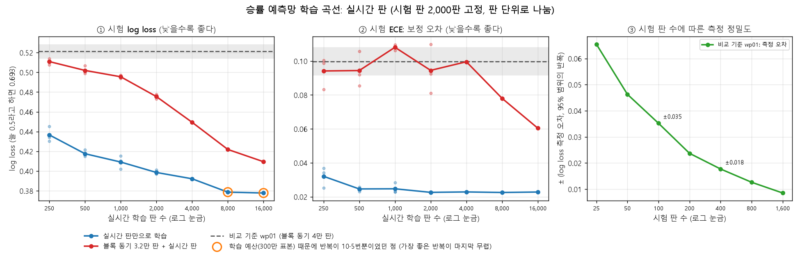
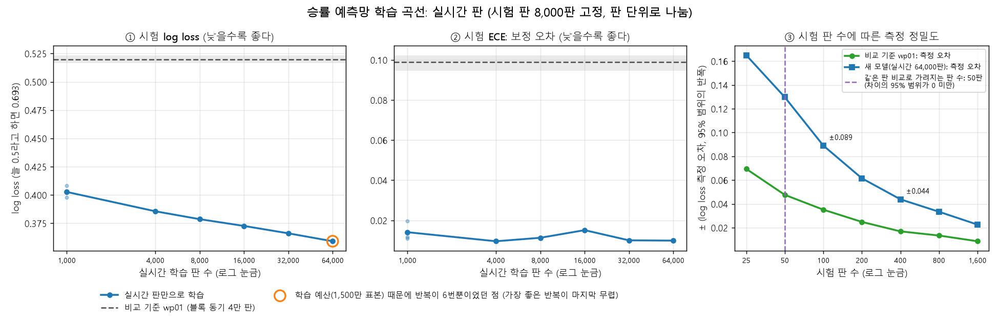

# 학습 설계 (TRAINING)

> 기록 형식 `match-1` | 규칙 버전 `0.3` 기준 | 모델 입력은 [MODEL_IO.md](MODEL_IO.md) 형식 `2` | 상태: **초안, 단계 A 완료·단계 B 검증·승률 예측망 완료 (10-02)** | 관련: [PLAN.md](PLAN.md) 9장, [RULES.md](RULES.md)

딥러닝 AI(애프터스테이트 가치망)를 어떻게 만들고 학습하는지 정한다. AI는 **2인 대전으로 학습한다**(2026-10-01 결정, 1장). PLAN 9장의 방향(Java가 두고 Python이 배운다)을 바로 구현할 수 있는 수준으로 구체화했고, 9장과 다른 점은 이 문서를 따른다.

Java 러너와 Python 학습기가 함께 지켜야 하는 **기록 형식**(7장)도 여기서 정한다. 기록 형식을 바꿀 때는 **이 문서 → `fixtures/match/` → Java·Python 코드** 순서로 고친다. `[초안]`이 붙은 수치는 첫 학습을 돌려 본 뒤 조정한다.

---

## 1. 왜 2인 대전으로 학습하는가

- **상대와 주고받는 것은 가비지다.** 1인 학습에서는 가비지가 정해진 일정(스케줄러 `S-mix`)으로만 들어온다. 그래서 상대 상태를 보고 "지금 공격할지, 받을 가비지를 먼저 막을지"를 고르는 법을 배울 수 없다.
- **목표가 진짜 목표가 된다.** 1인 학습의 목표는 공격량이라는 대리 목표지만, 2인 대전에서는 **이기는 것** 자체를 배운다.
- **페르소나 임베딩이 의미를 갖는다.** 여러 AI가 서로 대전하며 학습하면 임베딩에 "상대를 대하는 방식"(압박형, 버티기형 등)이 담긴다. 그래야 과제 1번의 학습 가중치 클러스터링이 상호작용 스타일의 구분이 된다.
- **같은 기록으로 과제 2번도 해결된다.** 대전 기록(두 플레이어의 상태와 승패)이 곧 승률 예측망의 학습 자료다(10장).
- TD-Gammon도 원래 2인 자기 대국으로 승률을 배운 방식이다.

대가도 있다. 승패는 판이 끝나야 나오므로 학습이 느릴 수 있어 처음 세대들에는 보조 보상을 준다(4.2). 또 블록 동기 모드는 두 플레이어가 같은 속도로 둔다고 가정한다(14장).

## 2. 전체 흐름

학습은 **세대**를 반복한다. 한 세대는 네 단계다.

| 단계 | 하는 쪽 | 내용 | 남는 것 |
|---|---|---|---|
| ① 대전 | Java | 지금 세대 AI들이 블록 동기 모드로 서로, 이전 세대, 기준 AI와 둔다 (6장) | 기록 `*.jsonl.gz` (7장) |
| ② 학습 | Python | 기록으로 가치망을 TD(λ) 학습한다 (5장) | 체크포인트 `.pt` |
| ③ 내보내기 | Python | AI마다 ONNX 파일로 내보내고 onnxruntime으로 확인한다 (MODEL_IO 6장) | `value_<AI>_gen-<세대>.onnx` |
| ④ 평가 | Java | 기준 AI·이전 최고 세대와 고정 시드로 대전한다 (8장) | `eval.json` |

- Python 스크립트 하나(`python/tools/train_loop.py`, 예정)가 Java 러너를 하위 프로세스로 부르며 세대를 이어 간다. 게임을 실행할 때는 여전히 Python이 필요 없다.
- 내보낸 파일의 꼬리표(MODEL_IO 5장)에는 `tetris.persona`에 AI 이름, `tetris.stage`에 `gen-<세대>`를 넣는다.

**세대 0은 기준 AI끼리 둔다.** `BaselineScorer`(높이·구멍·울퉁불퉁함·지운 줄)끼리의 대전 기록으로 가치망을 처음 학습한다. 배치 점수에는 기준 평가가 사전 지식으로 들어 있어(3.5) 학습 전 모델은 기준 AI와 똑같이 두고, 세대 1부터는 학습한 가치망이 그 위에서 조금씩 나아지며 그 기록으로 다시 배운다(정책 반복). PLAN 9.2의 1단계(휴리스틱 AI를 흉내 내는 모방 사전학습)를 이것으로 바꾼다. 같은 TD 학습 코드를 그대로 쓰고, 기록에 후보 전체를 남길 필요가 없으며, 페르소나 휴리스틱 AI 없이 지금 바로 시작할 수 있다.

## 3. 모델: 애프터스테이트 가치망

### 3.1 점수

결정 시점의 상대 상태를 `o`라 할 때, 배치 후보의 애프터스테이트 `x`(MODEL_IO 2장)마다 다음 점수를 낸다.

```
score(x, o) = R(x) + γ · V(x, o) + β · H(x)
```

- `R(x)`: 이 배치의 즉시 보상 (4장). 애프터스테이트만 보고 계산한다.
- `V(x, o)`: 이 배치 다음부터 판이 끝날 때까지 받을 보상(승패 포함)의 기댓값. 가치망이 배운다.
- `γ`: 할인율 `[초안] 1`. 판은 반드시 끝나므로 할인하지 않는다(TD-Gammon과 같다).
- `β · H(x)`: 기준 평가를 사전 지식으로 더한 것이다(3.5). `V`의 학습 목표에는 들어가지 않는다.

내보낼 때 `R`, `γ`, `β · H`를 모델 안에 넣으므로 ONNX 출력 `value`가 곧 `score(x, o)`이고, Java는 이 값만으로 고른다(MODEL_IO 4장).

### 3.2 입력: MODEL_IO 형식 2

형식 1의 두 입력에 **상대 상태** 두 입력을 더한다.

| 입력 | 모양 | 내용 |
|---|---|---|
| `board` | `[N, 24, 10]` | 후보의 애프터스테이트 보드 (형식 1과 같음) |
| `features` | `[N, 48]` | 후보의 애프터스테이트 특징 (형식 1과 같음) |
| `opp_board` | `[N, 24, 10]` | 결정 시점의 상대 보드. 후보 N개에 같은 값을 반복한다 |
| `opp_features` | `[N, 10]` | 결정 시점의 상대. `[0]` 대기 가비지 줄 수의 합, `[1]` `combo + 1`, `[2]` `b2b`, `[3]`~`[9]` 홀드 원-핫(`I J L O S T Z`) |

- 상대 상태는 상대가 마지막으로 고정한 뒤(가비지 상승 포함)의 보드와 대기열이다. 블록 동기 모드에서는 턴 시작 시점의 상태다.
- 상대가 없으면(1인 진단 등) `opp_board`와 `opp_features`를 모두 0으로 둔다.
- 형식 1처럼 정수를 실수로 바꾼 값만 넣고, 정규화와 보드 통계(3.3)는 모델 안에서 계산한다. Java·Python의 입력이 비트 단위로 같아야 하기 때문이다(MODEL_IO 3장).
- MODEL_IO.md 형식 2로 옮겼고, `fixtures/model_io/`와 Java·Python 인코더를 함께 고쳤다(2026-10-01). 정의는 MODEL_IO.md가 기준이다.

### 3.3 보드 통계

모델 안에서 내 보드와 상대 보드에 똑같이 계산한다. 보상(4장)과 신경망 입력에 함께 쓴다.

| 통계 | 계산 |
|---|---|
| 열 높이 (10개) | 열마다 24 − (맨 위 찬 칸의 행 번호). 빈 열은 0 |
| 열별 구멍 (10개) | 열마다 맨 위 찬 칸보다 아래에 있는 빈칸 수 |
| 최고 높이 | 열 높이의 최댓값 |
| 구멍 합 | 열별 구멍의 합 (`BaselineScorer`와 같은 정의) |
| 울퉁불퉁함 | 이웃한 두 열의 높이 차이 절댓값의 합 |
| 구멍 있는 줄 | 구멍이 하나라도 있는 행의 수 |

### 3.4 구조 `[초안]`

| 부분 | 구성 |
|---|---|
| 내 보드 | 합성곱 3층 (채널 1 → 16 → 32 → 32, 3×3, 셋째 층은 행 방향 보폭 2) → 1×1 합성곱 (32 → 8) → 펼쳐서 128 |
| 내 특징 | `features` 48 + 내 보드 통계 24 → 64 |
| 상대 | `opp_features` 10 + 상대 보드 통계 24 → 32 |
| 페르소나 | AI마다 학습하는 임베딩 8차원 (9장) |
| 머리 | 128 + 64 + 32 + 8 → 128 → 1 (`V`) |

- 활성 함수는 ReLU다. ONNX opset 17로 내보낼 수 있는 연산(합성곱, 행렬곱, 누적합, 비교, 합, 최댓값, 절댓값)만 쓴다.
- 매개변수는 173,073개, 후보 하나에 곱셈-덧셈 약 240만 번이다. 512판 대전(약 5만 결정)이 12스레드로 10초 남짓 걸린다(2026-10-01 측정).
- 머리의 마지막 층은 0에서 시작한다. 그래서 학습 전에는 `V = 0`이고, 점수는 `R + β · H`만 남아 기준 AI와 같은 배치를 고른다.
- 구현: [python/tetris_ai/net.py](../python/tetris_ai/net.py).

### 3.5 기준 평가 (사전 지식)

`H(x)`는 Java `BaselineScorer`와 같은 식이다. 높이 합 × −0.510066, 지운 줄 × 0.760666, 구멍 합 × −0.35663, 울퉁불퉁함 × −0.184483. 점수에는 `β = [초안] 0.05`를 곱해 더한다. 구멍 하나가 점수를 약 0.018 낮추는 크기다.

- **왜 넣는가.** 승패는 판 끝에만 나오고, λ-리턴은 처음에 학습되지 않은 `V`에 기대므로, 판 초반의 수에는 좋고 나쁨이 거의 전해지지 않는다. 사전 지식 없이 시작하면 첫 세대들이 사실상 아무 데나 두어 기준 AI에게 한 판도 이기지 못했다(2026-10-01 시험).
- **왜 `V` 밖에 두는가.** 처음에는 `V = c · H + 보정값`처럼 `V` 안에 넣었다. 그러자 `c · H`의 범위(−1 ~ −6)가 학습 목표(±1)와 맞지 않아, 판 끝 무렵의 높이 쌓인 보드에서 신경망이 큰 양의 보정을 배웠고, 세대가 지나며 줄을 지우지 않고 쌓기만 하는 정책으로 무너졌다. 점수에만 더하면 `V`는 순수하게 승패를 배워 학습 목표와 범위가 같다.
- **영향.** 기준 평가가 점수에 계속 남는다. 신경망은 그 위에서 상대 상태와 승패를 보고 판단을 바꾼다. `V`의 차이가 `β · H`의 차이보다 커지면 신경망의 판단이 이긴다.

### 3.6 `β`가 너무 커서 76%에서 멈췄다 (2026-10-02 진단)

`r01`이 기준 AI 상대 약 76%에서 멈춘 주된 원인은 **`β = 0.05`의 기준 평가가 신경망의 판단을 눌렀기 때문**이다. 학습한 신경망은 그대로 두고 내보낼 때의 `β`만 바꿔서 쟀다(`r01` 세대 38, 기준 AI와 1,000판, 개발용 시드 `930001`~`930500`, 8.1).

| 내보낼 때의 `β` | 0.1 | **0.05 (학습할 때 값)** | 0.025 | 0.015 | **0.01** | 0.005 | 0 |
|---|---|---|---|---|---|---|---|
| 기준 AI 상대 승률 | 0.716 | 0.747 | 0.774 | 0.808 | **0.841** | 0.821 | 0.760 |

- 결정 하나하나를 보면(같은 모델, 기준 AI와 200판, 시드 `940001`~`940100`, 결정 약 1.6만 개) `β = 0.05`일 때 **고른 배치의 80%가 기준 AI가 고를 배치와 같았다**. `V`의 1등과 기준 평가의 1등은 결정의 44%에서 달랐는데, 그때 고른 배치는 기준 평가 쪽이 54%, `V` 쪽이 40%였다. 점수 상위 10개 후보 사이에서 `V`의 차이(표준편차 0.047)가 `β · H`의 차이(0.072)보다 작았기 때문이다. `β = 0.01`이면 둘이 다를 때 `V` 쪽을 고르는 비율이 60%로 오르고, 기준 AI와 같은 배치는 71%로 줄어 승률이 0.84가 된다.
- **`β = 0`은 오히려 나쁘다(0.760).** `V`는 판 초반에 승패를 거의 맞히지 못한다(판의 처음 4분의 1에서 `V`와 실제 결과의 상관 0.04~0.06, 5.3). 그래서 작은 사전 지식은 여전히 필요하다. 최고 높이가 6.3(`β = 0.01`)에서 7.6(`β = 0`)으로 높아진다.
- 같은 방법이 마지막 세대에도 통한다: 세대 79는 0.721(`β = 0.05`, 시드 `910001`~)에서 0.794(`β = 0.01`, 시드 `930001`~)가 된다.
- 그래서 학습도 `β`를 줄여서 이어 했다(`a1`, `a2`, 12.2). 세대마다 `β`를 바꾸는 설정은 `prior_weight`(처음 값), `prior_final`(나중 값), `prior_from`·`prior_until`(바꾸기 시작하는 세대와 끝나는 세대)이다. `prior_final`을 주지 않으면 `β`는 그대로다(기본값, `r01`과 같다).
- **권장 (2026-10-02):** 처음은 지금처럼 `β = 0.05`로 학습하고, 승률이 멈춘 뒤에(`r01`은 세대 10쯤부터 멈췄고, 시험은 세대 38에서 이어 했다) `--init-from <실행>/<세대> --prior-weight 0.01 --lr 1e-4 --lr-final 2e-5 --matches 1024 --epochs 1`로 이어 학습한다(`a2`, 12.2). 이미 학습한 체크포인트는 `evaluate.py --checkpoint … --prior-weight 0.01`로 `β`만 바꿔 내보내도 바로 강해진다. 기본값은 바꾸지 않았다. 처음부터 작은 `β`로 학습하는 것은 시험하지 않았기 때문이다.

## 4. 보상

### 4.1 승패

판이 끝나면 이긴 쪽 **+1**, 진 쪽 **−1**, 무승부 **0**이다. 턴 상한(6장)에 닿은 판도 무승부다(RULES 12.2). 이것이 모든 AI의 기본 목표다.

### 4.2 보조 보상 (처음 세대들)

승패만 주면 판이 끝날 때까지 어떤 수가 좋았는지 알 수 없어서 학습이 느리다. 그래서 처음 세대들에는 모든 AI에게 **공격 1줄당 `[초안]` 0.005**를 더 주고, 세대 `[초안]` 20까지 0으로 줄인다.

### 4.3 페르소나 스타일 보상 `[초안]`

페르소나 학습(9장)의 AI들은 승패에 작은 스타일 보상을 더해 받는다. 모두 애프터스테이트로만 계산하며, 학습과 내보내기가 같은 PyTorch 모듈을 쓰므로 Java는 보상을 계산하지 않는다.

| 항목 | 애프터스테이트에서 읽는 방법 | 중립 | 공격 | 수비 | T-spin | 콤보 |
|---|---|---|---|---|---|---|
| 공격 `attack` | `attack` (줄 수, 상쇄 전) | 0 | 0.004 | 0 | 0 | 0 |
| T-spin 클리어 `tspin` | `1 ≤ lines ≤ 3`이고 배치 뒤 `b2b`가 참이면 1 | 0 | 0 | 0 | 0.05 | 0 |
| 테트리스 `tetris` | `lines = 4`면 1 | 0 | 0.02 | 0 | 0 | 0 |
| 콤보 클리어 `combo` | `lines > 0`이고 배치 뒤 `combo ≥ 1`이면 1 | 0 | 0 | 0 | 0 | 0.01 |
| 높이 비용 `height` | 최고 높이 ÷ 24 | 0 | 0 | 0 | 0 | 0 |
| 구멍 비용 `holes` | 구멍 합 | 0 | 0 | 0 | 0 | 0 |
| 생존 `survive` | 배치마다 1 | 0 | 0 | 0.0005 | 0 | 0 |
| 가비지 상승 `garbage_rise` | 이번 고정에서 올라오는 줄 수: `features[47] = 1`이면 `min(pending, 8)`, 아니면 0 (RULES 10.3) | 0 | 0 | −0.004 | 0 | 0 |
| 남은 대기 가비지 `pending` | `pending` − 가비지 상승 줄 수 | 0 | 0 | −0.004 | 0 | 0 |
| 위험 높이 `danger` | `max(0, 최고 높이 − 12) ÷ 12` | 0 | 0 | −0.01 | 0 | 0 |

- **크기:** 한 판 동안의 스타일 보상 합이 승패(±1)보다 충분히 작게(대략 0.2~0.3) 정한다. 크면 이기는 것보다 스타일을 앞세운다.
- **크기를 맞춘 방법 (10-02).** 처음 표(10-01: 공격 0.002·테트리스 0.01, T-spin 0.01, 콤보 0.002, 높이 −0.002·구멍 −0.0005)를 `r01` 79세대 학습 대전 790판(τ = 0.3, 한 판 평균 57블록)에 대 보니, 한 판 스타일 보상 합의 평균이 공격 +0.068, 수비 −0.219, T-spin +0.002, 콤보 +0.018로 100배 넘게 달랐다. 한 판 합은 공격 33.9줄, T-spin 클리어 0.18번, 테트리스 0.04번, 콤보 클리어 8.8번, 최고 높이 ÷ 24의 합 21.3, 구멍 합의 합 352였다. 이대로는 T-spin·콤보 AI가 중립과 거의 같은 목표를 받는다. 그래서 지금 정책에서 한 판 합이 원형마다 대략 0.1~0.15가 되도록 다시 정했다: 공격 +0.137, 수비 −0.134, 콤보 +0.088. T-spin은 지금 정책에서 +0.009지만 한 판에 3번 하면 +0.15다. 검증 실행 결과는 9.8.
- **T-spin 클리어를 형식 1의 값으로 알 수 있는 이유:** 줄을 지운 배치 뒤의 `b2b`는 B2B 대상(테트리스, T-spin)이면 참, 아니면 거짓이 된다(RULES 9.3, `Attack.compute`). 테트리스는 4줄이므로 1~3줄을 지우고 `b2b`가 참이면 T-spin(mini 포함)이다. 퍼펙트 클리어는 공격 +10으로 이미 들어 있다.
- 비용은 **블록마다 그 상태에 있는 비용**이다. "직전보다 높아진 만큼"처럼 차이로 주면 최적 행동이 바뀌지 않아(퍼텐셜 기반 보상) 수비형이 생기지 않는다.
- **수비 원형을 다시 정함 (10-04).** 10-02 표의 수비(높이 −0.003, 구멍 −0.0002)는 검증 실행 `p01`~`p03` 어디서도 행동 차이를 만들지 못했고, `p03`에서는 고정 상대에게 가장 많이 졌다(9.8). 이유를 둘로 보았다. ① 높이·구멍 비용은 안전한 상태에서도 블록마다 붙어 언제나 음수라, 판을 빨리 끝낼수록 손해가 적다. ② 구멍 비용(−0.0002)이 기준 평가의 구멍 비용(β 0.01에서 약 −0.0036)보다 작아 고르는 점수에 거의 드러나지 않는다. 그래서 수비 원형은 **위험할 때만 비용**을 받고(가비지가 올라올 때, 상쇄하지 못한 가비지가 남았을 때, 최고 높이가 12를 넘을 때), 대신 블록마다 작은 **생존 보상**을 받는다. 안전한 블록의 보상은 +0.0005라서 오래 버틸수록 좋고, 위험한 블록에서만 음수가 된다. 높이·구멍 항목은 10-02 표의 실행(`p01`~`p03`의 `config.json`)을 다시 만들 수 있게 남겨 두되 기본 표에서는 쓰지 않는다.
- **새 수비 가중치의 크기 (10-04).** `a2` 세대 58 학습 대전 1,024판의 궤적 2,048개(한 판 평균 64.7블록)에 대 보았다. 한 판 합의 평균은 가비지 상승 18.4줄, 남은 대기 가비지 4.2, 위험 높이 6.7(위험 높이가 0보다 큰 블록 18.9개)이다. 가중치를 곱하면 생존 +0.032, 가비지 상승 −0.073, 남은 대기 가비지 −0.017, 위험 높이 −0.067, 합 **−0.125**로 다른 원형(공격 +0.137, 콤보 +0.088)과 크기가 비슷하다. 진 쪽은 가비지 상승 22.7줄·위험 높이 9.2, 이긴 쪽은 14.0줄·4.1이라, 비용이 지는 길에서 크게 쌓인다. `p03` 세대 10 기록에서도 값이 거의 같았다. 이 비용이 실제로 올라온 줄(기록의 `risen`)과 어긋나는 블록은 0.1%였다(대기열의 덩어리 경계).
- **생존 보상의 한계.** 블록 동기 모드(RULES 12.2)에서는 두 플레이어가 같은 수의 블록을 두므로, 생존 보상은 한 판 안의 승자와 패자를 가르지 않고 **판을 길게 끄는 것**만 보상한다. 턴 상한(1,000턴)까지 가면 +0.5로 커지지만, 지금 학습 대전은 평균 65턴이다.

## 5. 학습: TD(λ)

### 5.1 목표

한 판에서 한 플레이어의 기록은 고른 애프터스테이트와 그때의 상대 상태의 열 `(x_0, o_0), (x_1, o_1), …, (x_{T−1}, o_{T−1})`이다(7장). `V(x_t, o_t)`의 학습 목표 `G_t`(λ-리턴)를 판의 끝에서부터 계산한다.

```
G_t = R(x_{t+1}) + γ · [ (1 − λ) · V(x_{t+1}, o_{t+1}) + λ · G_{t+1} ]
```

- **마지막 턴** `t = T − 1`: `G`는 승패 값(+1, −1, 0)이다.
- `R`은 그 플레이어를 둔 AI의 보상 가중치(4.2, 4.3)로 계산한다.
- `λ` `[초안] 0.8`. 0이면 한 걸음 TD, 1이면 판 끝까지 실제로 받은 보상의 합이다.
- 목표 안의 `V`는 그 세대의 학습을 시작할 때 **한 번 계산해 고정**한다. 학습 중에 목표가 함께 움직이지 않아 안정적이다.
- 가치망 학습에는 **지금 세대 AI가 둔 쪽의 기록만** 쓴다. 이전 세대 모델과 기준 AI가 둔 쪽은 승률 예측망(10장)에만 쓴다.

### 5.2 세대마다 `[초안]`

| 항목 | 값 |
|---|---|
| 학습 자료 | 최근 4세대의 기록. 오래된 세대는 지금 정책과 조금 다르지만 자료가 많아지는 이득이 크다 |
| 반복 | 자료 전체를 2번 (세대 0은 5번) |
| 손실 | 평균 제곱 오차 `(V(x_t, o_t) − G_t)²` |
| 최적화 | AdamW, 학습률 3e-4, 묶음 1,024 |
| 학습률 일정 | 기본은 그대로. `lr_final`을 주면 `lr_from` 세대의 `lr`에서 `lr_until` 세대의 `lr_final`까지 등비로 줄인다 |

### 5.3 과적합 확인

한 판의 표본(약 55개)은 모두 같은 승패를 목표로 가지므로, 표본 수에 비해 실제로 독립인 자료(판 수)가 적다. 그래서 신경망이 판의 결과를 외우는지 세대마다 확인한다.

- `log.csv`의 `loss_new`는 학습을 시작하기 전 신경망의 **이번 세대 기록**(아직 배우지 않은 자료)에 대한 손실, `loss_seen`은 **이전 세대 기록**(이미 배운 자료)에 대한 손실이다. 둘 다 그 세대의 λ-리턴 목표로 잰다. `loss_new`가 `loss_seen`보다 계속 크면 외우고 있다는 뜻이다.
- `r01`(2026-10-02 측정): 세대 78의 신경망은 배운 기록(세대 76~78)에서 손실 0.044, 실제 결과와의 상관 0.45였지만, 배우지 않은 세대 79 기록에서는 손실 0.064, 상관 0.32였다. 판의 마지막 4분의 1에서도 상관이 0.80에서 0.59로 떨어진다. 판의 처음 4분의 1에서는 어느 쪽이든 상관이 0.04~0.06으로 `V`가 승패를 거의 모른다.
- 외우는 정도를 줄이는 방법은 세대당 판 수를 늘리거나, 반복(`epochs`)을 줄이거나, 학습률을 줄이는 것이다(12.2의 실험).
- 세 가지를 모두 한 `a2`(12.2): 세대 57의 신경망이 배운 기록(세대 55~57)에서 상관 0.337, 배우지 않은 세대 58 기록에서 0.352로 차이가 없다. 배우지 않은 기록에서의 상관도 `r01`(0.32)보다 조금 높다.

## 6. 대전 러너 (Java)

| 항목 | 값 |
|---|---|
| 진행 방식 | 블록 동기 모드 (RULES 12.2). 두 플레이어는 같은 시드로 같은 순서의 블록을 받는다 |
| 턴 상한 | RULES 12.2의 `[초안]` 1,000턴. 넘으면 무승부 |
| 세대당 판 수 | `[초안]` 512판 |
| 상대 구성 | `[초안]` 지금 세대 AI 50%, 이전 세대 모델 30%, 기준 AI 20%. 한 상대에게만 맞춘 전략이 되지 않게 한다 |
| 자리 | 판마다 P1·P2를 번갈아 맡는다. 가비지 구멍 난수가 자리마다 다르기 때문이다(RULES 5.2) |
| 동시 실행 | CPU 스레드마다 한 판씩. ONNX Runtime의 연산 스레드는 1개로 둔다 |
| 시드 | `세대 × 1,000,000 + 판 번호`. 평가 시드(8장)와 겹치지 않는다 |

**배치 고르기**

1. 후보는 `GameModel.placements()` 중 락 아웃이 아닌 배치다(MODEL_IO 1장). 후보가 없으면 그 플레이어는 그 턴에 락 아웃으로 진다.
2. 후보마다 애프터스테이트를 만들고, 턴 시작 시점의 상대 상태와 함께 한꺼번에 점수를 매긴다.
3. 온도 `τ = 0`이면 점수가 가장 높은 배치를 고른다. 점수가 같으면 정규화 키가 사전 순으로 앞선 배치다.
4. `τ > 0`이면 점수를 후보들 점수의 표준편차로 나눈 뒤 `softmax(점수 / τ)` 확률로 뽑는다. 표준편차로 나누므로 모델마다 점수 크기가 달라도 같은 `τ`면 탐험 정도가 비슷하다(표준편차가 0이면 모두 같은 확률). 대전 기록을 모을 때는 `[초안] τ = 0.3`.
5. 뽑기에 쓰는 난수는 판 시드의 스트림 101(P1), 102(P2)로 정한다(RULES 5.2의 방법, 규칙의 스트림 1~4와 겹치지 않음). 같은 시드, 같은 모델, 같은 `τ`면 같은 판이 나온다.

구현은 `ai.Chooser`(고르기), `train.MatchRunner`(한 판)이다.

### 6.1 대전 계획 파일 `plan-1`

Python 학습 루프가 세대마다 계획 파일을 만들고 `gradlew match --args="<plan.json>"`(`train.MatchMain`)로 실행한다. 계획 안의 상대 경로는 계획 파일이 있는 폴더 기준이다.

```
{"format": "plan-1", "run": "r01", "gen": 3, "max_turns": 1000, "threads": 12, "out": "matches",
 "players": {"ai00": {"persona": "neutral", "model": "../models/value_ai00_gen-002.onnx", "temperature": 0.3},
             "baseline": {"model": "baseline", "temperature": 0.3}},
 "matches": [{"seed": 3000000, "p1": "ai00", "p2": "baseline"}, …]}
```

- 같은 모델 파일은 한 번만 불러 모든 스레드가 함께 쓴다. 스레드마다 기록 파일 하나(`w<스레드>.jsonl.gz`)를 쓰고, 끝나면 AI별 승패를 `summary.json`에 적는다. 같은 AI끼리 둔 판은 승패가 아니라 `self_play`로 따로 센다.
- 모델 파일이 맞지 않으면(꼬리표, 입력 모양) 대신 두지 않고 실패한다. 학습 중에는 조용히 기준 AI로 바뀌면 안 되기 때문이다.
- **선택 필드 `search`** (2026-10-02): 플레이어에 `"search": {"beam": 8}`을 주면 그 플레이어는 2수 탐색(6.2)으로 고른다. 없거나 `null`이면 1수만 본다(지금까지와 같다). `beam`은 1 이상의 정수여야 하고, 아니면 실패한다. 모델 파일 대신 `"baseline"`에도 쓸 수 있다(기준 평가로 2수를 보는 AI).

- 게임에서 난이도를 나눌 때의 온도(PLAN 9.4)도 같은 방법을 쓴다.
- **RULES 12.2 문구를 고친다.** 지금은 "둘 다 턴 시작 시점의 자기 상태만 보고 결정한다"인데, "턴 시작 시점의 두 플레이어 상태를 보고 결정한다(같은 턴에 상대가 고르는 수는 모른다)"로 바꾼다. 실제 게임 화면에도 두 보드가 다 보인다. 고정·송신 순서는 그대로라 기존 픽스처는 바뀌지 않는다.

### 6.2 2수 탐색 (PLAN 7장 레벨 5)

결정할 때 다음 블록까지 두어 보고 고른다. 학습한 가치망을 그대로 쓰고(학습은 1수로 한다), 게임과 평가에서 더 강하게 두는 방법이다. 구현은 `ai.BeamSearch`이다.

1. 1수 후보(6장 배치 고르기 1~2)에 점수를 매기고, 점수가 높은 순으로 `beam`개를 고른다. 점수가 같으면 앞선 후보(정규화 키 순)가 먼저 들어간다.
2. 고른 후보마다 RULES 7장 8~9단계를 이어서 둔다: 줄을 지우지 않았고 상쇄 뒤 대기 가비지가 있으면 최대 8줄이 올라오고(가비지 아웃이면 짐), 대기열의 첫 블록이 나온다(블록 아웃이면 짐).
3. 그 블록과 홀드로 둘 수 있는 모든 배치(락 아웃 제외)의 애프터스테이트에 점수를 매긴다. 상대 상태는 결정 시점 그대로이고, 대기 가비지에만 첫 수의 송신량을 더한다.
4. 후보의 값은 둘째 수 점수의 최댓값이다. 둘째 수를 둘 수 없으면 `−1000`(지는 수)이다.
5. 펼친 후보 중 값이 가장 큰 것을 고른다(`τ > 0`이면 6장 4처럼 값으로 뽑는다). 값이 같으면 정규화 키 순으로 앞선 후보다. 지지 않는 후보가 하나라도 있으면 지는 후보(`−1000`)는 미리 뺀다. `τ > 0`일 때 `−1000`이 표준편차를 키워 나머지 후보의 확률이 고르게 퍼지는 것을 막기 위해서다(`τ = 0`이면 고르는 후보는 같다).

**보이지 않는 정보는 쓰지 않는다.** 탐색의 입력은 1수 후보의 애프터스테이트와 상대 상태뿐이다(`GameModel`을 받지 않는다).

- 둘째 수의 대기열에서 새로 보일 블록(지금 미리보기 다음 블록)은 모르므로 그 칸을 비워 둔다. 학습 자료에서 대기열이 4개인 경우는 처음 홀드할 때뿐이라 조금 낯선 입력이지만, 모든 둘째 수 후보가 똑같이 비어 있다.
- 첫 수 뒤에 가비지가 올라오면 구멍 열을 모르므로 **10열을 같은 확률로 보고 값을 평균**한다(기댓값). 한 번에 올라오는 줄은 모두 같은 열에 구멍이 있다고 본다(실제로는 받은 공격마다 다른 열이다, RULES 5.4). 이 경우 둘째 수를 10번 펼치므로 느려진다.
- 상대가 이번 턴에 두는 수와 보내는 공격은 모른다.

**한계.** 첫 수의 즉시 보상 `R`은 값에 들어가지 않는다(내보낸 모델은 `R + γV + βH`의 합만 낸다). 보조 보상이 끝난 중립 AI는 `R = 0`이라 영향이 없고, 페르소나 AI는 첫 수의 스타일 보상을 덜 본다. 결과는 12.2.

**기록.** 기록 형식은 그대로다(7장). 플레이어 정보에 `search`가 붙고(7.2), `rank`는 펼친 후보 안에서 탐색 값으로 센 순위다.

## 7. 기록 형식 `match-1`

### 7.1 파일

```
runs/<실행 이름>/gen-<세대 3자리>/matches/w<스레드 번호>.jsonl.gz
```

- gzip으로 압축한 JSON Lines이고, **한 줄이 한 판**이다. TD(λ)는 판 단위로 계산하므로 한 판이 여러 파일에 나뉘지 않게 한다.
- UTF-8, 줄바꿈 LF. `runs/`는 git에 올리지 않는다.

### 7.2 판

| 필드 | 형식 | 뜻 |
|---|---|---|
| `format` | `"match-1"` | 이 형식의 버전 |
| `rules`, `model_io` | 문자열 | 규칙 버전, 모델 입력 형식 버전 |
| `run`, `gen` | 문자열, 정수 | 실행 이름, 세대 |
| `seed` | 정수 | 판 시드 (RULES 5.2). 두 플레이어가 같은 값을 쓴다 |
| `max_turns` | 정수 | 턴 상한 |
| `players` | 배열 2개 | P1, P2 순서. 각각 `ai`(AI 이름, 기준 AI는 `"baseline"`), `persona`, `model`(파일 이름 또는 `"baseline"`), `temperature`. 2수 탐색(6.2)으로 둔 플레이어에만 선택 필드 `search`(예: `{"beam": 8}`)가 붙는다. 읽는 쪽은 모르는 필드를 무시하므로 형식 버전은 그대로다 |
| `result` | 문자열 | `"p1"` `"p2"` `"draw"` |
| `topout` | 객체 | 플레이어마다 진 이유(`"block_out"` `"lock_out"` `"garbage_out"`) 또는 `null`. 둘 다 `null`이면 턴 상한 무승부 |
| `turns` | 정수 | 진행한 턴 수 |
| `steps` | 배열 | 턴마다 하나. 원소는 `{"p1": …, "p2": …}` (7.3) |

### 7.3 한 플레이어의 한 턴

| 필드 | 형식 | 뜻 |
|---|---|---|
| `state` | 객체 | 결정 시점(턴 시작)의 상태. `rows`, `current`(놓을 차례인 블록), `queue`(미리보기 5개), `hold`, `combo`, `b2b`, `pending`(대기 가비지 줄 수의 합). 상대의 모델 입력 `opp_*`와 승률 예측망이 이것을 쓴다 |
| `key` | 문자열 | 고른 배치의 정규화 키 (RULES 14.2). `h1`로 시작하면 홀드를 썼다 |
| `after` | 객체 | 고른 배치의 애프터스테이트 (MODEL_IO 2장과 같은 뜻). `rows`, `queue`, `hold`, `combo`, `b2b`, `lines`, `attack`(상쇄 전), `pending`(상쇄 뒤), `spin`(`"none"` `"mini"` `"full"`), `pc`(퍼펙트 클리어) |
| `sent`, `risen` | 정수 | 상쇄하고 남은 송신량, 이번 고정에서 올라온 가비지 줄 수. 행동 지표용 |
| `n`, `rank` | 정수 | 후보 수, 고른 배치의 점수 순위(0이 1등). 탐험 확인용. 2수 탐색이면 펼친 후보 안에서 탐색 값으로 센 순위다 |

- `rows`는 정수 24개다. `rows[r]`의 비트 `c`(값 `1 << c`)가 1이면 `r`행 `c`열이 차 있다. 0행이 맨 위다.
- 모든 배치가 락 아웃이면 정규화 키 순으로 첫 배치를 두어 규칙대로 락 아웃으로 진다. 이때 `key`는 그 배치이고, `after`와 `rank`는 `null`, `n`은 0이다. 키가 남아 있어 재생 시험이 그대로 된다.

### 7.4 예

첫 턴만 보인 예다. 읽기 쉽게 줄을 나누고 `rows`의 0 대부분과 P2는 줄였다. 실제 파일에서는 한 판이 한 줄이다.

```
{"format":"match-1","rules":"0.3","model_io":"2","run":"r01","gen":3,"seed":3000017,"max_turns":1000,
 "players":[{"ai":"ai00","persona":"neutral","model":"value_ai00_gen-003.onnx","temperature":0.3},
            {"ai":"baseline","persona":"neutral","model":"baseline","temperature":0.3}],
 "result":"p1","topout":{"p1":null,"p2":"garbage_out"},"turns":412,
 "steps":[{"p1":{"state":{"rows":[0,…,0],"current":"T","queue":"IOSLZ","hold":null,"combo":-1,"b2b":false,"pending":0},
                 "key":"h0|none|22,4;23,3;23,4;23,5",
                 "after":{"rows":[0,…,0,16,56],"queue":"IOSLZ","hold":null,"combo":-1,"b2b":false,
                          "lines":0,"attack":0,"pending":0,"spin":"none","pc":false},
                 "sent":0,"risen":0,"n":34,"rank":0},
           "p2":{…}}, …]}
```

### 7.5 검증

- **`fixtures/match/`:** Java 러너가 쓴 짧은 기록과, 그 기록의 턴마다 Java 인코더가 만든 모델 입력 값을 함께 둔다. Python은 기록을 읽어 자기 인코더(`tetris_ai.records`)로 만든 값이 같은지 확인한다. 서로 다른 두 구현의 교차 확인이다(FIXTURES.md 5.10).
- **재생 시험 (Java):** 기록의 `seed`와 두 플레이어의 `key`만으로 대전을 처음부터 다시 두면, 모든 턴의 `state`, `after`와 판 결과가 기록과 같아야 한다. 기록 값만으로 블록 동기 모드의 순서도 확인한다: 다음 턴의 대기 가비지 = 이번 턴 상쇄 뒤 대기 − 올라온 줄 + 상대가 이번 턴에 보낸 줄. 구현은 테스트의 `MatchReplay`이고, `MatchRunnerTest`와 픽스처가 함께 쓴다.

## 8. 평가와 세대 고르기

| 항목 | 값 |
|---|---|
| 기준 AI 상대 | 고정 시드 `[초안]` 100개(`900001`~`900100`) × 자리를 바꿔 2판 = 200판, 양쪽 `τ = 0` |
| 이전 최고 세대 상대 | 같은 방식으로 200판 |
| 지표 | 승률, 평균 턴 수, APP(블록당 공격), 블록당 송신, 상쇄 비율, T-spin·테트리스 비율, 평균 최고 높이 |
| 상호작용 지표 | 상대가 위험할 때(상대 최고 높이 16 이상) 블록당 송신과 평소의 차이, 받을 가비지가 많을 때(4줄 이상) 줄을 지우는 비율 |

- 세대마다 `eval.json`(기준 AI 상대, 최고 세대 상대 지표)을 남기고, 한 줄 요약을 `runs/<실행 이름>/log.csv`에 붙인다(`win_rate`는 기준 AI 상대, `win_rate_vs_best`는 그때까지의 최고 세대 상대).
- **최고 세대**는 기준 AI 상대 승률이 가장 높은 세대다(`best.json`). 이어서 학습할 때도 이 기록을 이어받고, 그 세대의 체크포인트는 지우지 않는다.
- 좋은 세대들을 난이도별 모델로 고른다(PLAN 9.4).
- 시드 수는 `eval_seeds`(기본 100)로 바꿀 수 있다.

### 8.1 다시 재기 (1,000판)

200판 평가의 95% 범위는 ±0.06 정도라, 여러 세대 중 가장 높은 값을 고르면 운이 섞인다(`r01`의 최고 0.835는 1,000판으로 다시 재면 0.76이었다). 그래서 **실력을 말할 때는 `python/tools/evaluate.py`로 1,000판(시드 500개 × 자리 2개, 양쪽 `τ = 0`)을 다시 잰다.** 95% 범위는 `1.96 × √(p(1 − p) / 판 수)`로 적는다(약 ±0.025).

| 시드 | 쓰는 곳 |
|---|---|
| `세대 × 1,000,000 + 판 번호` | 학습용 대전 (6장) |
| `900001`~ | 세대 평가 (8장) |
| `910001`~`910500` | `r01` 다시 재기 (PROGRESS 0.5) |
| `930001`~`930500` | 개발용: `β`, 탐색, 세대 고르기를 정할 때 (2026-10-02) |
| `940001`~`940100` | 결정 진단 (3.6) |
| `970001`~`970500` | **최종 확인용.** 위에서 고른 모델을 한 번만 잰다 (12.2) |

고를 때 쓴 시드로 잰 값은 고른 만큼 부풀려지므로, 고른 뒤에는 그때까지 쓰지 않은 시드로 다시 잰 값만 실력으로 적는다.

## 9. 페르소나 (PLAN 9.3 구체화)

1. **단계 A, 중립 하나.** AI 하나(승패 + 보조 보상)로 루프를 돌려, 기준 AI 상대 승률이 `[초안]` 80% 이상이 될 때까지 학습한다. 파이프라인 전체를 검증하는 단계다.
2. **단계 B, 여러 AI.** 단계 A의 가중치에서 시작해 AI `[초안]` 12개를 둔다. 스타일 원형 4개(공격·수비·T-spin·콤보)와, 원형 가중치를 무작위 비율(디리클레 분포)로 섞은 8개다. 모든 AI가 신경망 하나를 공유하고 AI마다 임베딩 8차원을 학습하며, 서로·이전 세대·기준 AI와 대전한다(6장 상대 구성). 상대에 따라 어떻게 공격하고 막는지가 AI마다 달라지고, 그 차이가 임베딩에 담긴다.
3. **분석.** 임베딩 12개를 k-means·GMM으로 묶고(과제의 "학습 가중치 클러스터링"), 군집마다 행동·상호작용 지표(8장)가 실제로 다른지 확인한다. 지표는 모든 AI가 **같은 고정 상대**(단계 A의 최종 모델)와 같은 시드로 둔 판에서 잰다. 상대가 지표를 좌우하지 않게 하기 위해서다(PLAN 8.1).
4. **게임용 파일.** 군집마다 대표 AI를 골라 이름을 붙이고 `value_<페르소나>_<단계>.onnx`로 내보낸다(MODEL_IO 8장).

단계 B의 학습은 `python/tools/train_personas.py`, 분석과 게임용 파일은 `python/tools/analyze_personas.py`가 한다(9.7). 공통 부분은 `tetris_ai/personas.py`(AI 표, 시작점, 리그 계획, 내보내기, 지표)와 `tetris_ai/persona_analysis.py`(군집 분석, scikit-learn 필요)에 있다.

### 9.1 AI 구성 `[초안]`

| 항목 | 값 |
|---|---|
| AI 수 | 12. 원형 4개(`attacker`, `defender`, `tspin`, `combo`)와 섞은 AI 8개(`mix01`~`mix08`) |
| 원형 가중치 | 4.3 표. 실행을 시작할 때 `config.json`에 그대로 복사해, 뒤에 표가 바뀌어도 실행을 다시 만들 수 있게 한다 |
| 섞은 AI | 원형 비율 `r`를 디리클레 분포(4성분 모두 `α = 1`, 시드 0)에서 뽑는다(`numpy.random.default_rng(0).dirichlet`). 보상 가중치는 `Σ r_k × (원형 k의 가중치)`다 |
| 라벨 | 비율이 가장 큰 원형. 분석에서 임베딩 군집과 비교하는 "설계 의도"다(원형 AI는 자기 이름) |
| 보상 | 승패(±1) + 그 AI의 스타일 보상. 보조 보상(4.2)은 주지 않는다(단계 A가 끝날 때 이미 0이다) |
| 이름 | AI 이름이 기록의 `players[].ai`·`persona`, 모델 꼬리표 `tetris.persona`가 된다. 이전 세대 모델은 `<AI>@gen-<세대>`로 둔다 |

시드 0으로 정해지는 섞은 AI 8개의 비율(공격·수비·T-spin·콤보 순서)과 라벨:

| AI | 비율 | 라벨 | AI | 비율 | 라벨 |
|---|---|---|---|---|---|
| `mix01` | 0.395, 0.592, 0.012, 0.001 | 수비 | `mix05` | 0.594, 0.067, 0.058, 0.281 | 공격 |
| `mix02` | 0.152, 0.452, 0.187, 0.209 | 수비 | `mix06` | 0.019, 0.068, 0.521, 0.392 | T-spin |
| `mix03` | 0.232, 0.498, 0.270, 0.000 | 수비 | `mix07` | 0.390, 0.093, 0.101, 0.416 | 콤보 |
| `mix04` | 0.533, 0.017, 0.251, 0.199 | 공격 | `mix08` | 0.495, 0.093, 0.061, 0.351 | 공격 |

라벨로 세면 공격 4, 수비 4, T-spin 2, 콤보 2다.

### 9.2 시작점

- 단계 A의 체크포인트(기본값 `runs/r01/checkpoints/gen-038.pt`, `--init`으로 바꿈)에서 신경망 가중치를 그대로 가져오고, 임베딩 표만 1행에서 12행으로 늘린다. 단계 A의 고친 절차로 학습한 더 강한 체크포인트(실행 `a2`의 세대 55, 10-02)가 있으면 그것에서 시작한다(9.8의 `p03`). 행마다 단계 A의 임베딩에 정규분포 잡음(표준편차 `[초안]` 0.01, 시드 고정)을 더한다. `net.py`는 고치지 않고 늘린 상태를 `ValueNet(n_ai=12)`에 불러온다.
- 최적화기(AdamW) 상태도 이어받는다. 임베딩의 모멘트는 1행을 12행으로 복사한다.
- 임베딩만 학습률을 `[초안]` 10배로 둔다. 공유 신경망은 이미 학습돼 있고, 임베딩은 같은 점에서 출발해 AI마다 갈라져야 하기 때문이다.
- **세대 0은 늘린 직후의 모델**(학습 전)이다. AI마다 내보내기만 하고 대전·학습은 하지 않는다. 세대 g(1 이상)의 대전은 세대 g−1 모델이 두고, 그 기록으로 학습해 세대 g 모델을 만든다(2장과 같은 순서). 세대 0에서도 AI마다 즉시 보상 `R`이 달라 고르는 배치가 조금 다르다.

### 9.3 리그 대전 (세대마다) `[초안]`

| 항목 | 값 |
|---|---|
| 판 수 | 1,024판 (검증 실행 `p01`·`p02`는 512판) |
| 학습 쪽 AI | 판 `i`는 `i mod 12`번째 AI의 판이다. 그래서 AI마다 같은 수(약 85판)를 학습 쪽으로 둔다 |
| 상대 | 6장의 구성을 따른다: 지금 세대의 **다른** AI 50%(자기 자신과는 두지 않는다), 이전 세대 모델 30%(최근 5세대 중 무작위 세대의 무작위 AI), 기준 AI 20%. 이전 세대가 없으면(세대 1) 그만큼 지금 세대 AI와 둔다 |
| 자리 | AI마다 자기 판에서 P1·P2를 번갈아 맡는다(`i div 12`가 짝수면 P1) |
| 온도 | 모두 `τ = 0.3` |
| 시드 | 6장과 같다(`세대 × 1,000,000 + 판 번호`) |
| 학습 자료 | 지금 세대 AI가 둔 쪽은 모두 학습에 쓴다. 상대도 지금 세대 AI면 양쪽 다 쓴다. 그래서 AI마다 세대당 궤적이 약 128개다(512판이면 64개). 표본마다 그 AI의 번호(임베딩)와 보상 가중치로 λ-리턴을 계산하고(5.1), 공유 신경망을 함께 학습한다 |
| 그 밖의 학습 수치 | 단계 A의 고친 절차(실행 `a2`, 10-02)를 따른다: **β = 0.01**, 학습률 1e-4에서 2e-5까지 20세대에 걸쳐 선형으로 줄임(임베딩은 그 10배), 1번 반복, 최근 4세대 기록, AdamW, 묶음 1,024, γ = 1, λ = 0.8. 검증 실행 `p01`·`p02`는 그 전 값(β = 0.05, 학습률 3e-4 고정, 512판, 2번 반복)으로 돌렸다 |

- **β를 0.01로 낮춘 이유 (단계 A, 10-02).** 같은 신경망을 β만 바꿔 내보내 기준 AI와 1,000판씩 두면 β 0.05에서 0.747, 0.01에서 0.841이었다. β 0.05에서는 고른 배치의 80%가 기준 AI의 배치와 같았다. 즉 기준 평가가 가치망의 판단을, 따라서 페르소나 임베딩의 차이도 누른다. 학습률을 고정하면 신경망이 판 결과를 외우며 약해지는 것도 확인돼 학습률을 줄여 간다.
- 학습 수치는 모두 실행 설정(`config.json`)에서 온다. 단계 A의 학습 절차를 고치면 그 값을 담은 설정 파일(예: 단계 A 실행의 `config.json`)을 `--config`로 넘긴다. 이 루프가 쓰지 않는 키(`lr_from`·`lr_until`처럼 단계 A의 세대 번호로 적힌 일정 등)는 경고하고 `config.json`의 `ignored`에 남긴다. 실행 관리·평가 크기 키(`threads`, `eval_every`, `eval_seeds`, `keep_every`, `init`, `init_ai`)는 이름이 같아도 뜻이 달라(단계 A의 `eval_seeds`는 AI 하나의 시드 수) 설정 파일로 바꾸지 않고 명령행 인자로만 바꾼다. 학습률 일정은 단계 B의 세대(1부터)로 센다(`lr`, `lr_final`, `lr_decay_gens`).

### 9.4 내보내기와 기록

| 남는 것 | 내용 |
|---|---|
| `models/value_<AI>_gen-<세대>.onnx` | 세대마다 AI마다. 그 AI의 임베딩과 보상 가중치를 상수로 넣은 `ScoreModule`(3.1)이다. 꼬리표 `tetris.persona`는 AI 이름, `tetris.stage`는 `gen-<세대>`. 내보낸 뒤 그 AI의 학습 표본으로 PyTorch와 onnxruntime의 점수를 비교한다(차이 1e-4 넘으면 멈춤) |
| `embeddings.csv` | 세대마다 AI 임베딩 12 × 8 (MODEL_IO 8장: 임베딩은 학습 쪽 기록에 남긴다) |
| `ai_log.csv` | 세대마다 AI별 학습 대전 지표(τ = 0.3, 대전한 모델의 세대 `model_gen`과 함께). 평가한 세대에는 평가 지표도 |
| `log.csv`, `train.log` | 세대마다 한 줄 요약: 표본 수, 손실, 임베딩 사이 평균 거리, AI별 한 판 스타일 보상의 범위, 걸린 시간 |
| 평가 `[초안]` | 5세대마다와 마지막 세대에, AI마다 기준 AI와 고정 시드 25개(`900001`~`900025`) × 자리 2 = 50판(양쪽 τ = 0). 8장의 200판보다 작아 승률의 95% 범위가 ±0.14 정도다. AI 사이 비교는 분석(9.5)으로 한다 |
| 정리 | 기록은 최근 4세대만, 체크포인트는 세대 0·최근 3개·5의 배수 세대만 남긴다. 모델 파일은 다음 세대가 상대로 쓸 수 있는 최근 6세대(지금 세대 + 이전 5세대)와 세대 0·5의 배수 세대 것만 남긴다. 분석(9.5)은 체크포인트와 모델이 함께 남는 세대(0, 5의 배수, 최근)에 한다 |

### 9.5 분석 `[초안]`

| 단계 | 방법 |
|---|---|
| 임베딩 군집 | 임베딩 12개(8차원 원래 좌표)를 k-means(시작점 20번)와 GMM(구형 공분산, 시작점 10번)으로 k = 2~6에서 묶고 실루엣 점수를 본다 |
| 행동 측정 | AI마다 **고정 상대**(단계 A의 모델 `runs/r01/models/value_ai00_gen-038.onnx`)와 고정 시드 100개(`920001`~`920100`, 학습·평가 시드와 겹치지 않음) × 자리 2 = 200판(8장의 평가와 같은 판 수). 양쪽 τ = 0. AI 12개면 2,400판이다. 둘 다 강해 판이 길어(평균 108턴) 3스레드에서 7.5분 걸렸다(10-02) |
| 행동 지표 | APP, 테트리스 비율, T-spin 비율, 콤보 클리어 비율(4.3의 콤보 항목), 평균 최고 높이, 평균 구멍, 평균 울퉁불퉁함, 홀드 비율, 상쇄 비율, 그리고 상호작용 지표 둘: **압박 반응**(상대 최고 높이 16 이상일 때 블록당 송신 − 평소), **방어 반응**(받을 가비지 4줄 이상일 때 줄 지우는 비율 − 평소). 승률·턴 수는 실력이라 군집에 넣지 않고 표에만 싣는다(PLAN 8.2). 평균 연속 클리어 길이도 표에만 싣는다 |
| 잡음 확인 | **AI 차이 순열 검정**(주 검정): 모든 AI가 같은 시드·같은 자리로 같은 상대와 두므로, 판(시드, 자리)마다 AI 이름을 섞어 2,000번 다시 계산한 AI 평균의 표준편차가 실제 이상일 확률을 지표마다 p로 낸다. 같은 판끼리의 상관을 그대로 써서 작은 차이도 잡는다. **부트스트랩**(보조): 판 단위로 200번 다시 뽑아 AI 평균의 표준오차를 구하고, AI 평균들의 표준편차 ÷ 표준오차의 RMS(차이/잡음 비)도 남긴다. 판을 독립으로 보므로 같은 시드로 둔 AI끼리 비교할 때는 잡음을 크게 잡는다(학습 전 세대 0에서 0.2~0.6). 지표는 모두 판별 합(공격 줄 수, 블록 수 등)의 비율이라, 둘 다 판마다 합을 한 번 구해 두고 계산한다(보드 통계를 다시 계산하면 20분쯤 걸린다). 전체 판의 합으로 낸 지표가 `persona_metrics`와 같은지 먼저 확인한다 |
| 행동 군집 | 행동 지표 11개를 AI 12개 사이에서 z-score로 바꾸고 k-means로 묶는다 |
| 비교 | **검증 분석:** k = 4(원형 수)에서 임베딩 군집과 라벨(9.1), 임베딩 군집과 행동 군집, 임베딩 군집과 비율 군집(원형 비율을 k-means로 묶은 것)의 ARI·NMI. **탐색 분석:** 실루엣이 가장 높은 k와 그 k의 임베딩·행동 군집 ARI |
| 거리 상관 | 점이 12개뿐이라 군집 ARI는 우연에도 크게 흔들린다. 그래서 AI 짝 66개에서 **임베딩 거리와 비율 거리**, 임베딩 거리와 행동 거리, 행동 거리와 비율 거리가 함께 커지는지 스피어만 순위 상관으로 보고, 점 순서를 2,000번 섞는 순열 검정(Mantel 검정)으로 한쪽 p 값을 구한다. 임베딩 PCA 축과 비율·한 판 스타일 보상·행동 지표의 피어슨 상관도 남겨 임베딩이 무엇을 담는지 본다 |
| 설계 ~ 행동 | 원형마다 그 원형의 비율과 대표 지표(9.6의 이름 붙이기와 같다: 공격 → APP·테트리스 비율, 수비 → 최고 높이·구멍(낮을수록), T-spin → T-spin 비율, 콤보 → 콤보 비율)가 AI 12개 사이에서 함께 움직이는지 스피어만 상관과 한쪽 순열 p(2,000번)로 본다. 잡음 섞인 지표 11개를 함께 묶는 행동 군집보다, 설계한 스타일이 행동에 나타나는지를 직접 본다 |
| 대조 | 같은 분석을 세대 0(늘린 직후, 임베딩은 잡음뿐)에도 해서 학습으로 생긴 차이와 비교한다 |
| 그림 대신 | 임베딩과 행동 z-score의 PCA 2차원 좌표를 CSV로 남긴다(그림 라이브러리는 쓰지 않는다). 그림이 필요하면 `pca.csv`의 `emb_pc1`, `emb_pc2`를 군집·라벨 색으로 찍으면 된다 |

### 9.6 게임용 파일

- k = 4(`--k`로 바꿈)의 k-means 임베딩 군집마다 중심에 가장 가까운 AI를 대표로 고른다.
- 이름은 군집의 행동 지표 평균(z-score)으로 붙인다: 공격형 `attacker`(APP, 테트리스 비율), 수비형 `defender`(낮은 최고 높이, 적은 구멍), T-spin형 `tspin`(T-spin 비율), 콤보형 `combo`(콤보 클리어 비율). 점수 합이 가장 크도록 군집과 이름을 하나씩 짝짓는다(헝가리안 방법). 군집이 4개보다 많으면 남는 군집은 `mixed<번호>`다. 사람이 `--names`로 바꿀 수 있다.
- `personas/value_<페르소나>_gen-<세대>.onnx`로 내보내고 꼬리표 `tetris.persona`, `tetris.stage`(`gen-<세대>`), `tetris.description`(대표 AI와 군집)을 넣는다. 대표 AI의 임베딩과 보상 가중치를 그대로 쓰므로, 내보낸 파일은 학습 루프가 내보낸 그 AI의 세대 모델과 같은 점수를 낸다(분석 스크립트가 확인한다). `personas/personas_gen-<세대>.json`에 페르소나마다 대표 AI, 군집 구성원, 임베딩, 보상 가중치를 남긴다.

### 9.7 실행 방법

```bash
# 학습 (runs/<실행 이름>/). --gens N 은 세대 N 전까지(세대 0 = 시작점). 이어서 하려면 --resume
python python/tools/train_personas.py --run p03 --gens 11 --init runs/a2/checkpoints/gen-055.pt   # 기본값(9.3) 그대로
python python/tools/train_personas.py --run p03 --gens 31 --resume
python python/tools/train_personas.py --run <실행 이름> --gens 121 --config <설정.json>   # 단계 A에서 바꾼 학습 수치로

# 분석과 게임용 파일 (runs/<실행 이름>/analysis/gen-<세대>/, personas/). 고정 상대는 시작점의 단계 A 모델로 한다
python python/tools/analyze_personas.py --run p03 --gen 10 --reference runs/a2/models/value_ai00_gen-055.onnx
python python/tools/analyze_personas.py --run p01 --gen 15
python python/tools/analyze_personas.py --run p01 --gen 0 --no-export   # 대조: 학습 전
python python/tools/analyze_personas.py --run p01 --trend               # 대전 없이 세대마다 임베딩 ~ 비율 순위 상관 (analysis/embedding_trend.csv)
```

공유 PC에서는 Java 스레드를 3개(`--threads 3`, 기본값)로 둔다.

### 9.8 검증 실행 결과 (10-02) `[초안]`

파이프라인이 끝까지 돌고 AI들이 갈라지는지 보려는 짧은 실행이다. 본 학습은 단계 A의 학습 절차를 고친 뒤 더 길게 한다.

**`p01`: 처음 설정으로 15세대.** 당시의 기본값(4.3의 10-02 가중치, β 0.05, 학습률 3e-4 고정, 세대당 512판, 2번 반복, Java 3스레드, 시작점 `r01` 세대 38)으로 시작점(세대 0)과 세대 1~15를 돌렸다. 20.5분이 걸렸다(세대당 약 70초: 대전 45~70초, 학습·내보내기 10~23초, 평가하는 세대는 55초 더). 세대마다 내보낸 모델 12개는 모두 PyTorch와의 차이가 1e-6 이하였다.

| 세대 | 0 | 5 | 10 | 13 | 15 |
|---|---|---|---|---|---|
| 임베딩 사이 평균 거리 | 0.040 | 0.537 | 0.726 | 0.794 | 0.814 |
| 임베딩 거리 ~ 비율 거리 순위 상관 (Mantel p) | −0.14 (0.73) | −0.09 (0.63) | +0.08 (0.31) | +0.30 (0.04) | +0.30 (0.04) |
| 임베딩 PC1과 수비 비율의 상관 \|r\| | 0.21 | 0.35 | 0.62 | 0.70 | 0.76 |
| 기준 AI 상대 승률: AI 12개 평균 (최저), AI마다 50판 | | 0.79 (0.70) | 0.78 (0.70) | | 0.80 (0.70) |
| T-spin 비율 ~ 원형 T-spin 비율의 상관 (평가 판) | | 0.93 | 0.96 | | 0.85 |

- **실력은 유지됐다.** 평가의 평균 승률이 단계 A(1,000판으로 잰 0.761) 수준이고, 분석에서 고정 상대(단계 A 모델)와의 승률도 AI마다 0.43~0.53이다.
- **스타일 보상의 크기.** 학습 대전(평균 57턴)에서 AI별 한 판 스타일 보상은 −0.15 ~ +0.17이다. 강한 상대와 두면 판이 두 배쯤 길어(108턴) 공격 원형은 +0.38까지 커진다. 블록마다 받는 보상이라 판 길이에 비례한다.
- **임베딩은 처음 9세대 동안 설계와 무관하게 퍼지다가 10세대 무렵부터 비율이 비슷한 AI끼리 가까워진다.** 처음에는 AI마다 세대당 약 64판의 승패 운이 임베딩에 들어가는 것으로 본다(승패 ±1이 스타일 차이보다 훨씬 크다). 첫 축은 **수비 ↔ 공격**이다. 한 판 스타일 보상의 부호가 반대이고 크기가 가장 큰 두 원형이며, 세대 15의 임베딩 PC1은 한 판 스타일 보상과 +0.72, 수비 비율과 −0.76의 상관이 있다. T-spin·콤보 방향은 아직 따로 갈라지지 않았다.

**세대 15 분석** (고정 상대와 AI마다 200판, 2,400판 7.5분):

| AI | 라벨 | 고정 상대 승률 | APP | T-spin 비율 | 콤보 비율 | 최고 높이 | 구멍 | 홀드 | 한 판 스타일 |
|---|---|---|---|---|---|---|---|---|---|
| `attacker` | 공격 | 0.460 | 0.859 | 0.0085 | 0.241 | 7.73 | 4.87 | 0.395 | +0.384 |
| `defender` | 수비 | 0.500 | 0.846 | 0.0075 | 0.235 | 7.53 | 4.68 | 0.404 | −0.200 |
| `tspin` | T-spin | 0.530 | 0.854 | **0.0135** | 0.238 | 7.73 | 4.87 | 0.395 | +0.069 |
| `combo` | 콤보 | 0.495 | 0.852 | 0.0079 | 0.238 | 7.70 | 4.83 | 0.404 | +0.257 |
| `mix01` | 수비 | 0.480 | 0.852 | 0.0077 | 0.239 | 7.87 | 5.01 | 0.396 | +0.021 |
| `mix02` | 수비 | 0.425 | 0.854 | 0.0110 | 0.239 | 7.65 | 4.81 | 0.402 | +0.029 |
| `mix03` | 수비 | 0.520 | 0.866 | 0.0132 | 0.242 | 7.60 | 4.73 | 0.405 | +0.006 |
| `mix04` | 공격 | 0.435 | 0.847 | 0.0122 | 0.237 | 7.63 | 4.75 | 0.401 | +0.253 |
| `mix05` | 공격 | 0.485 | 0.847 | 0.0085 | 0.237 | 7.57 | 4.73 | 0.398 | +0.289 |
| `mix06` | T-spin | 0.485 | 0.843 | **0.0135** | 0.236 | 7.57 | 4.70 | 0.395 | +0.129 |
| `mix07` | 콤보 | 0.505 | 0.861 | 0.0108 | 0.242 | 7.60 | 4.74 | 0.402 | +0.246 |
| `mix08` | 공격 | 0.475 | 0.852 | 0.0090 | 0.240 | 7.71 | 4.86 | 0.403 | +0.263 |
| 표준오차 (부트스트랩, AI 평균) | | ±0.035 | ±0.007 | ±0.0007 | ±0.003 | ±0.16 | ±0.15 | ±0.004 | |

같은 분석을 세대 0(늘린 직후, 학습 전)에도 해서 대조했다. 세대 0의 AI들은 임베딩이 잡음(표준편차 0.01)뿐이고 즉시 보상 `R`만 다르다.

| 분석 | 세대 0 (대조, 학습 전) | 세대 15 |
|---|---|---|
| AI 차이 순열 검정, p < 0.05인 지표 | T-spin 비율(< 0.001), 승률(0.007), APP(0.042) | **T-spin 비율(< 0.001)만.** 다음이 홀드 비율(0.10), 나머지 0.46~0.93 |
| 차이/잡음 비 (부트스트랩) | T-spin 4.6, 나머지 0.2~0.6 | T-spin 3.5, 나머지 0.6~1.1 |
| 임베딩 실루엣, k-means (k = 2~6) | 0.14~0.17 | 0.18~0.25 (GMM 0.10~0.19) |
| 행동 실루엣, k-means | 0.16~0.44 (k = 2가 0.44: T-spin 쪽과 나머지) | 0.07~0.17 |
| k = 4 ARI (NMI): 임베딩 k-means ~ 라벨 | −0.11 (0.26) | **0.21** (0.53) |
| 임베딩 k-means ~ 비율 군집 | −0.10 (0.29) | **0.40** (0.62) |
| 임베딩 k-means ~ 행동 군집 | 0.07 (0.43) | −0.12 (0.26) |
| 임베딩 GMM ~ 라벨 | −0.08 (0.29) | 0.03 (0.37) |
| 거리 순위 상관: 임베딩 ~ 비율 | −0.14 (p 0.74) | **+0.30 (p 0.039)** |
| 임베딩 ~ 행동 | +0.38 (p 0.047) | +0.22 (p 0.10) |
| 행동 ~ 비율 | +0.27 (p 0.12) | −0.06 (p 0.60) |

- **임베딩(학습 가중치)은 학습으로 설계를 담기 시작했다.** 세대 0에서는 비율과 무관하던 임베딩이(−0.14) 세대 15에는 비율이 비슷한 AI끼리 가깝고(+0.30, p 0.039), k = 4 군집이 비율 군집과 부분적으로 맞는다(ARI 0.40). 다만 군집 경계가 흐리다(실루엣 0.2 안팎). 섞은 AI 8개가 비율 공간에 고르게 퍼져 있으니 뚜렷한 군집이 생기지 않는 것도 자연스럽다.
- **행동은 T-spin만 갈라졌고, 그것도 학습이 아니라 즉시 보상 덕이다.** T-spin 비율은 원형 T-spin 비율 순서를 따르지만(세대 15: `tspin`·`mix06` 0.0135, `mix03` 0.0132, `mix04` 0.0122 > 비율 0인 AI들 0.0075~0.0085) 세대 0에 이미 그만큼 달랐다(`tspin` 0.0140 대 0.0062~0.0064). 배치 점수에 들어 있는 T-spin 보상 0.05가 T-spin 자리가 있을 때 바로 고르게 만든다. 원형 비율 ~ 대표 지표의 순위 상관도 T-spin만 뚜렷하다(세대 15: T-spin +0.96, p < 0.001 / 공격 ~ APP +0.12, 수비 ~ 구멍 +0.34(p 0.15), 콤보 ~ 콤보 비율 −0.01). 공격·수비·콤보 원형의 차이는 순열 검정으로도 잡히지 않는다. 행동 군집이 잡음이니 임베딩 군집과 맞지 않는 것(ARI −0.12)도 그 때문이다.
- 세대 0에 T-spin 쪽 AI들은 지는 판이 더 많았지만(승률 `tspin` 0.455, `mix06` 0.475, 순열 검정 p 0.007) 세대 15에는 승률 차이가 없어졌다(p 0.58, `tspin` 0.530). 스타일을 지키며 이기는 법을 배운 것으로 본다.
- 세대 0의 "임베딩 ~ 행동" 상관(+0.38, p 0.047)은 검정 여러 개 중 하나라 우연일 수 있다. 세대 0의 임베딩은 잡음 0.01뿐이다.
- **공유 신경망을 통한 번짐.** 기준 AI와의 평가 판에서 T-spin 비율이 0인 AI들의 T-spin 비율이 세대 10의 0.0012에서 세대 15의 0.0073으로 올랐다. T-spin 쪽 AI들이 배운 가치가 공유 신경망을 통해 모든 AI로 번진 것으로 본다. 스타일 차이를 줄이는 방향이다.
- **세대 15의 게임용 파일**(`value_attacker/defender/tspin/combo_gen-015.onnx`)은 파이프라인 시연이다. 행동 차이가 T-spin 말고는 잡음이라, 자동으로 붙인 이름은 `tspin`(대표 `tspin`) 말고는 의미가 없다(`attacker` 군집의 대표가 `mix08`, `defender` 군집의 대표가 `mix07`). 내보낸 파일은 학습 루프의 그 AI 모델과 점수가 정확히 같았다(차이 0).

**`p02`: 스타일 가중치 2배 15세대.** 4.3의 10-02 표 가중치를 모두 2배로 한 설정 파일(`--config`, `archetypes`만 바꿈)로, 나머지(시드, 섞는 비율, 상대 일정, 임베딩 잡음)는 `p01`과 같게 돌렸다(16분). 가중치만 다른 대조 실험이다.

| | `p01` (4.3의 10-02 표) | `p02` (2배) |
|---|---|---|
| 한 판 스타일 보상: 학습 대전 / 고정 상대와 (AI별 평균의 범위) | −0.15~+0.17 / −0.20~+0.38 | −0.30~+0.33 / −0.41~+0.77 |
| 기준 AI 상대 평가 승률, AI 12개 평균 (세대 5, 10, 15) | 0.79, 0.78, 0.80 | 0.85, 0.74, 0.80 |
| 고정 상대 승률 (세대 15, AI 12개의 범위) | 0.43~0.53 | 0.48~0.58 |
| 임베딩 ~ 비율 순위 상관: 세대 10 / 15 | +0.08 (p 0.31) / +0.30 (p 0.039) | **+0.45 (p 0.001) / +0.41 (p 0.004)** |
| 임베딩 PC1 설명 분산, PC1 ~ 한 판 스타일 보상 상관 | 0.39, +0.72 | 0.59, −0.96 (부호는 임의) |
| k = 4 ARI 임베딩 ~ 라벨: k-means / GMM | 0.21 / 0.03 | **0.40 / 0.43** |
| 실루엣이 가장 높은 k, 그 군집 ~ 라벨 ARI | k = 6 (0.25), −0.05 | k = 2 (0.30), **0.49** |
| AI 차이 순열 검정 p < 0.05 | T-spin 비율 | T-spin 비율, 압박 반응(0.030) |
| 원형 비율 ~ 대표 지표 ρ (p) | T-spin +0.96 (< 0.001), 공격 ~ APP +0.12 (0.35), 수비 ~ 구멍 +0.34 (0.15), 콤보 −0.01 | T-spin +0.93 (< 0.001), **공격 ~ APP +0.61 (0.021)**, 수비 ~ 구멍 +0.23 (0.24), 콤보 −0.29 |

- 가중치를 2배로 하면 **임베딩이 더 빨리, 더 뚜렷하게 설계를 담는다**(세대 10부터 순위 상관 +0.41~0.48, k = 4 ARI 0.40~0.43). 임베딩의 첫 축(분산 59%)이 거의 그대로 AI의 한 판 스타일 보상이다(−0.96). 즉 지금 임베딩이 먼저 담는 것은 "스타일 보상을 얼마나, 어느 부호로 받는가"(수비 ↔ 공격)다.
- 행동에서는 **공격이 APP에 나타나기 시작한다**(ρ +0.61, p 0.021. 지표 여러 개 중 하나라 약한 근거). 압박 반응의 순열 검정 p 0.030도 14개 지표 중 하나라 우연일 수 있다. 수비·콤보는 여전히 보이지 않는다.
- 실력은 비슷하다(평가 승률 평균 0.80, 고정 상대 승률 0.48~0.58). 다만 한 판 스타일 보상이 판 길이에 비례해, 강한 상대와의 긴 판(107턴)에서는 공격 원형이 +0.77로 승패(±1)에 가까워진다. 4.3의 크기 원칙은 학습 대전의 판 길이(약 57턴) 기준이다.

**`p01` 이어 돌리기: 세대 16~30.** 같은 설정으로 15세대를 더 돌렸다(`--resume`, 14분).

| 세대 | 15 | 20 | 25 | 30 |
|---|---|---|---|---|
| 임베딩 사이 평균 거리 | 0.814 | 0.879 | 0.914 | 0.952 |
| 임베딩 ~ 비율 순위 상관 (p) | +0.30 (0.041) | +0.40 (0.011) | +0.38 (0.043) | **+0.49 (0.001)** |
| 기준 AI 상대 평가 승률: 12개 평균 (최저), AI마다 50판 | 0.80 (0.70) | 0.725 (0.64) | 0.73 (0.64) | 0.758 (0.68) |

| 세대 30 분석 (고정 상대와 AI마다 200판) | 결과 |
|---|---|
| k = 4 ARI (NMI): 임베딩 k-means ~ 라벨 / ~ 비율 군집 / GMM ~ 라벨 | **0.69** (0.84) / 0.51 (0.71) / 0.06 (0.40) |
| 실루엣이 가장 높은 k와 그 군집 ~ 라벨 | k = 3, **0.84** (0.90). 실루엣 자체는 0.14~0.17로 낮다 |
| 거리 순위 상관: 임베딩 ~ 비율 / 행동 ~ 비율 / 임베딩 ~ 행동 | +0.49 (p < 0.001) / **+0.37 (p 0.030)** / +0.14 (p 0.19) |
| AI 차이 순열 검정 p < 0.05 | T-spin 비율만 (다음이 울퉁불퉁함 0.086, 테트리스 0.089) |
| 원형 비율 ~ 대표 지표 ρ (p) | T-spin +0.95 (< 0.001), **공격 ~ APP +0.65 (0.014)**, 수비 ~ 구멍 −0.04, 콤보 −0.42 |

- k = 4 k-means 군집은 {`defender`, `mix01`, `mix02`, `mix03`}(수비 라벨 4개 전부), {`attacker`, `mix04`, `mix08`}과 {`mix05`}(공격 라벨 4개), {`tspin`, `mix06`, `combo`, `mix07`}(T-spin·콤보 라벨)이다. **임베딩 군집이 설계와 맞는다.** 임베딩 ~ 라벨은 PLAN 8.3의 최소 확인(ARI 0.6)을 넘는다. 다만 T-spin과 콤보가 한 군집이고, GMM(구형)은 군집을 제대로 찾지 못하며(0.06), 실루엣이 낮아 경계는 흐리다.
- 행동도 설계와 이어지기 시작했다(행동 거리 ~ 비율 거리 +0.37, p 0.030; 공격 ~ APP +0.65). 세대 15에 모든 AI로 번졌던 T-spin은 다시 갈라졌다(비율 0인 AI들 0.0028~0.0039, T-spin 쪽 0.0123~0.0136). 수비·콤보 원형은 여전히 행동 차이가 없다.
- **실력이 조금 떨어졌다**(평가 0.80 → 0.73~0.76). 세대 20부터 대부분의 AI가 함께 떨어졌고 구멍·높이가 조금 늘었다. 단계 A `r01`이 세대가 갈수록 조금씩 약해진 것과 같은 모양이며, 단계 A의 진단(학습률을 고정하면 판 결과를 외우며 약해짐, β 0.05가 가치망을 누름)과 맞는다. 그래서 기본값을 β 0.01과 학습률 일정으로 바꿨다(9.3).
- 세대 30의 게임용 파일 `value_attacker/defender/tspin/combo_gen-030.onnx`의 대표는 `mix04`(공격 군집), `mix03`(수비 군집), `mix06`(T-spin·콤보 군집, 이름 `tspin`), `mix05`(혼자인 군집, 이름 `combo`)다. 이름은 행동 z-score로 붙이므로, 행동 차이가 작은 지금은 공격 라벨인 `mix05`에 `combo`가 붙는 것처럼 어긋날 수 있다.

**`p03`: β 0.01과 고친 학습 절차로 10세대.** 9.3의 새 기본값(β 0.01, 학습률 1e-4에서 시작해 세대 10에 6.4e-5, 세대당 1,024판, 1번 반복, 4.3의 10-02 표 가중치)으로, 단계 A 실행 `a2`의 세대 55 체크포인트(기준 AI 상대 약 0.90)에서 시작했다. 14분(세대당 약 73초). 고정 상대는 시작점 모델(`a2` 세대 55, β 0.01로 내보낸 것)이다. 판이 길다(평균 153턴).

| 세대 | 0 | 2 | 5 | 10 |
|---|---|---|---|---|
| 임베딩 사이 평균 거리 | 0.040 | 0.124 | 0.282 | 0.397 |
| 임베딩 ~ 비율 순위 상관 (p) | −0.14 (0.73) | **+0.47 (0.008)** | +0.47 (0.015) | **+0.63 (0.001)** |
| 기준 AI 상대 평가 승률: 12개 평균 (최저), AI마다 50판 | | | **0.912** (0.80) | **0.885** (0.84) |

| 세대 10 분석 (고정 상대와 AI마다 200판) | 결과 |
|---|---|
| 원형 비율 ~ 대표 지표 ρ (p) | T-spin +0.94 (< 0.001), **콤보 ~ 콤보 비율 +0.82 (< 0.001)**, 공격 ~ 테트리스 +0.44 (0.088)·~ APP +0.37 (0.12), 수비 ~ 구멍 −0.04 |
| AI 차이 순열 검정 p < 0.05 | T-spin 비율, 승률(0.009). 다음이 방어 반응(0.073) |
| 고정 상대 승률 | 0.475(`defender`) ~ 0.62(`mix05`, `mix08`). 공격 쪽이 높고 수비 쪽이 낮다 |
| k = 4 ARI (NMI): 임베딩 k-means ~ 라벨 / ~ 비율 군집 / ~ 행동 군집 | 0.37 (0.60) / 0.45 (0.68) / 0.16 (0.51). GMM ~ 라벨 0.35, ~ 행동 0.28 |
| 실루엣이 가장 높은 k와 그 ARI | k = 2 (임베딩 실루엣 0.34): ~ 라벨 0.40, **~ 행동 군집 0.67** |
| 거리 순위 상관: 임베딩 ~ 비율 / 임베딩 ~ 행동 / 행동 ~ 비율 | **+0.63 (p < 0.001)** / **+0.26 (p 0.041)** / +0.15 (p 0.20) |
| 임베딩 PC1 | 분산 68%, 한 판 스타일 보상과 −0.94, 수비 비율과 +0.85, 콤보 비율 −0.67, APP −0.59 |

- **β를 낮추자 임베딩이 처음부터 설계를 따라 움직인다.** 임베딩이 움직인 거리는 `p01`의 절반쯤인데(학습률이 1/3) 세대 2에 이미 순위 상관 +0.47이고, 세대 10에 +0.63으로 모든 실행 중 가장 높다. `p01`의 처음 10세대에 임베딩이 설계와 무관하게 퍼진 것은 승패 운을 따라간 잡음이었다고 본다. 학습률을 낮추고 판 수를 늘리면 잡음이 줄어든다.
- **행동에서 콤보가 처음으로 갈라졌다**(ρ +0.82). T-spin(+0.94)과 함께 두 원형이 행동으로 확인됐고, 공격은 약하게 보인다. 임베딩 거리와 행동 거리도 이어진다(+0.26, p 0.041). 실력은 단계 A `a2` 수준이다(평가 0.885~0.912).
- 수비 원형은 여전히 행동 차이가 없다. 오히려 고정 상대에게 가장 많이 진다(0.475). 수비 비용이 블록마다 쌓여 판을 빨리 끝내려는 유인이 되거나, 높이·구멍 비용이 너무 작다(9.8 결론 ③).
- 자동 이름은 여기서도 어긋났다. 수비 라벨 4개 군집에 `tspin`이, `attacker` 혼자인 군집에 `defender`가 붙었다(이름 점수가 모두 음수라 덜 나쁜 쪽이 골라짐). 지금은 이름을 `--names`로 정해 주어야 한다.

**결론과 본 학습 제안 `[초안]`**

1. **파이프라인은 끝까지 동작한다.** AI 12개 학습, 세대마다 AI별 내보내기(PyTorch와 차이 1e-6 이하), 고정 상대 분석, 군집 대표의 게임용 파일(학습 루프 모델과 점수 차이 0, Java 대전 러너가 그대로 불러 둠). 세대당 70~75초(512판 또는 1,024판), 분석 한 번 5~8분이다.
2. **임베딩(학습 가중치)은 설계를 담는다.** 세대 0에서 무관하던(−0.14) 임베딩 거리가 비율 거리와 이어진다: `p01` 15세대 +0.30, 30세대 +0.49(k-means 군집 ~ 라벨 ARI 0.69, k = 3에서 0.84), 2배 가중치 `p02` 10~15세대 +0.41~0.48, β 0.01의 `p03` 10세대 +0.63. 첫 축은 AI가 받는 한 판 스타일 보상의 크기와 부호(수비 ↔ 공격)다.
3. **행동 차이는 β 0.01에서 커졌지만 아직 원형 둘(T-spin, 콤보)뿐이다.** β 0.05에서는 T-spin(즉시 보상 덕, 세대 0부터)과 약한 공격(APP)만 보였다. β 0.01의 `p03`은 10세대 만에 콤보까지 갈라졌다. 수비는 어느 실행에서도 행동 차이가 없다. 행동 군집 ~ 라벨 ARI는 어디서도 0.6에 못 미친다(PLAN 8.3의 최소 확인은 임베딩 쪽만 `p01` 30세대에 넘음).
4. **본 학습 제안.** ① 9.3의 새 기본값(β 0.01, 학습률 일정, 1,024판, 1번 반복)과 `a2` 계열 시작점으로 30세대 이상 돌리고, 세대 10·20·30에 분석한다. ② 가중치는 4.3 표로 시작한다. 2배는 임베딩을 더 빨리 정리하지만 블록당 보상이라 긴 판(강한 상대와 107~153턴)에서 승패에 가까워진다. 블록당 스타일 보상에 판 길이 상한을 두거나 정규화하는 방법을 함께 검토한다. ③ 수비 원형은 즉시 비용(구멍 하나 −0.0002)이 기준 평가의 구멍 비용(β 0.01에서도 약 −0.0036)보다 작아 V로만 배우고, 블록마다 쌓이는 비용이 판을 빨리 끝내려는 유인이 될 수 있다. 높이·구멍 비용을 키우는 것을 검토한다(→ 10-04에 수비 원형을 "위험할 때만 비용 + 생존"으로 다시 정했다, 4.3). ④ 실력을 함께 본다. 고정 학습률·β 0.05의 `p01`은 세대 20부터 평가 승률이 0.80에서 0.73으로 떨어졌다. ⑤ 게임용 파일의 이름은 행동 지표가 원형마다 갈라질 때까지 `--names`로 사람이 정한다.

### 9.9 본 학습 `p04` (10-04)

**설정.** 4.3의 새 수비 원형("위험할 때만 비용 + 생존")으로, 나머지는 `p03`과 같게(β 0.01, 학습률 1e-4 → 2e-5를 20세대에 걸쳐, 세대당 1,024판, 1번 반복, 시작점 `a2` 세대 55, 시드 0) 31세대(0~30)를 돌렸다(약 50분, 세대당 65~105초). 분석은 세대 10·20·30에 AI마다 시작 모델(`a2` 세대 55, `p03`의 분석과 같은 고정 상대)과 200판씩(시드 920001~920100 × 자리 2, τ 0) 두었다. 결과는 `runs/p04/analysis/`. 결론은 다섯 검토자(숫자 대조, 통계, 반박, 게임·과제 설계, 종합)가 원본 파일로 따로 확인한 뒤 고쳐 적었다.

1. **임베딩은 설계를 담지만 한 축이다.** 임베딩(학습 가중치)은 설계를 담지만, 사실상 한 축만 담는다. 임베딩 거리 ~ 비율 거리 순위 상관(Mantel)은 학습 전 −0.14(p 0.73)였다. 세대 2에 +0.50, 세대 9에 +0.60(최고)이 되었고, 세대 10·20·30에는 +0.57(p 0.0015)·+0.44(p 0.004)·+0.47(p 0.0025)이다(Mantel 검정 9개 Holm 보정 뒤에도 유의). 임베딩 PC1(분산 73~77%)은 고정 상대와 둔 판의 한 판 스타일 보상과 |r| 0.97~0.99다. 수비 원형이 음수 끝, 공격·콤보 쪽이 양수 끝, T-spin이 가운데다. PC1을 빼거나 한 판 스타일 보상 차이를 통제하면 남는 설계 정보는 세대 10에 약하고(p 0.07~0.08) 세대 20·30에는 거의 없다(p 0.20~0.28). 체크포인트로 재면 임베딩이 만드는 AI별 V 차이의 96~98%가 상태와 무관한 AI별 상수다(세대 10: 상수의 표준편차 0.050, 상태에 따라 변하는 부분 0.007, V 전체 0.25). 모든 후보 배치에 똑같이 더해지는 상수는 고르는 배치를 바꾸지 않는다. 즉 임베딩은 AI가 한 판에 받을 스타일 보상의 크기와 부호를 기억할 뿐, 그 자체로 행동 차이를 만들지는 않는다.
2. **군집은 연속된 분포를 나눈 것이다.** 임베딩 군집은 뚜렷한 덩어리가 아니라 연속된 분포를 나눈 것이다(실루엣 0.43 이하). 계획한 k = 4 k-means 군집 ~ 라벨 ARI는 세대 10·20·30에 0.20·0.25·0.29다(라벨 순열 p 0.09·0.06·0.04, NMI 0.55~0.64는 우연 평균 약 0.36과 비교해야 한다). 실루엣이 가장 높은 k = 2(0.39·0.39·0.43)의 ARI 0.40·0.49·0.49(p ≤ 0.009)는 PC1을 따라 {수비·T-spin 쪽}과 {공격·콤보 쪽}으로 나눈 것이다. 대전 기록 없이 임베딩만으로 세대 0~30을 모두 묶어 보았다. k = 4 k-means가 원형 4개를 서로 다른 군집에 넣는 것은 세대 5~10뿐이다(세대 7~10은 GMM·Ward·평균 연결도 같고, 세대 10은 k-means의 가장 좋은 두 해가 모두 그렇다). 세대 11~30의 k-means는 매 세대 공격과 콤보 원형을 한 군집에 넣는다(GMM·평균 연결은 일부 세대에서 넷을 가른다). 세대 10에는 임베딩 PC2(분산 12%)가 공격 비율과 +0.60, 콤보 비율과 −0.63으로 공격 ↔ 콤보 축이었다. 이 축은 세대 20·30에는 사라졌다(|r| 0.21 이하). k = 3에서는 세 무리 {공격·콤보와 공격 쪽 섞은 AI}, {수비 원형 혼자}, {T-spin과 수비 쪽 섞은 AI}가 세대 10~12와 25~30에 나타난다. 세대 30에서는 네 방법이 똑같이 묶고, 다음으로 좋은 k-means 해는 관성이 23% 크다. 세대 30에서 이 세 무리는 한 판 스타일 보상의 세 구간(−0.26 | +0.03~+0.21 | +0.36~+0.58)과 같다.
3. **행동은 T-spin만 확실히 갈린다.** 고정 상대와 둔 판에서 원형 비율을 확실히 따르는 행동은 T-spin뿐이다. 원형 T-spin 비율 ~ T-spin 비율의 ρ는 세대 10·20·30에 +0.97·+0.98·+0.95다. 순열 p는 모두 0.0005(2,000번 섞기의 최솟값)로, 다중 검정 보정 뒤에도 남는다. T-spin 원형은 세 세대 모두 블록당 0.0127~0.0128을 했다. 반면 T-spin 보상이 없는 원형들이 0.0023~0.0027(세대 10)에서 0.0063~0.0069(세대 30)로 올라, 차이가 약 5배에서 약 2배로 줄었다(중립인 고정 상대는 약 0.003). 공유 신경망을 통해 T-spin이 번진 것으로 본다. 이 차이의 적어도 일부는 배치 점수에 직접 들어가는 T-spin 보상(0.05)에서 온다. 학습 전 모델도 세대 1 대전에서 T-spin 원형이 약 2배였고(0.0092 대 0.0025~0.0049), 학습 대전(τ 0.3)에서는 30세대 내내 1.2~2.4배였다. p04에는 같은 조건의 세대 0 대조가 없어 학습의 몫은 가를 수 없다. 콤보는 콤보 비율 ρ가 +0.50(p 0.043)·+0.28(p 0.19)·+0.61(p 0.019)로 방향은 일관된다. 그러나 보정 뒤에는 어느 세대도 남지 않고, 크기도 1~2%라 눈에 띄지 않는다. 공격 비율은 APP와 무관하다(ρ −0.28·+0.10·−0.25, 약 2%보다 큰 효과는 배제). 테트리스 비율은 드문 사건이라(블록의 약 0.5%) ±15~25% 효과도 가리지 못한다.
4. **새 수비 원형도 행동 차이를 만들지 못했다.** 다시 설계한 수비 원형도 30세대 안에 고정 상대와의 판에서 확실하거나 되풀이되는 행동 차이를 만들지 못했다. 수비 비율 ~ 올라온 가비지/블록의 ρ는 +0.02·+0.11·+0.44(p 0.48·0.39·0.086)다. 수비 비율 ~ 위험 비율(최고 높이 12 초과)은 −0.01·+0.60(p 0.023)·−0.04다(양수가 설계 방향). 눈에 띄는 두 값은 설계 방향이지만 세대와 지표가 다르고, 보정 뒤에는 남지 않는다(세대 20 위험 비율 Holm 0.33). 세대 10에는 수비 원형이 조금 더 수비적이었다(나머지보다 올라온 가비지 −2.8%, 방어 반응 +0.042, 사후 검정). 세대 30에는 올라온 가비지가 12개 중 4번째로 적고, 위험 비율은 3번째로 높다. 배제되는 것은 큰 효과뿐이다(수비 비율 1당 올라온 가비지 약 4%, 위험 비율 약 10~20%보다 큰 감소). 두 지표는 AI 사이에서 승률과 함께 움직여(올라온 가비지 ~ 승률 r −0.72·−0.74·−0.55), 수비 성향과 실력이 섞인다. 가능한 설명: 수비 원형의 학습 대전 한 판 순 보상이 여전히 약 −0.12로 음수라(생존 보상은 한 판 약 +0.03), 판을 빨리 끝낼수록 손해가 적다. 보조 분석(체크포인트, 따로 검증하지 않음)에서는 세대 30에 모든 AI의 V가 남은 블록 수를 자기 한 판 스타일 보상의 부호대로 따라갔다. 수비 원형의 V도 세대 10과 달리 위험 상태를 피하지 않았다.
5. **T-spin 말고는 AI 사이 행동 차이가 잡음 크기다.** T-spin을 빼면 세대 20·30의 AI 사이 행동 차이는 판마다의 잡음 크기다. AI 평균의 퍼짐이 짝지은 순열 귀무분포와 같고, 차이/잡음 비는 0.55~1.20이다(부트스트랩이 같은 판을 둔 것을 무시해 잡음만으로도 약 0.85가 나온다). T-spin 비율의 차이/잡음 비는 8.1·5.3·4.4다. 행동 군집 ~ 라벨 ARI는 0.02·0.04·0.02로 우연 수준이다. 세대 10에는 작은 신호가 더 있었다. 행동 거리 ~ 비율 거리 순위 상관이 +0.45(p 0.002, 보정 뒤에도 유의, T-spin 비율을 빼도 +0.35)였다. 높이·방어 지표 몇 개의 순열 p도 0.01~0.08이었다(방어 반응 0.0095, 최고 높이 0.035). 이 상관은 세대 20·30에 +0.09·+0.11로 사라졌다.
6. **실력: 세대 30에 시작 모델을 이긴다.** 세대 30에는 AI 12개가 모두 시작 모델(a2 세대 55, 고정 상대)을 이긴다. AI마다 200판에 117~130승(0.585~0.65)이고 무승부는 없다. 95% 범위는 ±0.06~0.07(가장 낮은 하한 0.52)이고, 12개 합계는 0.613(시드 단위 95% 범위 0.58~0.65)이다. 다만 향상은 늦게 왔다. 세대 10·20의 합계는 0.524·0.523(95% 범위 0.49~0.56)으로 시작 모델과 구분되지 않는다. 세대 20 → 30에 +0.091(짝지은 95% 범위 +0.045~+0.134) 올랐다. 기준 AI 상대 평가(AI마다 50판, 같은 시드 25개)의 12개 평균은 오르지 않았다: 0.945(세대 5), 0.943(10), 0.872(15), 0.897(20), 0.92(25), 0.925(30, 최저 0.86). 시작 모델은 1,000판에 0.897이었다. 스타일 학습은 실력을 지켰고, 세대 30에는 자기 조상 상대로 조금 강해졌다. 상대가 하나뿐(자기 조상)이라, 일반적인 실력 향상을 말하려면 독립 상대와의 1,000판 확인(8.1)이 필요하다.
7. **페르소나 차이는 세대 10 무렵이 가장 뚜렷하다.** 페르소나 차이는 세대 10 무렵이 가장 뚜렷하다. 그 뒤로는 시작 모델 상대 실력이 조금 오르는 대신 스타일이 서로 비슷해진다. 세대 10 → 30에 T-spin 원형과 T-spin 보상이 없는 원형의 T-spin 차이는 분석 판에서 5.2배 → 2.0배, 기준 AI와의 평가 판(다른 시드)에서 13배 → 2.2배로 줄었다. 행동 ~ 비율 순위 상관은 +0.45 → +0.11, 임베딩 ~ 비율은 +0.57 → +0.47이다(최고는 세대 9의 +0.60). 원형 넷의 시작 모델 상대 승률은 0.53~0.575 → 0.585~0.625로 올랐다(12개 합계 0.524 → 0.613). 기준 AI 상대 평가는 0.92~0.98 → 0.92~0.96(50판씩)으로 같았다. 세대 10과 30은 같은 분석 시드로 비교했으므로, 세대를 고른 뒤 새 시드로 다시 재어 확인한다.
8. **수비 원형의 한 판 보상 크기.** 수비 원형의 한 판 스타일 보상은 고정 상대와의 판에서 −0.25·−0.24·−0.26(141~161턴)이다. 자기 학습 대전의 약 −0.12(약 69턴)의 두 배쯤이다. 턴당으로는 −0.0016 대 −0.0018로 비슷해, 차이는 대부분 판 길이에서 온다. 더 약한 기준 AI와의 평가 판에서는 −0.084(80턴, 턴당 −0.0011)다. 그래서 한 판 크기는 판 길이와 상대가 주는 압박에 함께 달려 있다. 위험할 때만 비용이 붙는 설계와 맞는다. 블록당 보상이 판 길이에 비례하는 문제는 p01(108턴)·p02(107턴)에서도 보았다(9.8).
9. **PLAN 8.3의 최소 확인은 넘지 못했다.** PLAN 8.3의 최소 확인(페르소나 수 k에서 ARI 0.6 이상, 순도 80% 이상)은 p04의 어느 분석 세대에서도 넘지 못했다. 임베딩 k = 4 군집 ~ 라벨 ARI는 0.20~0.29, 순도는 8/12 = 0.67이다. 임베딩 군집 ~ 행동 군집 ARI도 −0.07~−0.03이라, '임베딩 군집이 행동 지표로 갈린다'는 기준도 채우지 못한다. 앞선 실행에서는 p01 세대 30(ARI 0.69)만 임베딩 쪽에서 이 기준을 넘었다.
10. **p03과의 대조.** p03과 p04는 수비 원형만 다르고 시작점·시드·설정이 같은 대조 실험이다. 세대 10에서 p04가 더 약하게 갈렸다: 임베딩 군집 ~ 라벨 ARI 0.20 대 0.37, 임베딩 ~ 비율 순위 상관 +0.57 대 +0.63, 콤보 ρ +0.50 대 +0.82(p < 0.001), 공격 ~ 테트리스 비율 ρ −0.27 대 +0.44. 실행이 하나씩뿐이라, 수비 원형을 바꾼 탓인지 실행 사이의 변동인지는 가를 수 없다.
11. **자동으로 붙인 이름은 쓰면 안 된다.** 분석 스크립트가 세대 30에 자동으로 붙인 이름은 설계와 맞지 않아 게임에 쓰면 안 된다. runs/p04/personas의 value_combo_gen-030은 수비 원형이다. value_defender는 공격 라벨인 mix04(수비 설계 비율 0.017)다. value_tspin은 수비 라벨인 mix01로, T-spin 설계 비율이 0.012이고 T-spin을 블록당 0.0069 해 T-spin 보상이 없는 AI들(0.0063~0.0069)과 같다. value_attacker는 콤보 라벨인 mix07이다. 이름은 군집의 행동 z-score로 붙이는데, T-spin 말고는 행동 차이가 잡음 수준이다. 게다가 헝가리안 짝짓기는 점수가 모두 0 이하인 군집(수비 원형 혼자, 최고 점수 −0.003)에도 이름을 준다. 수비 이름의 지표(올라온 가비지, 위험 비율)는 승률과 함께 움직여, '수비형'이 가장 많이 이긴 군집 {mix04, mix05}(0.635·0.65)로 갔다. 대표 AI는 임베딩 중심에 가장 가까운 AI라 행동과 무관하다. 이름은 세대마다 바뀐다(수비 원형 혼자인 군집이 세대 10·20에는 defender, 세대 30에는 combo). GAME 6.3과 PROGRESS 0.10의 '--personas-dir runs/p04/personas'를 따르면 이 파일들이 틀린 이름으로 묶음에 들어간다. 지금 models/manifest.json에는 중립만 있다.

**게임용 페르소나 (10-04).** 세대 10의 원형 AI 넷(`runs/p04/models/value_{attacker,defender,tspin,combo}_gen-010.onnx`)을 쓴다. 세대 10은 계획한 k = 4 임베딩 군집에서 원형 넷이 서로 다른 군집에 드는 마지막 세대이고(세대 7~10은 k-means·GMM·Ward·평균 연결 모두), 행동 차이도 가장 크다. 분석을 본 뒤 고른 세대이므로 쓰지 않은 시드로 다시 쟀다. 시드 970001~970100 × 자리 2 = 200판, 상대 `a2` 세대 52(4·5단계 최상급·불가능의 두뇌), τ 0이고, 결과는 `runs/persona_check/`에 있다.

| 세대 | 페르소나 | 4단계 두뇌 상대 승률 (± 95%) | T-spin / 블록 | APP | 평균 턴 |
|---|---|---|---|---|---|
| 10 | 공격형 | 0.510 ± 0.069 | 0.0029 | 0.922 | 149 |
| 10 | 수비형 | 0.570 ± 0.069 | 0.0021 | 0.934 | 143 |
| 10 | T-spin형 | 0.505 ± 0.069 | **0.0112** | 0.931 | 151 |
| 10 | 콤보형 | 0.575 ± 0.069 | 0.0031 | 0.925 | 142 |
| 30 | 공격형 / 수비형 / T-spin형 / 콤보형 | 0.575 / 0.540 / 0.590 / 0.600 | 0.0053 / 0.0063 / **0.0121** / 0.0065 | 0.927~0.936 | 141~147 |

- 미리 정한 통과 기준(T-spin형이 나머지의 3배 이상, 모든 승률의 95% 범위가 약 0.40~0.65 안)을 세대 10이 넘었다(3.6~5.3배). 세대 30은 같은 비교에서 약 2배다.
- 페르소나 모델의 실력은 4단계 두뇌와 비슷하다. 그래서 페르소나는 4·5단계(최상급·불가능)에서만 고른다(10-04 사용자 결정, GAME.md 6.2). 메뉴 설명은 학습 방향만 가볍게 말한다.
- 메뉴의 한 줄 설명은 학습 보상(방향)만 가볍게 말한다(예: "T-spin을 노리도록 배운 AI"). 시험 결과(확실한 차이는 T-spin형뿐)는 이 문서에만 둔다. 실시간 대전(가상 시간 모드)과 사람 상대에서는 아직 재지 않았다.
- 자동 이름 파일(`runs/p04/personas/`)은 쓰지 않는다. 9.6의 대표 AI·행동 이름 대신, 고른 세대의 각 군집 안 원형 AI를 학습 방향 이름으로 쓴다.

**다음 페르소나 실행에서 바꿀 것.** ① 수비 원형의 한 판 순 보상(지금 약 −0.12)을 0 근처로 맞춘다(생존 보상 키우기 또는 판 길이 정규화). ② 같은 200판 방식의 세대 0(τ 0) 대조를 둔다. ③ 페르소나 차이가 세대 7~10에 가장 크므로 5세대마다 분석한다. ④ 임베딩 효과의 대부분이 배치를 바꾸지 않는 상수이므로, 스타일이 행동에 드러나게 하려면 즉시 보상의 스타일 항을 키우거나 임베딩이 상태에 따라 값을 바꾸는 구조를 검토한다(`net.py` 구조 변경이라 팀 결정).

## 10. 승률 예측망 (과제 2번)

관전 화면의 **예상 승률 막대**에 쓰는 모델이다. 대전 중 어느 순간이든 두 플레이어의 상태를 보고 P1이 이길 확률을 낸다. 가치망과 따로 학습하는 지도 학습 모델이고, 입력·출력 형식 `winprob-1`은 [MODEL_IO.md](MODEL_IO.md) 9장에 정의했다. 구현은 [python/tetris_ai/winprob.py](../python/tetris_ai/winprob.py)(인코더, 모델, 평가 지표), [python/tools/make_winprob_data.py](../python/tools/make_winprob_data.py)(자료), [python/tools/train_winprob.py](../python/tools/train_winprob.py)(학습·평가·내보내기), Java `ai.WinRate`다.

### 10.1 자료

| 항목 | 내용 |
|---|---|
| 표본 | 대전 기록(7장)의 **턴마다 하나**: 두 플레이어의 `state`(결정 시점)와 판 결과. 정답은 P1 승 1, P2 승 0, 무승부 0.5 |
| 선수 | `runs/r01`의 가치망 8개(세대 0, 2, 5, 10, 20, 38, 55, 79)와 기준 AI, 각각 온도 `τ` 0, 0.3, 0.6, 1.0 → 선수 36명 `[초안]` |
| 짝 짓기 | 판마다 반은 명단 전체에서 아무나 두 명, 반은 같은 온도에서 세대가 이웃한(같은 것 포함) 두 명. 크게 기우는 판과 팽팽한 판이 모두 들어가게 한다. 자리는 무작위 |
| 판 수 | `[초안]` 40,000판(184만 턴), 블록 동기 모드, 턴 상한 1,000. 3스레드로 약 45분 걸렸다. 시드는 `500,000,000 + 판 번호`로 학습(6장)·평가(8장) 시드와 겹치지 않는다. 처음 16,000판으로는 과적합이 심해 늘렸다(10.4) |
| 나누기 | **판 단위로 나눈다.** 시드의 끝자리가 0~7이면 학습, 8이면 검증, 9면 시험이다. 한 판의 턴들은 서로 닮아서, 같은 판이 학습과 시험에 함께 들어가면 점수가 실제보다 좋게 나온다 |
| 다른 분포 시험 | `r01` 학습 실행의 마지막 4세대 기록(세대 76~79, 2,048판, 자기 대국 위주, `τ = 0.3`). 위 자료와 선수 구성이 다르다 |

- 가치망 학습 기록(5.1)과 달리 **양쪽 플레이어와 모든 선수의 기록을 모두 쓴다.** 승률 예측에는 약한 선수의 판도 필요하다.
- 선수가 누구인지(세대, 온도)는 입력에 넣지 않는다. 게임에서는 알 수 없는 값이기 때문이다(사람 플레이어). 그래서 판 초반처럼 보드가 아직 실력을 드러내지 않을 때의 예측은 학습 자료의 선수 구성에 대한 평균이 된다(10.7).

### 10.2 입력

MODEL_IO 9장: 플레이어마다 보드 `[24, 10]`과 특징 52개(`current`, 미리보기 5개, `hold`의 원-핫, `combo + 1`, `b2b`, `pending`). 턴 번호는 넣지 않는다(MODEL_IO 9.2). 학습 자료는 기록의 `state`에서 `tetris_ai.winprob`이 만들고, 게임에서는 Java `WinRate`가 `GameModel`에서 만든다. 두 인코더가 같은 값을 내는지는 `fixtures/winprob`(FIXTURES.md 5.11)로 확인한다.

### 10.3 모델 `[초안]`

| 부분 | 구성 |
|---|---|
| 플레이어 인코더 (두 플레이어가 공유) | 보드: 합성곱 3층(채널 1 → 16 → 32 → 32, 3×3, 셋째 층은 행 방향 보폭 2) → 1×1 합성곱(32 → 8) → 펼쳐서 128. 특징: 52 + 보드 통계 24(3.3) → 64. 둘을 합쳐 → 128 |
| 쌍 머리 `g(a, b)` | 두 플레이어의 인코딩을 이어 붙인 256 → 128 → 64 → 1 |
| 출력 | `p1_win = σ( g(e₁, e₂) − g(e₂, e₁) )` |

- **자리 대칭을 구조로 지킨다.** 두 플레이어를 바꾸면 로짓의 부호만 바뀌므로 출력이 정확히 `1 − p`가 된다(MODEL_IO 9.1). P1과 P2를 바꾼 자료(정답 `1 − y`)를 함께 학습하는 것과 같은 효과다. 이 구조에서는 바꾼 표본의 손실이 원래 표본의 손실과 똑같아서 바꾼 자료를 따로 넣지 않는다(이진 교차 엔트로피에서 `L(1 − p, 1 − y) = L(p, y)`). 시험 자료로 `p(a, b) + p(b, a) = 1`을 확인한다.
- 매개변수는 208,169개다. 활성 함수는 ReLU, 입력 정규화(개수 ÷ 10 등)와 보드 통계는 모델 안에서 계산한다. 가치망(3.4)과 같은 연산만 써서 opset 17로 내보낸다.

### 10.4 학습 `[초안]`

| 항목 | 값 |
|---|---|
| 손실 | 이진 교차 엔트로피(정답 1, 0.5, 0). 로짓으로 계산한다 |
| 최적화 | AdamW, 학습률 1e-3에서 코사인으로 줄임, weight decay 1e-4, 묶음 1,024 |
| 반복 | 학습 자료 전체를 2번, 학습률은 그동안 코사인으로 0까지 줄인다. 반복마다 검증 log loss를 재고 가장 낮았던 반복의 가중치를 쓴다 |
| 표본 가중치 | 모든 턴이 같은 무게. 승률 막대는 판의 모든 순간에 보이기 때문이다(긴 판이 더 많이 들어간다) |

**과적합이 빠르다.** 한 판의 턴들은 서로 닮았고 정답(판 결과)이 같아서, 표본은 많아도 독립인 결과는 판 수만큼뿐이다. 처음 16,000판(학습 12,800판, 59만 턴)으로 학습률 1e-3, 12번 반복하자 검증 log loss가 2번째 반복의 0.540에서 11번째 0.734까지 올랐다(학습 손실은 계속 내려감). dropout(0.3, 0.5)과 weight decay(0.01, 0.05)를 바꿔 봐도 가장 낮은 검증 log loss는 0.538~0.540으로 같았고 과적합이 시작되는 때만 늦어졌다. 그래서 판 수를 40,000판으로 늘리고 반복을 짧게 했다. 40,000판에서도 4번 반복하면 2번째부터 검증 log loss가 올랐고(0.5447 → 0.5456 → 0.5512 → 0.5562), 반복 2번 안에 학습률을 0까지 줄이면 0.5424로 가장 낮았다(학습률 5e-4로 3번: 0.5436). 모두 2026-10-02에 한 번씩 돌린 값이다. dropout은 `--dropout`으로 켤 수 있지만 기본은 0이다.

### 10.5 평가

시험 자료(판 단위로 나눈 시험 판, 다른 분포 시험)에서 다음을 잰다. 모든 지표는 턴 단위 표본의 평균이다.

| 지표 | 계산 |
|---|---|
| log loss | `−[y ln p + (1 − y) ln(1 − p)]`의 평균 (자연로그). 늘 0.5라고 하면 ln 2 = 0.693 |
| Brier 점수 | `(p − y)²`의 평균. 늘 0.5라고 하면 0.25 |
| 보정 표 | 예측 `p`를 10구간(0~0.1, …, 0.9~1)으로 나눠 구간마다 표본 수, 평균 예측, 실제 결과의 평균(무승부 0.5) |
| ECE | 보정 표 구간들의 `|평균 예측 − 실제|`를 표본 수로 가중 평균한 값. 0이면 완벽하게 보정된 것이다 |
| 판의 단계별 | 턴 0~9, 10~19, 20~39, 40~79, 80 이상, 그리고 판 안의 상대 위치(앞 25%, …, 마지막 25%)마다 위 지표 |
| 짝 짓기별 | 시험 판을 팽팽한 짝(같은 온도, 이웃 세대 또는 같은 선수), 같은 선수끼리, 나머지로 나눠 위 지표와 보정 표 |
| 비교 기준 | ① 늘 0.5 ② 로지스틱 회귀: 두 플레이어의 최고 높이, 구멍 합, 울퉁불퉁함, 대기 가비지의 **차이** 4개(학습 자료로 맞춤) |

### 10.6 결과 `wp01` (2026-10-02)

자료 40,000판(학습 32,000판·147만 턴, 검증 4,000판, 시험 4,000판), 반복 2번에 41초(RTX 5060). 모델은 `runs/wp01/winprob_wp01.onnx`(약 0.85MB, git 제외)이고 모든 지표는 `runs/wp01/metrics.json`에 있다. 괄호는 판 단위 부트스트랩(200번) 95% 범위다. ECE는 다시 뽑은 표본에서 위로 치우치므로(구간의 무작위 오차가 절댓값으로 더해짐) ECE의 범위는 참고용이고, 추정값이 범위의 아래 끝에 있는 것도 그 때문이다.

**시험 판** (4,000판, 183,988턴, 학습·검증에 쓰지 않은 판)

| 모델 | log loss | Brier | ECE |
|---|---|---|---|
| 승률 예측망 | **0.5439** (0.532~0.552) | **0.1848** (0.180~0.188) | **0.0055** (0.005~0.019) |
| 로지스틱 회귀 (특징 4개, 10.5) | 0.5693 | 0.1938 | 0.0084 |
| 늘 0.5 | 0.6931 | 0.2481 | — |

| 예측 구간 | 0~0.1 | 0.1~0.2 | 0.2~0.3 | 0.3~0.4 | 0.4~0.5 | 0.5~0.6 | 0.6~0.7 | 0.7~0.8 | 0.8~0.9 | 0.9~1 |
|---|---|---|---|---|---|---|---|---|---|---|
| 표본 | 15,534 | 10,614 | 12,732 | 19,585 | 30,291 | 36,658 | 18,987 | 12,637 | 10,706 | 16,244 |
| 평균 예측 | 0.037 | 0.150 | 0.253 | 0.354 | 0.453 | 0.538 | 0.646 | 0.748 | 0.850 | 0.963 |
| 실제 | 0.045 | 0.164 | 0.249 | 0.348 | 0.455 | 0.538 | 0.635 | 0.741 | 0.834 | 0.959 |

| 판의 단계 | 턴 0~9 | 10~19 | 20~39 | 40~79 | 80 이상 | | 앞 25% | 25~50% | 50~75% | 마지막 25% |
|---|---|---|---|---|---|---|---|---|---|---|
| 표본 | 40,000 | 39,666 | 54,958 | 35,179 | 14,185 | | 47,473 | 45,508 | 46,516 | 44,491 |
| log loss | 0.600 | 0.497 | 0.512 | 0.572 | 0.571 | | 0.656 | 0.608 | 0.537 | 0.366 |
| Brier | 0.207 | 0.167 | 0.171 | 0.196 | 0.196 | | 0.230 | 0.209 | 0.181 | 0.116 |
| ECE | 0.007 | 0.009 | 0.013 | 0.018 | 0.015 | | 0.017 | 0.025 | 0.018 | 0.039 |
| 로지스틱 회귀 log loss | 0.626 | 0.517 | 0.537 | 0.598 | 0.613 | | | | | |

- **보정 곡선이 대각선에 가깝다.** 구간마다 평균 예측과 실제의 차이가 0.016 이하다(13장 6번의 완료 기준). 승패가 난 표본에서 더 높게 본 쪽이 이긴 비율은 0.699다.
- 특징 4개의 로지스틱 회귀보다 모든 턴 구간에서 낫다(log loss 0.025, Brier 0.009 낮음). 보드 모양과 미리보기·홀드까지 보는 값이 있다.
- 턴 0~9에도 0.600으로 늘 0.5(0.693)보다 낫다. 약한 선수(높은 온도)는 처음 몇 블록부터 보드가 흐트러지기 때문이다. 턴 0은 두 상태가 같아서 언제나 정확히 0.5다(자리 대칭).
- 판이 길어질수록(턴 40 이상) 다시 어려워진다. 오래 가는 판에는 실력이 비슷한 판이 많기 때문으로 보인다. 판의 마지막 25%에서는 0.366이다.
- 자리 대칭: 두 플레이어를 바꿔 넣은 두 확률의 합과 1의 차이는 최대 1.2 × 10⁻⁷이다.
- **보정이 잘 맞는 것은 선수 구성 전체의 평균이다.** 시험 판을 짝 짓기 방식(10.1)으로 나누면, 팽팽한 짝(같은 온도, 이웃 세대, 2,208판)에서는 확신이 지나치고(log loss 0.626, ECE 0.036, 예측 0.15 → 실제 0.21, 0.85 → 0.78), 아무나 짝 지은 판(1,792판)에서는 확신이 모자란다(log loss 0.395, ECE 0.055, 예측 0.25 → 실제 0.15, 0.75 → 0.85). 두 오차가 섞여 전체에서는 상쇄된다(`metrics.json`의 `pairing`). 모델은 선수가 누구인지 모르므로(10.1) 게임에서의 보정은 실제 대전 구성이 학습 자료와 얼마나 닮았는지에 달려 있다. 아래 다른 분포 시험의 과신도 같은 현상이다.
- **Java = Python:** 내보낸 모델을 onnxruntime(Python)과 PyTorch가 같은 값(시험 표본 2,048개에서 차이 최대 2.1 × 10⁻⁷)으로 계산하고, 시험 판의 실제 상태 쌍 500개를 Java `WinRate`와 Python onnxruntime이 2 × 10⁻⁷ 안에서 같은 값으로 계산했다(임시 픽스처를 `gradlew fixtures -PfixturesDir`로 돌림). 한 쌍 계산은 약 0.14ms다(onnxruntime 1스레드).

**다른 분포 시험** (`r01` 세대 76~79 기록, 2,048판, 비슷하게 강한 AI끼리)

| 모델 | log loss | Brier | ECE |
|---|---|---|---|
| 승률 예측망 | 0.6215 (0.610~0.633) | 0.2161 (0.212~0.220) | 0.0362 (0.029~0.046) |
| 로지스틱 회귀 | 0.6320 | 0.2207 | 0.0269 |
| 늘 0.5 | 0.6931 | 0.2490 | — |

- 여전히 비교 기준들보다 log loss, Brier가 낮지만 **확신이 지나치다.** 예측 0.15 구간의 실제는 0.22, 0.85 구간은 0.79다. 특히 판 초반은 턴 0~9가 log loss 0.722로 늘 0.5(0.693)보다 나쁘고, 턴 10~19도 0.686으로 거의 같다. 학습 자료에서는 초반의 보드 차이가 실력 차이의 신호인데, 비슷한 실력끼리는 대부분 우연이기 때문이다. 턴 40 이상에서는 0.549(40~79), 0.536(80 이상)으로 시험 판보다 오히려 낮다.
- 같은 자료를 4번 반복으로 학습한 1번째 반복의 모델은 덜 확신해서 이 시험에서는 더 나았다(log loss 0.617, ECE 0.014). 그러나 같은 분포의 검증에서는 더 나빠서(0.5447 대 0.5424) 정한 규칙(검증 log loss)대로 2번 반복 모델을 골랐다.

### 10.7 한계

- **AI끼리 둔 기록으로만 배운다.** 사람은 AI와 다른 실수(구멍, 높이 쌓기)를 하고 다른 속도로 두므로 사람이 낀 판에서는 어긋날 수 있다(PLAN 9.5). 사람과 둔 기록이 생기면 같은 방법으로 더 학습한다.
- **선수의 실력을 모른다.** 판 초반의 예측은 학습 자료의 선수 구성(세대·온도 섞기)에 대한 평균이다. 실력 차이가 큰 판(예: 가장 강한 AI 대 초보)에서도 보드에 차이가 드러나기 전까지는 50% 근처에 머문다.
- **블록 동기 모드의 기록이다.** 실제 게임(가상 시간 모드)에서는 두 플레이어의 속도가 달라 같은 상태라도 빠른 쪽이 유리하다. 모델은 속도를 모른다(14장의 속도 가정과 같은 한계).
- **실력이 비슷한 판에서는 확신이 지나치고, 실력 차이가 큰 판에서는 모자란다(10.6).** 같은 난이도의 AI끼리 두는 시연에서는 판 초반의 막대가 실제보다 크게 흔들리고, 실력 차이가 큰 판에서는 막대가 실제보다 늦게 기운다. 보완 후보: 판 초반 예측을 0.5 쪽으로 줄이기(놓은 블록 수에 따른 온도 보정), 실력이 비슷한 판의 비중을 높인 자료, 게임이 아는 정보(AI 난이도)를 입력에 넣는 새 형식. 학습 목표를 판 결과 대신 TD(λ)식 목표(다음 상태의 예측)로 바꾸면 분산이 줄어 과적합도 줄 수 있다.
- 자료의 가장 강한 선수는 `r01` 수준(기준 AI 상대 약 76%)이다. 더 강한 AI가 나오면 그 대전 기록을 더해 다시 학습한다.

### 10.8 실행 방법

```bash
python python/tools/make_winprob_data.py --run wp01 --matches 40000   # 자료: Java 대전 러너, 3스레드로 약 45분
python python/tools/train_winprob.py --run wp01                        # 학습, 평가, ONNX 내보내기와 확인
python python/tools/train_winprob.py --run wp01 --eval-only            # 학습한 체크포인트를 다시 평가만 (내보낸 파일은 같은 바이트)
python python/tools/make_winprob_fixture.py                            # fixtures/winprob 다시 만들기 (형식을 바꿨을 때만)
```

결과는 `runs/wp01/`(git 제외)의 `winprob_wp01.onnx`, `metrics.json`, `train.log`다.

### 10.9 실시간 자료와 사람 판 (10-04)

승률 예측망은 스스로 배우지 않는다. `wp01`은 블록 동기 모드로 둔 AI끼리의 판(`r01`의 세대들과 기준 AI)만 배웠고, 그 뒤로 그대로다. 그런데 게임은 실시간이고(두 플레이어의 속도가 다르다), 4·5단계(최상급·불가능)의 `a2` 모델과 페르소나는 자료에 없었으며, 한쪽은 사람이다. 그래서 실제 게임과 비슷한 판을 쌓아 다시 학습한다.

| 항목 | 내용 |
|---|---|
| 기록 `timed-1` | 가상 시간 모드(RULES 12.3) 한 판에서, **블록이 고정될 때마다**(어느 쪽이든) 두 플레이어의 상태와 판 결과. 게임이 승률 막대를 다시 재는 순간과 같다. `steps[].p1.state`·`steps[].p2.state`가 `match-1`(7.3)과 같은 모양이라 `tetris_ai.winprob.read_records`가 그대로 읽는다(가치망 학습은 `match-1`만 받는다). Java `train.TimedRecorder` |
| AI끼리 실시간 자료 | `train.TimedDataMain`(`python/tools/make_timed_data.py`가 부른다). 판마다 **게임 AI**(모델 묶음의 난이도 5단계를 고르게, 4·5단계는 중립을 포함한 페르소나 5개를 고르게)와 **사람 흉내**(난이도의 두뇌 하나에 생각 지연 150~1,500ms, 초당 입력 3~20, 고르기 온도 0~0.25를 무작위로)를 둔다. 중력 상한은 게임처럼 게임 AI 쪽 단계를 따르고, 자리는 무작위, 판 시간 상한은 10분(넘으면 무승부)이다. 시드는 `600,000,000 + 판 번호`이고 나누기는 10.1과 같다. 짝과 속도는 시드로 정해진다 |
| 사람 판 | 게임이 **끝난** 사람 대 AI 판을 `runs/human/data/games/human-<시각>-<시드>.jsonl.gz`로 남긴다(git 제외, 판의 상태만 있다). 기권하고 나간 판은 결과를 모르므로 남기지 않는다. `-Dtetris.records=off`로 끄고, 다른 폴더는 `-Dtetris.records=<폴더>` |
| 다시 학습 | `train_winprob.py --extra-data <실행>`이 블록 동기 자료에 그 실행의 `data/*/*.jsonl.gz`를 더한다. 실시간 기록은 고정마다 상태가 있어 많으므로 판마다 `--extra-stride`(기본 3)개에 하나만 쓴다. 더한 자료의 시험 판 성적을 `test_extra`로 따로 낸다 |

```bash
python python/tools/make_bundle.py --p04-personas                      # 게임과 같은 AI (생성기가 runs/<run>/models 로 복사)
python python/tools/make_timed_data.py --run wpt01 --matches 100000 --threads 8   # 이미 있는 묶음은 건너뛰고 이어 만든다
```

**`wpt01` (10-04).** 처음 20,000판을 만들고 100,000판으로 늘리다가 **84,000판에서 멈췄다**(백그라운드 작업의 시간 한도 2시간). 끝까지 만든 묶음은 84개(묶음 0~83)다. 85번째 묶음(`chunk-084`)은 도중에 멈춰 `summary.json`이 없고, 읽는 도구(`train_winprob.py`, `winprob_learning_curve.py`)는 `summary.json`이 있는 묶음만 읽는다. 남은 묶음은 같은 명령을 다시 실행하면 이어서 만든다. `wpt01`(과 그것으로 배운 `wp02`)은 10-04 난이도 조정 전의 모델 묶음으로 만들었다(1~3단계 생각 지연 900/500/300ms, 초당 입력 5/8/12, GAME.md 6.1). 이어 만들면 처음 복사한 그 사본(`runs/wpt01/models/`)을 계속 쓰고, 새 실행은 지금 묶음을 쓴다. 8스레드로 1,000판 묶음 하나에 약 2분(초당 약 9판)이고, 한 판은 평균 68초(게임 안 시간), 고정 약 119번이다. 묶음마다 자리별 승수는 거의 반반이다(묶음 0: 504 대 496, 무승부 0). 한 판의 기록은 약 3KB다(10만 판이면 약 0.3GB).

**`wp02`는 실시간 판만으로 학습한다.** 처음에는 위 `--extra-data`처럼 `wp01`의 블록 동기 자료에 실시간 판을 더할 생각이었다. 그러나 학습 곡선(10.10)에서는 섞으면 실시간 판만으로 학습한 것보다 모든 판 수에서 나빴다. 그래서 주 자료를 실시간 기록으로 바꾸고 판마다 3개에 하나씩 쓴다(`--data-stride 3`). 반복은 8번이다(2차 곡선에서 3.2만~6.4만 판의 가장 좋은 반복이 5~7번째였다). 사람 판은 아직 몇 판뿐이라 넣지 않았다.

```bash
python python/tools/train_winprob.py --run wp02 --data-run wpt01 --data-stride 3 --epochs 8
```

### 10.10 학습 곡선: 실시간 판은 몇 판이 필요한가 (10-04)

`python/tools/winprob_learning_curve.py`로 두 번 쟀다. 판은 10.1과 같은 규칙으로 판 단위로 나누고, 표본은 판마다 고정 3번에 하나다. 학습 판에서 몇 판을 뽑아 학습하고, **모든 모델을 같은 시험 판으로** 잰다. 반복 횟수는 학습 예산 ÷ 학습 표본(2~30번)이고, 검증 log loss가 가장 낮은 반복을 쓴다. 2,000판 이하는 판을 다시 뽑아 3번씩 학습했다(표는 평균).

| | 1차 `wplc01` | 2차 `wplc02` |
|---|---|---|
| 자료 | 앞 2만 판(묶음 0~19). 학습 16,000판, 검증·시험 각 2,000판(시험 표본 82,403개) | 앞 8만 판(묶음 0~79). 학습 64,000판, 검증·시험 각 8,000판(시험 표본 323,567개) |
| 학습 예산 | 300만 표본 | 1,500만 표본 |
| 방식 | 실시간만, 섞기(`wp01`의 블록 동기 학습 32,000판·147만 표본에 뽑은 실시간 판을 더해 반복 2번. 10.4, 10.9의 `--extra-data`와 같은 방식) | 실시간만 |
| 걸린 시간 (RTX 5060) | 약 26분 | 약 25분 |

**1차: 실시간 판만 배우는 것이 낫다**



| 실시간 학습 판 | 250 | 500 | 1,000 | 2,000 | 4,000 | 8,000 | 16,000 |
|---|---|---|---|---|---|---|---|
| 실시간만: log loss | 0.437 | 0.418 | 0.409 | 0.399 | 0.392 | 0.379 | 0.378 |
| 실시간만: ECE | 0.032 | 0.025 | 0.025 | 0.023 | 0.023 | 0.023 | 0.023 |
| 실시간만: 적중률 | 0.798 | 0.806 | 0.810 | 0.815 | 0.818 | 0.825 | 0.826 |
| 섞기: log loss | 0.511 | 0.502 | 0.496 | 0.475 | 0.449 | 0.422 | 0.409 |
| 섞기: ECE | 0.094 | 0.094 | 0.108 | 0.094 | 0.100 | 0.078 | 0.060 |

비교 기준(같은 시험 판): 당시 게임 모델 `wp01`은 log loss 0.5215(판 단위 부트스트랩 95% 범위 0.514~0.529), ECE 0.100, 적중률 0.758이다. 늘 0.5라고 하면 log loss 0.693이다. 적중률은 승패가 난 표본에서 50%보다 높게 본 쪽이 이긴 비율이다.

- **실시간 판 250판만 배워도 `wp01`보다 낫다**(log loss 0.437 대 0.522, ECE 0.032 대 0.100). `wp01`은 실시간 판에서 확신이 모자라는데(예측 0.2~0.3 구간의 실제 0.13, 0.7~0.8 구간의 실제 0.89), 실시간 판으로 배우면 바로 고쳐진다.
- 8,000판과 16,000판에서 곡선이 평평해 보였다(0.379, 0.378). 16,000판 점은 학습 예산에 걸려 반복 5번에서 멈춰 덜 학습됐다(2차에서는 반복 24번 중 6번째가 가장 좋았고 0.373, 다만 시험 판이 다르다). 8,000판 점은 2차에서 반복 30번을 줘도 0.379로 같았다. 그래서 1차의 평평함은 16,000판 점이 덜 학습된 탓이고, 2차에서는 판이 많을수록 계속 내려갔다.
- **블록 동기 자료를 섞으면 나빠진다.** 같은 실시간 판 수에서 섞기는 언제나 더 나빴고(16,000판에서 0.409 대 0.378), ECE는 0.06~0.11로 `wp01`과 비슷했다. 블록 동기 표본(147만 개)이 실시간 표본(최대 64만 개)보다 많아 모델이 블록 동기 판 쪽에 맞춰지기 때문으로 보인다. 섞기는 반복이 2번뿐이었다. 그러나 학습한 표본 수가 비슷한 16,000판(섞기 212만 × 2번, 실시간만 64만 × 5번)에서도 차이가 크다.
- 시험 판 2,000판의 판 단위 95% 범위는 실시간만 모델에서 ±0.019 정도다(`wp01`은 ±0.007, 섞기는 ±0.008~0.013, 아래 정밀도 참고). 하지만 모든 모델을 같은 판으로 재므로 모델 사이의 차이는 이보다 정밀하다. 판을 다시 뽑아 학습한 3번 사이의 차이(같은 판 수에서 최대 0.015)가 학습의 우연에서 오는 흔들림이다.

**2차: 판이 많을수록 계속 좋아진다**



| 실시간 학습 판 | 1,000 | 4,000 | 8,000 | 16,000 | 32,000 | 64,000 |
|---|---|---|---|---|---|---|
| log loss | 0.403 | 0.386 | 0.379 | 0.373 | 0.366 | **0.359** |
| ECE | 0.014 | 0.010 | 0.011 | 0.015 | 0.010 | 0.010 |
| 적중률 | 0.814 | 0.823 | 0.826 | 0.830 | 0.833 | 0.836 |
| 가장 좋은 반복 / 반복 | 5~8 / 30 | 6 / 30 | 6 / 30 | 6 / 24 | 7 / 12 | 5 / 6 |

비교 기준(같은 시험 8,000판): `wp01`은 log loss 0.520(0.516~0.524), ECE 0.099, 적중률 0.760이다.

- **6.4만 판까지 평평해지지 않는다.** 판 수를 두 배로 늘릴 때마다 log loss가 0.006~0.007씩 줄었다(8,000 → 16,000 → 32,000 → 64,000판). 같은 16,000판도 예산을 늘리니 0.378(1차, 반복 5번)에서 0.373(반복 24번 중 6번째가 가장 좋음)으로 내려갔다.
- 6.4만 판은 가장 좋은 반복이 마지막 무렵(6번 중 5번째)이라 조금 더 내려갈 수 있다. 학습 판을 8만 판으로 늘리면(10만 판을 다 채우면) 두 배의 약 1/3이라, 곡선을 그대로 늘려 보면 0.002 정도 더 좋아진다.
- 6.4만 판 모델은 `wp01`보다 log loss가 0.161 낮고(0.359 대 0.520), ECE는 0.010 대 0.099, 적중률은 0.836 대 0.760이다.

**사람 판은 몇 판이면 성적을 잴 수 있나.** 시험 판에서 n판을 다시 뽑아(400번) log loss와 ECE가 얼마나 흔들리는지 쟀다. 1차는 `wp01`로만 쟀다. 2차는 6.4만 판으로 배운 새 모델로도 재고, 두 모델을 **같은 판으로 비교**했을 때 차이(새 모델 − `wp01`)의 범위도 쟀다. ±는 95% 범위의 반폭이다.

| 시험 판 | 25 | 50 | 100 | 200 | 400 | 800 | 1,600 |
|---|---|---|---|---|---|---|---|
| `wp01` log loss (1차) | ±0.065 | ±0.046 | ±0.035 | ±0.024 | ±0.018 | ±0.013 | ±0.009 |
| `wp01` ECE 평균 (1차, 2,000판 전체 0.100) | 0.130 | 0.118 | 0.107 | 0.101 | 0.101 | 0.100 | 0.099 |
| 새 모델 log loss (2차) | ±0.165 | ±0.130 | ±0.089 | ±0.062 | ±0.044 | ±0.033 | ±0.023 |
| 새 모델 ECE 평균 (2차, 8,000판 전체 0.010) | 0.076 | 0.057 | 0.040 | 0.029 | 0.021 | 0.017 | 0.013 |
| 두 모델 차이의 95% 범위 (2차) | −0.266~+0.001 | −0.232~−0.078 | −0.218~−0.100 | −0.205~−0.115 | −0.191~−0.132 | −0.182~−0.138 | −0.176~−0.147 |

- **같은 판으로 두 모델을 비교하면 50판이면 새 모델이 낫다고 가려진다.** 25판은 범위가 0에 닿는다(다시 뽑은 것의 97%에서 새 모델이 나았다).
- **새 모델 자체의 log loss를 ±0.04 안으로 재려면 약 400~500판이 필요하다.** 확신이 큰 모델일수록 판마다 손실이 크게 흔들려 `wp01`보다 판이 더 든다. 1차에서 판 수의 제곱근으로 미루어 본 값(100판 ±0.08, 400판 ±0.04)과 맞았다.
- **보정(ECE)은 판이 적으면 실제보다 크게 나온다.** 새 모델은 실제 0.010인데 100판에서는 평균 0.040, 400판에서는 0.021로 나온다. 보정을 0.01 수준으로 확인하려면 1,000판 이상이 필요하다.
- 이 값은 AI끼리 둔 실시간 판으로 잰 것이다. 사람 판은 길이와 흔들림이 달라 정밀도도 조금 다를 수 있다.

**10만 판이면 충분한가.** 판은 쓸모가 있다. 2차 곡선은 6.4만 판까지 두 배마다 0.007씩 좋아졌으므로 판이 많을수록 조금씩 더 좋아진다. 다만 그 폭이 작아서(두 배에 0.007), 그다음에는 판을 더 모으기보다 사람 판을 모아 사람 판에서의 성적을 확인하는 편이 중요하다. 메모리는 판마다 3개에 하나만 읽으면 10만 판이 표본 약 400만 개(RAM 약 3.6GB)라서 지금 PC(GPU 8GB)로 한 번에 학습할 수 있다.

```bash
python python/tools/winprob_learning_curve.py --timed-run wpt01 --timed-glob "chunk-0[01]?/*.jsonl.gz" --out wplc01
python python/tools/winprob_learning_curve.py --timed-run wpt01 --timed-glob "chunk-0[0-7]?/*.jsonl.gz" --out wplc02 \
    --modes scratch --sizes 1000,4000,8000,16000,32000,64000 --target-samples 15000000
python python/tools/plot_winprob_curve.py --run wplc01 --test-games 2000 --png docs/figures/winprob_learning_curve.png       # matplotlib 필요
python python/tools/plot_winprob_curve.py --run wplc02 --test-games 8000 --png docs/figures/winprob_learning_curve_80k.png
```

결과는 `runs/wplc01/`, `runs/wplc02/`(git 제외)의 `curve.csv`, `curve.json`, `curve.log`다.

### 10.11 결과 `wp02` (10-04): 게임의 승률 막대를 바꿨다

`wpt01`의 끝까지 만든 84,000판(묶음 0~83)만으로 학습했다(10.9의 명령). 학습 67,200판(표본 271만 개), 검증 8,400판, 시험 8,400판(표본 339,904개)이고, 판마다 고정 3번에 하나를 쓴다. 반복 8번 중 검증 log loss가 가장 낮은 6번째(0.3558)를 썼다. 학습은 약 4분(RTX 5060), 자료 읽기는 약 2분 걸렸다. 모델 구조와 크기는 `wp01`과 같다(10.3). 모든 지표는 `runs/wp02/metrics.json`에 있다.

**실시간 시험 판** (8,400판, 학습·검증에 쓰지 않은 판)

| 모델 | log loss | Brier | ECE | 적중률 |
|---|---|---|---|---|
| **`wp02`** | **0.3595** (0.349~0.369) | **0.1148** | **0.0090** | **0.835** |
| `wp01` (지금까지 게임에 쓴 모델) | 0.5199 | 0.1736 | 0.0989 | 0.760 |
| 로지스틱 회귀 (특징 4개, 10.5) | 0.4418 | 0.1435 | 0.0247 | |
| 늘 0.5 | 0.6931 | 0.2500 | — | |

- 보정 표는 구간마다 평균 예측과 실제의 차이가 0.031 이하다(가장 큰 곳은 0.2~0.3 구간: 예측 0.248, 실제 0.279).
- 판 초반(턴 0~9)도 log loss 0.312로 낮다. 실시간에서는 두 플레이어의 속도 차이가 처음 몇 블록 만에 쌓인 양으로 드러나기 때문이다.

**속도가 정말 비슷한 판에서는 `wp02`가 조금 못하다.** 시험 판을 두 플레이어의 실제 초당 블록 수 비율로 나눠 두 모델을 같은 판으로 쟀다. 초당 블록 수는 기록의 고정마다 플레이어의 다음 블록 목록이 바뀐 횟수 ÷ 판 시간이다. 차이는 판 단위 부트스트랩(1,000번) 95% 범위다.

| 실제 초당 블록 수 비율 | 판 | `wp01` log loss / ECE / 적중률 | `wp02` log loss / ECE / 적중률 | log loss 차이 (`wp02` − `wp01`) |
|---|---|---|---|---|
| 1.25배 미만 (거의 같은 속도) | 2,220 | **0.593 / 0.032** / 0.669 | 0.607 / 0.076 / **0.691** | +0.014 (+0.003~+0.025) |
| 1.25~2배 | 3,220 | 0.518 / 0.113 / 0.769 | **0.340 / 0.022 / 0.855** | −0.179 (−0.188~−0.169) |
| 2~4배 | 2,609 | 0.431 / 0.169 / 0.862 | **0.081 / 0.049 / 0.986** | −0.350 (−0.353~−0.347) |
| 4배 이상 | 351 | 0.413 / 0.122 / 0.842 | **0.027 / 0.022 / 0.997** | −0.386 (−0.394~−0.379) |

다시 만들기: `python python/tools/winprob_speed_subsets.py --timed-run wpt01 --models wp01,wp02` (`--group-by think`는 생각 지연만으로 묶는다).

- 속도 차이가 1.25배 이상인 판(시험 판의 약 74%)에서는 `wp02`가 훨씬 낫다.
- **속도가 거의 같은 판에서는 `wp02`가 승자를 더 자주 맞히지만(0.691 대 0.669) 확신이 지나쳐 log loss가 0.014 나쁘고 ECE가 0.076이다.** `wp01`은 이 구간에서 보정이 잘 맞는다(ECE 0.032). `wp02`는 쌓인 양의 차이로 속도 차이를 읽는데, 속도가 같으면 그 신호가 없기 때문으로 보인다. 사람은 대개 자기와 속도가 비슷한 단계를 고르므로 게임에서 자주 나올 상황이다. 같은 단계의 AI끼리 두는 관전도 그렇다.
- 처음에는 생각 지연(`think_ms`)만으로 묶어 "모든 구간에서 `wp02`가 낫다"고 적었다. 생각 지연은 초당 입력 수(3~25)를 무시해서 속도가 다른 판이 '거의 같은 속도'에 섞였다(검토에서 바로잡음).
- **다음 과제:** 속도가 비슷한 판의 확신 보정. 후보는 지금까지의 두 플레이어 초당 블록 수를 입력에 넣는 새 형식, 또는 속도 비가 1에 가까울수록 확률을 0.5 쪽으로 줄이는 보정(게임은 두 플레이어의 블록 수와 판 시간을 안다)이다.

**다른 분포 시험**(`r01` 세대 76~79, 블록 동기, 비슷하게 강한 AI끼리): log loss 0.7068로 늘 0.5(0.6931)보다 나쁘다(`wp01`은 0.6215). 블록 동기 판에는 실시간 판의 속도 차이라는 신호가 없는데, `wp02`는 쌓인 양의 차이를 실력 차이로 읽기 때문으로 보인다. 게임은 실시간이므로 이 시험은 더 이상 기준으로 쓰지 않는다.

**게임에 넣었다.** `make_bundle.py`의 기본 승률 모델을 `runs/wp02/winprob_wp02.onnx`로 바꿔 모델 묶음을 다시 만들었다(`models/winprob.onnx`만 바뀜). 내보낸 모델은 onnxruntime과 PyTorch의 차이가 최대 3.0 × 10⁻⁷이고, 창 없이 그린 대전 화면(`gradlew screenshot`)에서 Java `WinRate`가 막대와 흐름 그래프를 정상으로 그렸다. 이어 학습용 체크포인트는 `weights/wp02/`에 두었다.

**남은 확인:** 이 결과는 모두 AI끼리 둔 판이다. 사람 판에서 `wp01`보다 나은지는 같은 판으로 비교해 약 50판(10.10)이면 가려진다. 사람 판은 게임이 `runs/human/`에 저장한다. 그림 도구는 matplotlib이 필요하다. matplotlib은 학습 환경(`requirements*.txt`)에 넣지 않았으므로 따로 설치한다(`python -m pip install matplotlib`).

## 11. 게임 쪽에 넘기는 것

처음 범위는 **모델 관련 부분**(학습, AI의 배치 고르기, 승률 예측)이었다(2026-10-01 결정). 10-04부터 게임 전체(화면, 입력, 시간 진행)도 이 저장소에서 함께 만들고, 모델은 그동안 백그라운드에서 계속 학습한다(PROGRESS 0.2). 모델 쪽이 게임에 넘기는 것은 아래와 같다.

| 넘기는 것 | 내용 |
|---|---|
| 모델 파일 | 페르소나 × 난이도별 `value_*.onnx`, 승률 예측 모델 |
| `AiPlayer` (Java, 예정) | 내 `GameModel`, 상대 상태, 페르소나·난이도 → 둘 배치(정규화 키와 경로). 모델이 없거나 꼬리표가 맞지 않으면 기준 AI로 대신한다 |
| `WinRate` (Java) | 두 플레이어의 상태(`PlayerState`) → P1이 이길 확률(형식 `winprob-1`, MODEL_IO 9장). 끝난 판은 모델 없이 결과를 바로 돌려준다 (10장) |

실제 게임(가상 시간 모드)에서는 AI가 새 블록의 배치를 고를 때마다 그 순간의 상대 상태를 함께 넘긴다.

### 11.1 난이도 사다리 `[초안]`

난이도는 **학습량**으로, 페르소나는 **학습 방향**(스타일 보상, 9장)으로 나눈다(10-04 결정). 난이도마다 쓰는 가치망은 학습 세대가 다른 모델이고, 맨 위 난이도는 같은 최종 모델에 2수 탐색(6.2)을 더한다. 같은 모델에 온도 τ를 주면 일부러 실수하는 더 약한 단계를 만들 수 있다. 게임에서는 여기에 AI의 생각 시간과 조작 속도가 더해진다(게임 설계 문서).

후보는 `python/tools/eval_ladder.py`의 `CANDIDATES`(학습량 순서)다. 후보마다 기준 AI와 시드 `940001`부터 100개 × 자리 2 = 200판을 두고, 이웃한 후보끼리도 200판을 두어 뒤 후보가 앞 후보를 이기는지 본다. 그 결과로 단계 5개를 고른다. 결과는 `runs/ladder01/ladder.json`(온도 0.05~0.3은 `runs/ladder02`).

**결과 (10-04, 블록 동기 모드, 200판씩, ± 는 95% 범위):**

| 후보 | 학습량 | 기준 AI 상대 | 바로 앞 후보 상대 | 평균 턴 | APP | 평균 최고 높이 | 평균 구멍 |
|---|---|---|---|---|---|---|---|
| `r01` 세대 0, τ 1.0 | 0 | 0.000 | | 22.5 | 0.06 | 11.6 | 14.3 |
| `r01` 세대 0, τ 0.5 | 0 | 0.005 ± 0.010 | 0.925 | 31.2 | 0.23 | 11.1 | 10.3 |
| `r01` 세대 0, τ 0.3 | 0 | 0.040 ± 0.027 | | 46.2 | 0.44 | 10.6 | 8.2 |
| `r01` 세대 0, τ 0.2 | 0 | 0.165 ± 0.051 | | 58.3 | 0.57 | 9.9 | 7.1 |
| `r01` 세대 0, τ 0.1 | 0 | 0.420 ± 0.068 | | 72.5 | 0.70 | 8.7 | 5.9 |
| `r01` 세대 0, τ 0.05 | 0 | 0.465 ± 0.069 | | 73.9 | 0.72 | 8.2 | 5.4 |
| `r01` 세대 0 | 0 | 0.515 ± 0.069 | 1.000 (τ 0.5 상대) | 77.1 | 0.74 | 7.9 | 5.1 |
| `r01` 세대 3 | 3세대 | 0.550 ± 0.069 | 0.510 ± 0.069 | 73.5 | 0.74 | 8.0 | 5.4 |
| `r01` 세대 10 | 10세대 | 0.675 ± 0.065 | 0.740 ± 0.061 | 81.6 | 0.79 | 7.2 | 4.4 |
| `r01` 세대 38 | 38세대 | 0.755 ± 0.060 | 0.530 ± 0.069 | 79.1 | 0.80 | 6.6 | 3.8 |
| `a2` 세대 52 | 38 + 14세대 (β 0.01) | 0.900 ± 0.042 | 0.740 ± 0.061 | 85.7 | 0.85 | 6.1 | 3.2 |
| `a2` 세대 52 + 2수 탐색 | 같음 + 탐색 | 0.985 ± 0.017 | 0.900 ± 0.042 | 89.9 | 0.87 | 4.2 | 1.3 |

- 학습량이 늘수록 기준 AI 상대 승률이 오른다(0.515 → 0.675 → 0.755 → 0.900 → 0.985). 이웃끼리 맞붙여도 뒤 후보가 이기지만, 세대 3 대 0(0.51)과 세대 38 대 10(0.53)은 95% 범위 안의 차이다.
- **온도는 아주 작아야 한다.** 점수를 표준편차로 나눈 뒤 소프트맥스하므로(6장) τ 0.3이면 학습 전 모델이 기준 AI에게 거의 다 진다. PLAN 7장의 온도(1.0~0.2)는 쓸 수 없다.
- **고른 단계 (게임, GAME.md 6.1):** 1 초급 = 세대 0 + τ 0.2, 2 중급 = 세대 10, 3 상급 = 세대 38, 4 최상급 = `a2` 세대 52, 5 불가능 = `a2` 세대 52 + 2수 탐색(10-04에 이름을 입문·초급·중급·상급·고수에서 바꿨다). 세대 3은 세대 0과 구분되지 않아 뺐다.

## 12. 실행 환경

| 항목 | 내용 |
|---|---|
| 이 PC | AMD Ryzen 5 9600 (6코어 12스레드), 메모리 31GB, **NVIDIA GeForce RTX 5060 (8GB)** |
| 대전·평가 | Java, CPU 스레드 여러 개 |
| 학습 | PyTorch 2.14.1 + CUDA 13.0, GPU (RTX 50 시리즈는 CUDA 12.8 이상용 빌드가 필요하다). `python/requirements-train.txt`, README 11장 |
| 용량 | 저장소가 OneDrive 아래 있어 `runs/`와 `python/.venv`(PyTorch 포함 약 3.2GB)도 OneDrive에 올라간다. 용량은 충분하다(10-01 확인). 그래도 기록은 최근 4세대만 남기고, 체크포인트는 최근 3개와 최고 세대만 남긴다. 모델 파일(약 0.7MB)은 이전 세대 상대로 쓰므로 모두 남긴다 |
| 시간 | 한 세대(512판 대전, 학습, 평가 200판)에 약 25초 (2026-10-01 측정) |

- ONNX 내보내기는 opset 17을 지키려고 PyTorch의 옛 방식(TorchScript)을 쓴다. 2.9부터 "없어질 기능" 경고가 나오지만 고정한 2.14.1에서는 동작하며, 결과는 시험(`test_net.ExportTest`)과 학습 루프가 onnxruntime과 비교한다. PyTorch를 올릴 때 새 방식(`dynamo=True`)으로 옮긴다.
- **실행마다 Java 대전 러너를 고정한다 (10-04).** 예전에는 학습 루프가 세대마다 `gradlew match`를 불러, Gradle이 그때 작업 폴더의 코드를 다시 컴파일했다. 코드를 고치다 컴파일이 깨지면 학습이 멈추고(10-02 `a1`에서 겪음), 컴파일이 되더라도 세대 중간에 대전 방식이 바뀌었다. 지금은 실행을 처음 시작할 때 `gradlew installDist`로 만든 jar들을 `runs/<실행 이름>/runner/lib`에 복사하고, 그 실행은 끝까지 그 사본을 `java -cp`로 부른다(`python/tetris_ai/runner.py`). 이어 하기도 같은 사본을 쓴다. `runner/runner.json`에 그때의 커밋과 jar마다의 SHA-256 앞 16자리가 남는다. 그래서 **학습하는 동안 게임 코드를 고쳐도 된다.** 엔진을 일부러 바꿔 이어 학습하려면 `runner` 폴더를 지운다. `train_loop.py`, `train_personas.py`, `analyze_personas.py`, `evaluate.py`(`--runner-home`), `make_winprob_data.py`, `eval_ladder.py`가 모두 이 방식이다. `gradlew match`는 손으로 계획 파일을 돌릴 때 그대로 쓸 수 있다.

### 12.1 실행 방법

```bash
# 학습 (runs/<실행 이름>/ 에 결과). 이어서 하려면 --resume
python python/tools/train_loop.py --run r01 --gens 80
python python/tools/train_loop.py --run r01 --gens 120 --resume
# 다른 실행의 세대 체크포인트에서 새 실행으로 (세대 번호를 잇고, 설정은 원래 실행의 config.json 을 바탕으로 한다)
python python/tools/train_loop.py --run a1 --gens 69 --init-from r01/38 --prior-weight 0.01 --threads 6

# 1,000판 다시 재기 (8.1). 체크포인트를 β 만 바꿔 내보내 잴 수도 있다. 2수 탐색은 --search
python python/tools/evaluate.py --model runs/r01/models/value_ai00_gen-038.onnx --seeds 930001:930500
python python/tools/evaluate.py --checkpoint runs/r01/checkpoints/gen-038.pt --prior-weight 0.01 --seeds 930001:930500
python python/tools/evaluate.py --model <모델.onnx> --seeds 930001:930500 --search '{"beam": 8}'

# 난이도 사다리 후보 재기 (11.1)
python python/tools/eval_ladder.py --run ladder01 --threads 5

# 시험: Python 쪽 픽스처·모델 (Java 쪽은 gradlew build)
python -m unittest discover -s python/tests

# 픽스처 다시 만들기 (형식이나 모델 구조를 바꿨을 때만)
python python/tools/make_test_model.py      # fixtures/model_io/linear_v2.*
python python/tools/make_value_fixture.py  # fixtures/model_io/value_tiny.*
python python/tools/make_winprob_fixture.py  # fixtures/winprob/ (승률 예측망)
gradlew matchFixture                       # fixtures/match/basic.json
```

`train_loop.py`의 `[초안]` 수치(판 수, γ, λ, β, 상대 구성 등)는 명령행 인자로 바꿀 수 있고(`--help`), 실행마다 `runs/<실행 이름>/config.json`에 남는다. 세대마다 한 줄 요약은 `log.csv`와 `train.log`에 있다.

### 12.2 단계 A 실험 (2026-10-02)

모든 승률은 기준 AI 상대, 양쪽 `τ = 0`, 시드마다 자리를 바꿔 두 판이다. 95% 범위는 8.1의 식이다.

**ⓐ 1수 (탐색 없음), 개발용 시드 `930001`~`930500`, 1,000판**

| 모델 | 학습 | 내보낼 때 `β` | 승률 |
|---|---|---|---|
| `r01` 세대 38 | `β = 0.05` | 0.05 | 0.747 ± 0.027 |
| `r01` 세대 38 | `β = 0.05` | 0.01 | 0.841 ± 0.023 |
| `r01` 세대 79 | `β = 0.05` | 0.01 | 0.794 ± 0.025 |
| `a1` 세대 40 | 세대 38부터 `β = 0.01` | 0.01 | 0.863 ± 0.021 |
| `a1` 세대 43 | 〃 | 0.01 | 0.839 ± 0.023 |
| `a1` 세대 44 | 〃 | 0.01 | 0.847 ± 0.022 |
| `a1` 세대 49 | 〃 | 0.01 | 0.777 ± 0.026 |
| `a2` 세대 49 | 세대 38부터 `β = 0.01`, 학습률 줄임, 1,024판, 반복 1번 | 0.01 | 0.901 ± 0.019 |
| `a2` 세대 52 | 〃 | 0.01 | **0.902 ± 0.018** |
| `a2` 세대 55 | 〃 | 0.01 | 0.897 ± 0.019 |
| `a2` 세대 58 | 〃 | 0.01 | 0.880 ± 0.020 |

- `a1`(`--init-from r01/38 --prior-weight 0.01`, 나머지는 `r01`과 같음)은 처음 두 세대에 조금 오르고(0.863) 그 뒤 세대 49에 0.777까지 떨어졌다. 같은 기간 이전 최고 세대(43)와의 대전은 0.43~0.55로 비슷했다. 즉 자기 자신과 이전 세대에게는 지지 않는데 기준 AI에게만 약해지는, 자기 대전에 맞춰 흘러가는 모습이다. 같은 기간 `loss_new`는 0.053~0.057, `loss_seen`은 0.039~0.041로, 배운 판의 결과를 외우고 있었다(5.3).
- `a2`(`--init-from r01/38 --prior-weight 0.01 --lr 1e-4 --lr-final 2e-5 --lr-from 39 --lr-until 58 --matches 1024 --epochs 1`)는 20세대 동안 떨어지지 않았다. 200판 평가는 세대 39~43에 0.84~0.89, 세대 49~56에 0.865~0.90이었고, 1,000판으로 다시 잰 세대 49~55가 0.90 안팎이다. `loss_new`(0.041~0.044)와 `loss_seen`(0.041~0.042)의 차이도 거의 없어졌다. 판을 두 배로 늘리고 반복을 한 번으로 줄여 한 판을 덜 외우고, 학습률을 낮춰 한 세대에 덜 움직인 결과로 본다. 세 가지를 한꺼번에 바꿨으므로 어느 것이 얼마나 도왔는지는 모른다.
- 세대당 시간은 `a2`가 약 1.5분이다(6스레드, 다른 작업과 CPU를 나눠 씀). 대전 50초 남짓, 학습 6~15초, 평가 40초 남짓.
- 200판 평가로 고른 "최고 세대"는 1,000판으로 다시 재면 순서가 바뀐다(`a1`: 200판 최고는 세대 43의 0.90이지만 1,000판으로는 세대 40이 가장 높다). 고를 때는 몇 세대를 1,000판으로 다시 재는 것이 좋다(8.1).

**ⓑ 2수 탐색 (6.2), 개발용 시드 `930001`~`930100`, 200판**

| 점수 모델 | 고르기 | 승률 | 평균 턴 | 최고 높이 | 구멍 | 걸린 시간 |
|---|---|---|---|---|---|---|
| `r01` 세대 38, `β = 0.01` | 1수 | 0.830 ± 0.052 | 85 | 6.19 | 3.23 | 14초 (6스레드) |
| `r01` 세대 38, `β = 0.01` | 2수, `beam` 4 | 0.960 ± 0.027 | 91 | 4.40 | 1.51 | 132초 (6스레드) |
| `r01` 세대 38, `β = 0.01` | 2수, `beam` 8 | **0.985 ± 0.017** | 93 | 4.24 | 1.38 | 524초 (3스레드) |
| `r01` 세대 38, `β = 0.05` | 2수, `beam` 8 | 0.970 ± 0.024 | 118 | 4.69 | 1.72 | 362초 (6스레드) |
| 기준 평가 `H`만 (신경망 없음) | 2수, `beam` 8 | 0.700 ± 0.064 | 182 | 6.68 | 3.26 | 139초 (6스레드) |

- 2수 탐색은 같은 모델을 0.83에서 0.985로 올린다. 학습한 `V` 없이 기준 평가만으로 2수를 봐도 0.70이라, 탐색과 가치망이 서로를 보탠다.
- 걸린 시간은 다른 작업과 CPU를 나눠 쓴 값이라 대략이다. `beam` 8은 1수보다 약 20배 느리다(결정 하나에 수십 ms). 가비지가 올라오는 후보는 둘째 수를 10번 펼치기 때문이다.

**ⓒ 최종 확인: 쓰지 않은 시드 `970001`~`970500`, 1,000판**

개발용 시드에서 모델과 설정을 모두 고른 뒤 한 번만 쟀다. 최종 모델은 ⓐ에서 1수 승률이 가장 높은 `a2` 세대 52다.

| 모델 | 고르기 | 승률 | 평균 턴 | APP | 최고 높이 | 구멍 |
|---|---|---|---|---|---|---|
| `r01` 세대 38, `β = 0.05` (10-01의 최고 세대 그대로) | 1수 | 0.737 ± 0.027 | 81 | 0.803 | 6.94 | 4.12 |
| `r01` 세대 38, `β = 0.01` | 1수 | 0.802 ± 0.025 | 82 | 0.824 | 6.32 | 3.36 |
| `a1` 세대 40 | 1수 | 0.862 ± 0.021 | 83 | 0.839 | 6.12 | 3.17 |
| **`a2` 세대 52** | 1수 | **0.883 ± 0.020** | 83 | 0.845 | 6.24 | 3.29 |
| **`a2` 세대 52** | 2수, `beam` 8 | **0.978 ± 0.009** | 91 | 0.867 | 4.21 | 1.36 |

- 최종 모델의 2수 탐색은 1,000판에 978승 22패(P1 0.974, P2 0.982)다. 6스레드로 1,153초 걸렸다(1수는 40초).
- 행동도 달라졌다(같은 1,000판). 상대 최고 높이가 16 이상일 때 블록당 송신이 `r01` 세대 38은 0.658(평소 0.555), `a2` 세대 52의 1수는 0.717(평소 0.585), 2수는 0.751(평소 0.556)로, 상대가 위험할 때 더 몰아붙인다. 받을 가비지가 4줄 이상일 때 줄을 지우는 비율은 0.54 → 0.557 → 0.576이다.
- `r01` 세대 38을 `β = 0.01`로 내보낸 값은 개발용 시드(0.841)보다 낮게 나왔다(0.802). `β = 0.01`을 개발용 시드에서 7개 값 중 가장 좋은 것으로 골랐으므로 그만큼 부풀려졌거나 시드 운이 섞인 것으로 본다(차이 0.039는 두 값의 95% 범위를 합친 것보다 작다). 반면 `a1` 세대 40은 두 시드에서 거의 같다(0.863, 0.862).

## 13. 구현 순서

| 순서 | 작업 | 완료 기준 | 현황 (10-04) |
|---|---|---|---|
| 1 | MODEL_IO 형식 2(상대 입력)와 RULES 12.2 문구 | 문서 → `fixtures/model_io/` → Java·Python 인코더 순서로 고치고 `gradlew build` 통과 | **완료** |
| 2 | Java: 배치 고르기, 블록 동기 대전 러너, 기록 `match-1` | 재생 시험과 `fixtures/match` 통과. 기준 AI끼리 세대 0 기록 생성 | **완료** |
| 3 | Python: PyTorch 설치, 기록 읽기, 모델과 보상, TD(λ) 학습, ONNX 내보내기 | 내보낸 모델을 Java `OnnxScorer`가 받아들이고, 같은 입력에서 Java·Python 점수 차이가 1e-5 이내 | **완료** (`value_tiny` 픽스처로 확인) |
| 4 | 학습 루프와 평가, 단계 A | 중립 AI의 기준 AI 상대 승률 80% 이상 | **완료 (10-02).** `r01`이 약 76%에서 멈춘 원인은 `β` 과다(3.6)와 자기 대전 표류(12.2 ⓐ). `a2` 세대 52: 1수 0.883 ± 0.020, 2수 탐색(`beam` 8) 0.978 ± 0.009 (쓰지 않은 시드 1,000판, 12.2 ⓒ) |
| 5 | 단계 B, 임베딩 클러스터링 | 군집이 행동·상호작용 지표로 구분됨 (PLAN 8.3) | 학습·분석 도구와 검증 실행 완료 (10-02, 9.8). 임베딩은 설계를 담고(순위 상관 최대 +0.63, 군집 ~ 라벨 ARI 0.69), 행동은 T-spin·콤보만 뚜렷하고 수비는 구분되지 않음. 10-04: 수비 원형을 "위험할 때만 비용 + 생존"으로 바꾸고(4.3) 본 학습 `p04`(31세대)를 마쳤다(9.9). 임베딩 ~ 설계 +0.47~+0.57이지만 한 축, 행동은 T-spin만 확실, 수비는 여전히 구분되지 않음, PLAN 8.3 최소 확인 미달. 게임에는 세대 10 원형 넷 |
| 6 | 승률 예측망 | 보정 곡선이 대각선에 가까움 | **완료 (10-02)**: 시험 판 ECE 0.006 (10.6). 실력이 비슷한 판에서는 과신한다 |
| 7 | 게임 쪽에 넘기기 (`AiPlayer`, `WinRate`, 모델 파일) | 모델 파일이 없어도 기준 AI로 동작 | **완료 (10-04).** `AiPlayer` 자리는 `Brain`(고르기, 학습 대전과 같은 코드)·`AiController`(실시간 조작)·`AiCatalog`(`models/manifest.json`, 없거나 못 쓰면 기준 AI)로 나눴다. 모델 묶음은 `make_bundle.py`, 난이도 사다리는 11.1 |

## 14. 한계와 정하지 않은 것

- **속도 가정.** 블록 동기 모드는 두 플레이어가 한 턴에 한 블록씩, 같은 속도로 둔다고 가정한다. 실제 게임은 난이도별 조작 속도와 사람의 속도가 다르다. 모델은 매번 그 순간의 상대 상태를 보므로 크게 어긋나지 않을 것으로 보지만, 가상 시간 모드(RULES 12.3) 대전으로 확인한다. 차이가 크면 속도 비율을 섞은 대전(예: 한쪽이 두 블록 둘 때 다른 쪽은 한 블록)을 학습에 넣는다.
- **상대가 AI뿐이다.** 사람과 둔 기록이 없어 사람을 상대로는 다르게 움직일 수 있다.
- **기준 평가가 점수에 남는다(3.5).** 학습 초반을 살리려는 선택이다. `β = 0.05`는 학습이 된 뒤에는 너무 커서 신경망의 판단을 누른다(3.6). 지금은 `β = 0.01`로 내보내는 것이 가장 좋고, `β = 0`(신경망만)은 오히려 약하다. 처음부터 작은 `β`로 학습하는 것은 시험하지 않았다(10-01의 `β` 없는 시작은 실패했다).
- **자기 대전에 맞춰 흘러간다(12.2 ⓐ).** `r01`의 학습 설정 그대로 `β = 0.01`로 이으면(`a1`) 몇 세대 뒤 기준 AI 상대 승률이 떨어진다. 학습률을 줄이고 세대당 판 수를 늘리고 반복을 줄인 `a2`는 20세대 동안 떨어지지 않았지만, 더 길게(수십 세대) 돌려 보지는 않았다. 상대 구성(기준 AI 20%)을 바꾸는 것은 시험하지 않았다.
- **2수 탐색은 느리다(6.2).** `beam` 8은 1수보다 약 20배 느리다. 게임에서 결정 하나에 수십 ms라 실시간으로는 충분하지만, 학습용 대전에 쓰면 세대가 그만큼 느려진다. 탐색으로 둔 기록으로 학습하는 것(더 좋은 자료)은 하지 않았다.
- `[초안]` 수치 전체(γ, λ, 보조·스타일 보상, 판 수, 상대 구성, 온도, 단계 A 기준). 첫 학습 결과를 보고 정한다.
- 승률 막대를 어떤 대전 구성(사람 대 AI 난이도별, AI끼리)에 맞춰 보정할지 (10.6, 10.7).
- ~~최종 모델 파일을 저장소에 넣는 방법~~ → 10-04: 게임용 묶음 `models/`(ONNX)와 핵심 체크포인트 `weights/`(r01 세대 38, a2 세대 55, p04 세대 10·30, wp01, wp02)를 git에 넣는다(`weights/README.md`).
